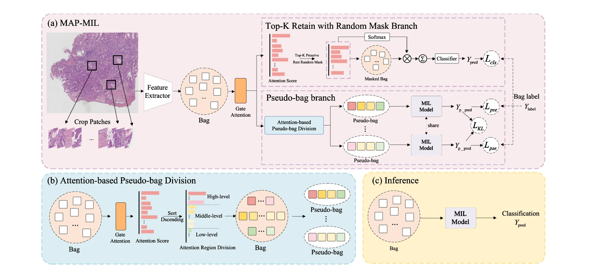
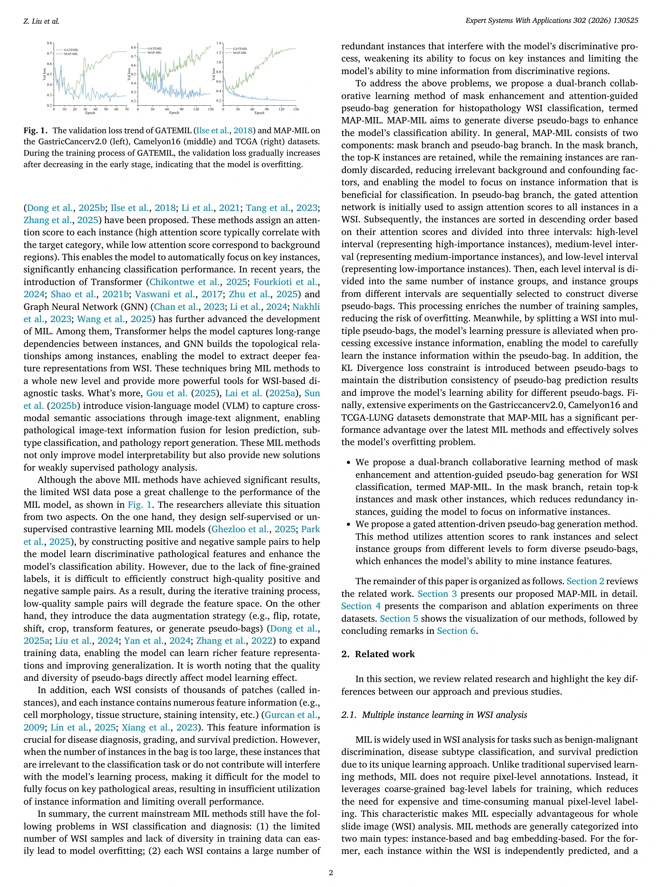
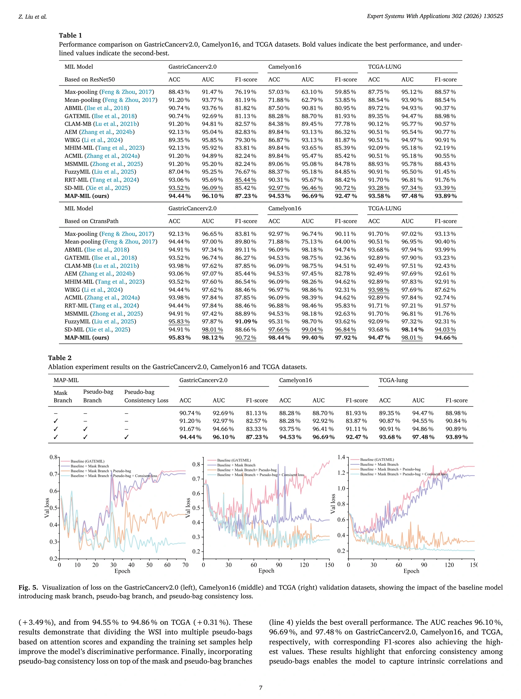
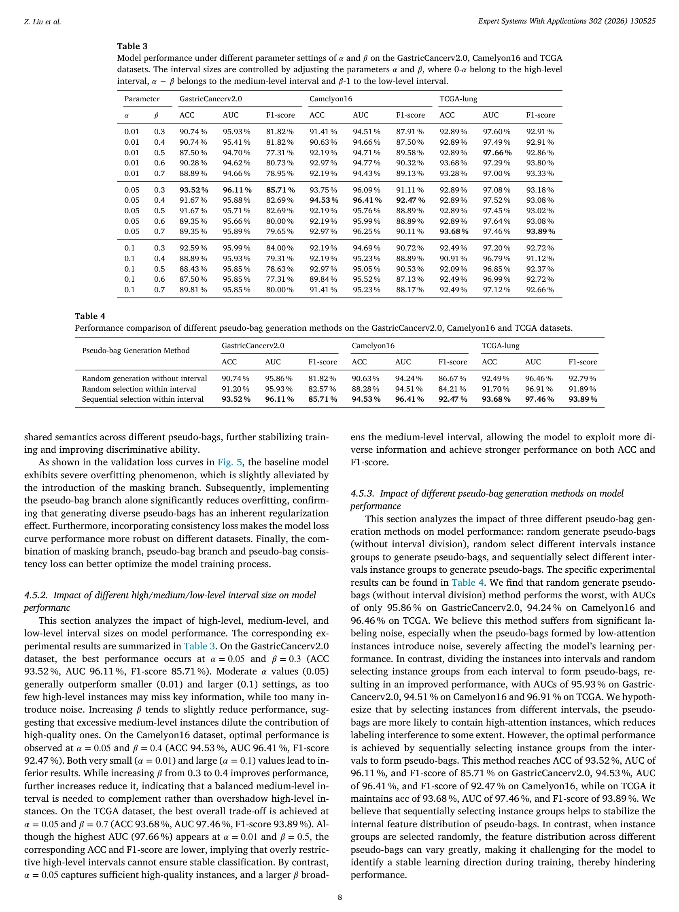
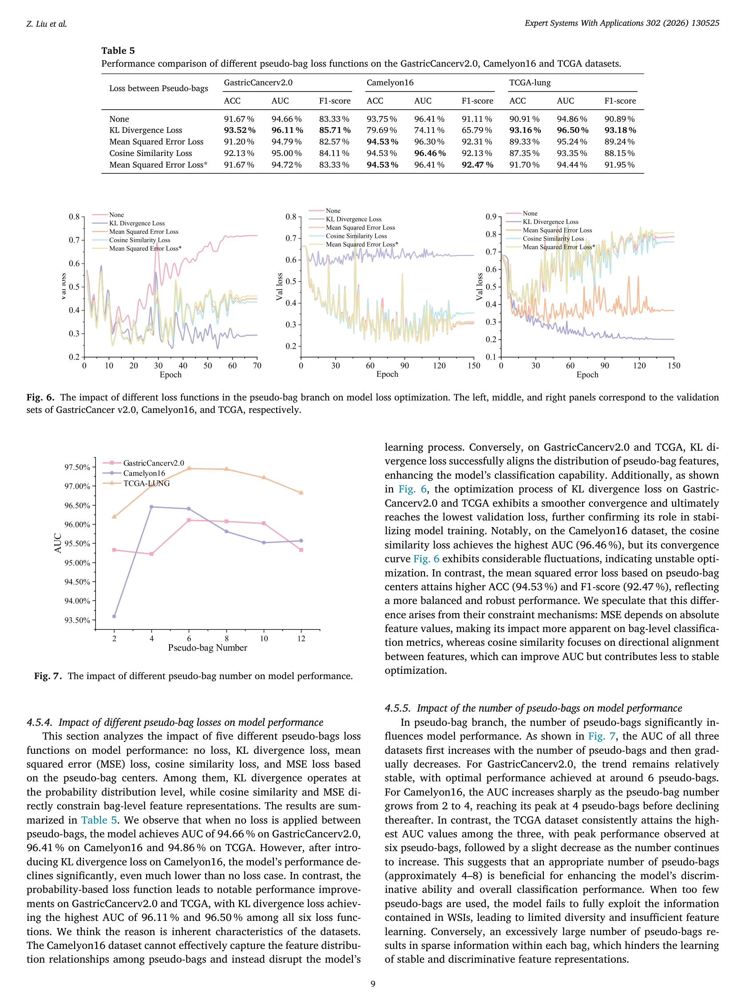
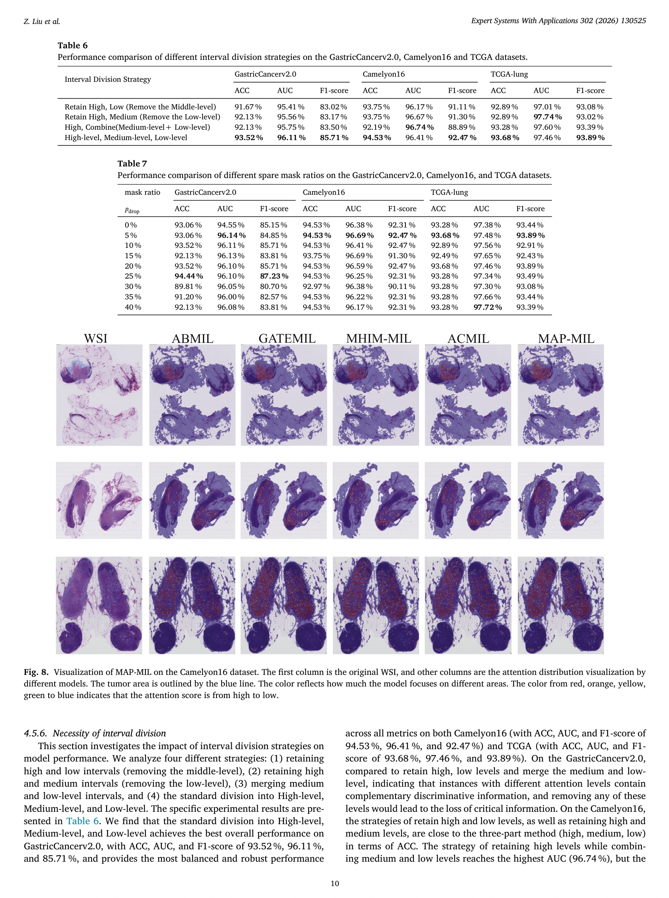
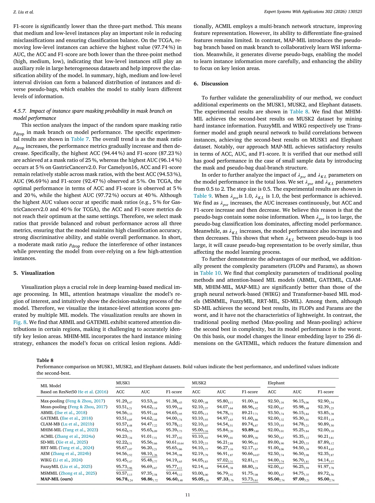
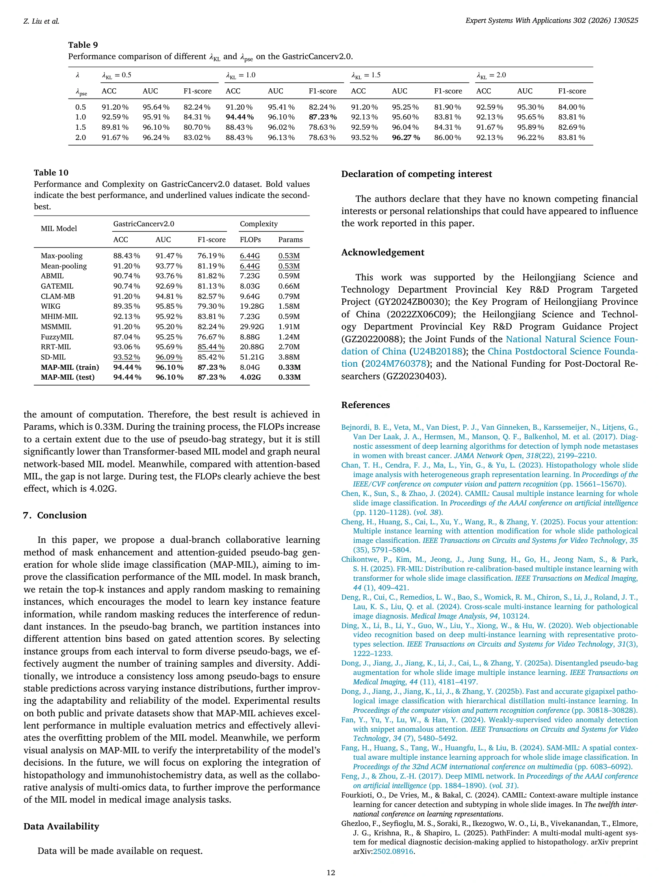

## MAP-MIL: Dual-branch collaborative learning of mask enhancement and pseudo-bag generation for whole slide image classification

> data: GastricCancerv2.0、CAMELYON16、TCGA-LUNG；MUSK1/2、Elephant
>
> Expert Systems with Applications 2026 · [论文](https://doi.org/10.1016/j.eswa.2025.130525) · [作者代码](https://github.com/Pikachu-one/MAP-MIL)

#### 引言

让掩码增强分支和注意力引导的伪包分支协同学习，结合伪包间一致性约束，减少冗余实例并扩大训练样本多样性。

#### 方法

（1）掩码分支：保留 Top-K 实例并随机遮蔽其他实例，减少冗余。

（2）伪包分支：按门控注意力构建多样训练子包。

（3）一致性目标：约束伪包间学习，使两分支协同优化。

<!-- wsi-complete-model -->
##### 模型结构图

**图 2 · 模型结构**（PDF 第 4 页）

> 原文图注：Fig. 2. (a) The overall framework of the proposed MAP-MIL method. (b) The process of generating pseudo-bags by interval-based instance grouping. (c) The WSI classification prediction during the inference stage.

[查看原尺寸](assest/MAP-MIL/figure-2-complete.webp)

<!-- /wsi-complete-model -->

#### 实验

##### 实验设置

比较不同编码器，包括 CTransPath，并额外在经典 MIL 数据上检验双分支结构。

##### 主要结果

CTransPath 配置下 C16 的 ACC/AUC/F1 为 98.44%/99.40%/97.92%；不能与其他编码器结果混合引用。

<!-- wsi-complete-results -->
##### 完整实验指标与对照

下列实验原页保留表头、全部行列、子图、误差说明和脚注，点击可查看原尺寸。比较时请对应相同的数据集、特征编码器和训练设置；`±`、置信区间、百分比和小数均保留原文的单位与统计口径。

| 原表/图中指标 | 读取方式 |
| --- | --- |
| ROC-AUC / AUROC | 越高越好；若原表明确为 PR-AUC，则按 PR 曲线面积读取 |
| ACC / Accuracy | 越高越好；平衡准确率、平均准确率以原表标注为准 |
| F1 | 越高越好；保留 macro / weighted / micro 等平均方式 |
| AP / AUPRC / mAP | 越高越好；与 ROC-AUC 不同，保留任务和召回定义 |

| 原文页 | 阅读内容 | 图表及正文引用 |
| --- | --- | --- |
| PDF 第 2 页 | 实验结果 | Figure 1 |
| PDF 第 7 页 | 实验结果 | Table 1、Table 2 |
| PDF 第 8 页 | 实验结果 | Table 3、Table 4 |
| PDF 第 9 页 | 实验结果 | Table 5、Figure 7 |
| PDF 第 10 页 | 实验结果 | Table 6、Table 7 |
| PDF 第 11 页 | 实验结果 | Table 9、Table 8 |
| PDF 第 12 页 | 实验结果 | Table 9、Table 10 |

**实验原页 · PDF 第 2 页**（图表及正文引用：Figure 1）

[查看原尺寸](assest/MAP-MIL/experiment-page-02.webp)

**实验原页 · PDF 第 7 页**（图表及正文引用：Table 1、Table 2）

[查看原尺寸](assest/MAP-MIL/experiment-page-07.webp)

**实验原页 · PDF 第 8 页**（图表及正文引用：Table 3、Table 4）

[查看原尺寸](assest/MAP-MIL/experiment-page-08.webp)

**实验原页 · PDF 第 9 页**（图表及正文引用：Table 5、Figure 7）

[查看原尺寸](assest/MAP-MIL/experiment-page-09.webp)

**实验原页 · PDF 第 10 页**（图表及正文引用：Table 6、Table 7）

[查看原尺寸](assest/MAP-MIL/experiment-page-10.webp)

**实验原页 · PDF 第 11 页**（图表及正文引用：Table 9、Table 8）

[查看原尺寸](assest/MAP-MIL/experiment-page-11.webp)

**实验原页 · PDF 第 12 页**（图表及正文引用：Table 9、Table 10）

[查看原尺寸](assest/MAP-MIL/experiment-page-12.webp)

<!-- /wsi-complete-results -->

##### 消融与讨论

消融掩码分支、注意力引导伪包和包间一致性；内部胃癌集与公开任务的结果分别解释。

#### 参考文献

> MAP-MIL: Dual-branch collaborative learning of mask enhancement and pseudo-bag generation for whole slide image classification
>
> Expert Systems with Applications 2026 · [论文](https://doi.org/10.1016/j.eswa.2025.130525) · [作者代码](https://github.com/Pikachu-one/MAP-MIL)
