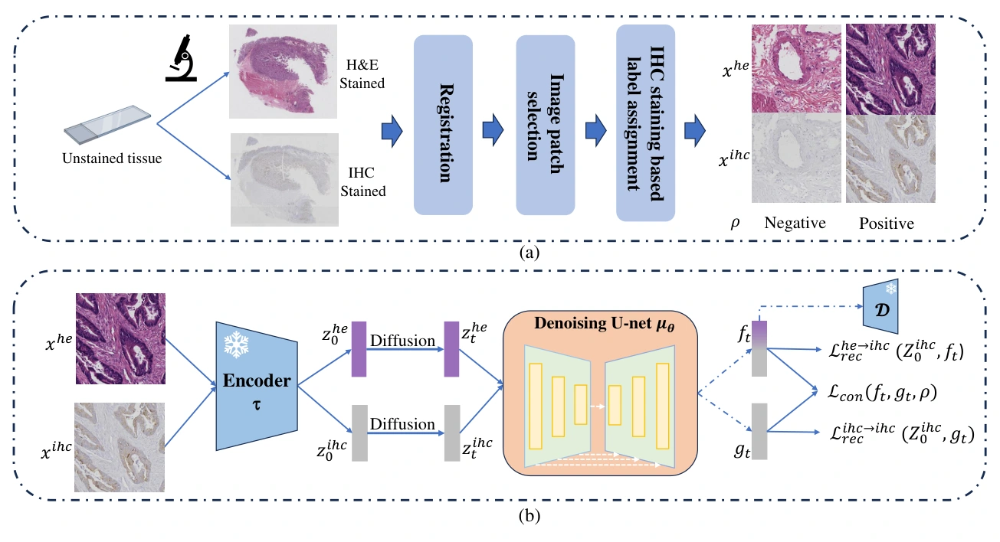

## Multi-modal Denoising Diffusion Pre-training for Whole-Slide Image Classification

> data: CAMELYON16、TCGA-COAD、TCGA-NSCLC
>
> ACM MM 2024 · [论文](https://doi.org/10.1145/3664647.3680882) · [作者代码](https://github.com/lhaof/MDDP)

#### 引言

利用 H&E 到 IHC 的重染色和 IHC 重建进行扩散预训练；推理只输入 H&E，以 IHC 引导的特征和包级增强辅助分类。

#### 方法

（1）双任务预训练：联合 H&E→IHC 重染色和 IHC 重建，学习结构与染色差异。

（2）语义约束：以类别约束对比损失维护双模态特征一致性。

（3）包特征增强：将仅由 H&E 提取的 IHC 引导特征加入现有 MIL 包表示。

##### 模型结构图

图 2（PDF 第 4 页）

#### 实验

##### 实验设置

向 CLAM-SB、CLAM-MB、DTFD-MIL、HAG-MIL 加入预训练特征与包增强；另在相同聚合器下比较预训练方法。

##### 关键指标 { #key-results }

| 数据集与聚合器 | AUC | F1 | ACC |
| --- | --- | --- | --- |
| CAMELYON16，HAG-MIL | 0.953 ± 0.013 | 0.905 ± 0.022 | 0.893 ± 0.023 |
| TCGA-COAD，CLAM-SB | 0.898 ± 0.031 | 0.710 ± 0.045 | 0.918 ± 0.028 |
| TCGA-NSCLC，HAG-MIL | 0.951 ± 0.017 | 0.881 ± 0.020 | 0.883 ± 0.020 |

数据来源为原文表 1，PDF 第 6 页。

##### 结果解读

固定病理预训练方法后，各数据集上表现最好的聚合器仍不同。IHC 提供预训练监督，推理时只输入 H&E。

##### 消融与讨论

比较 Simmim、DINO、DINOv2、HIPT，并考察扩散时间步和特征层；IHC 用于预训练，推理输入仍为 H&E。

#### 参考文献

> Multi-modal Denoising Diffusion Pre-training for Whole-Slide Image Classification
>
> ACM MM 2024 · [论文](https://doi.org/10.1145/3664647.3680882) · [作者代码](https://github.com/lhaof/MDDP)
