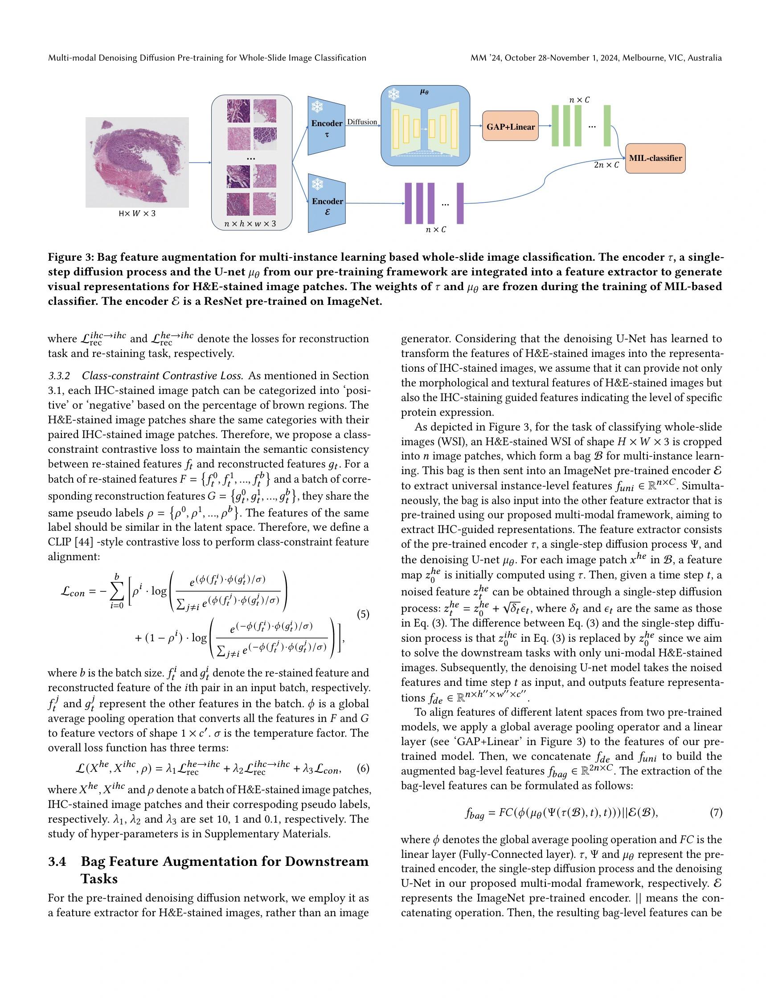
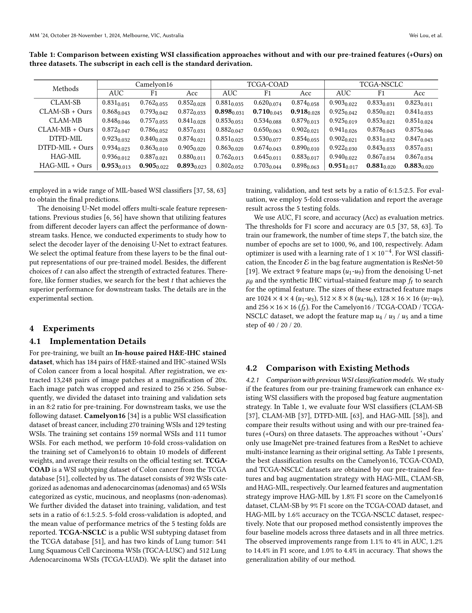
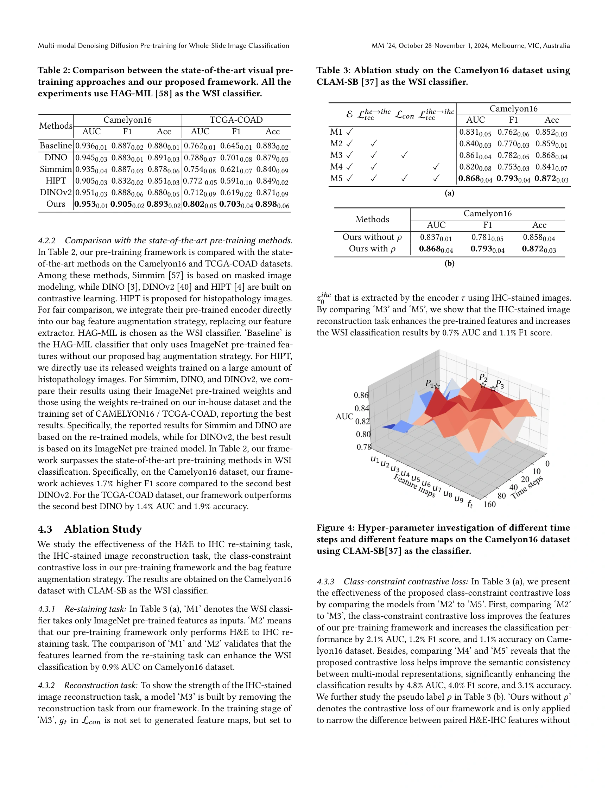

## Multi-modal Denoising Diffusion Pre-training for Whole-Slide Image Classification

> data: CAMELYON16、TCGA-COAD、TCGA-NSCLC
>
> ACM MM 2024 · [论文](https://doi.org/10.1145/3664647.3680882) · [作者代码](https://github.com/lhaof/MDDP)

#### 引言

利用 H&E 到 IHC 的重染色和 IHC 重建进行扩散预训练；推理只输入 H&E，以 IHC 引导的特征和包级增强辅助分类。

#### 方法

（1）双任务预训练：联合 H&E→IHC 重染色和 IHC 重建，学习结构与染色差异。

（2）语义约束：以类别约束对比损失维护双模态特征一致性。

（3）包特征增强：将仅由 H&E 提取的 IHC 引导特征加入现有 MIL 包表示。

<!-- wsi-complete-model -->
##### 模型结构图

**图 2 · 模型结构**（PDF 第 4 页）

> 原文图注：Figure 2: (a) Multi-modal image registration and label assignment. The IHC staining based label assignment is to assign a positive/negative pseudo label for each H&E-IHC stained patch pair based on the percentage of brown regions in the IHC-stained patch. (b) Multi-modal denoising diffusion pre-training framework. We employ a denoising-diffusion model to accomplish the re-staining task and the reconstruction task on two staining modalities at the feature level. 𝑓𝑡represents the generated features of the re-staining task, while 𝑔𝑡represents the generated features of the reconstruction task.

[查看原尺寸](assest/MDDP/figure-2-complete.webp)

<!-- /wsi-complete-model -->

#### 实验

##### 实验设置

向 CLAM-SB、CLAM-MB、DTFD-MIL、HAG-MIL 加入预训练特征与包增强；另在相同聚合器下比较预训练方法。

##### 主要结果

三个数据集的最优聚合器组合并不相同：分别为 HAG-MIL、CLAM-SB、HAG-MIL，说明增益需结合下游模型看。

<!-- wsi-complete-results -->
##### 完整实验指标与对照

下列实验原页保留表头、全部行列、子图、误差说明和脚注，点击可查看原尺寸。比较时请对应相同的数据集、特征编码器和训练设置；`±`、置信区间、百分比和小数均保留原文的单位与统计口径。

| 原文页 | 阅读内容 | 图表及正文引用 |
| --- | --- | --- |
| PDF 第 5 页 | 实验结果 | Figure 3 |
| PDF 第 6 页 | 实验结果 | Table 1 |
| PDF 第 7 页 | 实验结果 | Table 2、Table 3 |

**实验原页 · PDF 第 5 页**（图表及正文引用：Figure 3）

[查看原尺寸](assest/MDDP/experiment-page-05.webp)

**实验原页 · PDF 第 6 页**（图表及正文引用：Table 1）

[查看原尺寸](assest/MDDP/experiment-page-06.webp)

**实验原页 · PDF 第 7 页**（图表及正文引用：Table 2、Table 3）

[查看原尺寸](assest/MDDP/experiment-page-07.webp)

<!-- /wsi-complete-results -->

##### 消融与讨论

比较 Simmim、DINO、DINOv2、HIPT，并考察扩散时间步和特征层；IHC 用于预训练，推理输入仍为 H&E。

#### 参考文献

> Multi-modal Denoising Diffusion Pre-training for Whole-Slide Image Classification
>
> ACM MM 2024 · [论文](https://doi.org/10.1145/3664647.3680882) · [作者代码](https://github.com/lhaof/MDDP)
