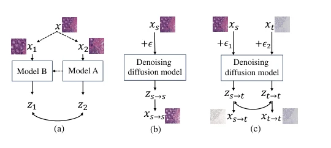
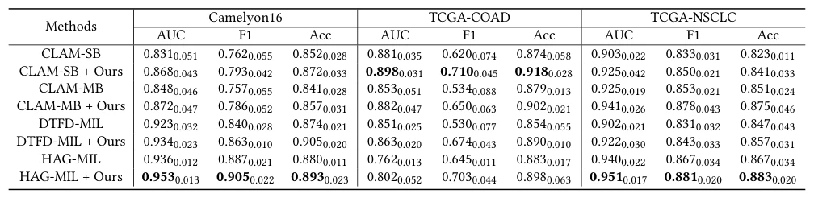

## Multi-modal Denoising Diffusion Pre-training for Whole-Slide Image Classification

> data: CAMELYON16、TCGA-COAD、TCGA-NSCLC
>
> ACM MM 2024 · [论文](https://doi.org/10.1145/3664647.3680882) · [作者代码](https://github.com/lhaof/MDDP)

#### 引言

利用 H&E 到 IHC 的重染色和 IHC 重建进行扩散预训练；推理只输入 H&E，以 IHC 引导的特征和包级增强辅助分类。

#### 方法

（1）双任务预训练：联合 H&E→IHC 重染色和 IHC 重建，学习结构与染色差异。

（2）语义约束：以类别约束对比损失维护双模态特征一致性。

（3）包特征增强：将仅由 H&E 提取的 IHC 引导特征加入现有 MIL 包表示。

原文Figure 1，PDF 第 1 页。

#### 实验

##### 实验设置

向 CLAM-SB、CLAM-MB、DTFD-MIL、HAG-MIL 加入预训练特征与包增强；另在相同聚合器下比较预训练方法。

##### 主要结果

三个数据集的最优聚合器组合并不相同：分别为 HAG-MIL、CLAM-SB、HAG-MIL，说明增益需结合下游模型看。

原文Table 1，PDF 第 6 页。

##### 消融与讨论

比较 Simmim、DINO、DINOv2、HIPT，并考察扩散时间步和特征层；IHC 用于预训练，推理输入仍为 H&E。

#### 参考文献

> Multi-modal Denoising Diffusion Pre-training for Whole-Slide Image Classification
>
> ACM MM 2024 · [论文](https://doi.org/10.1145/3664647.3680882) · [作者代码](https://github.com/lhaof/MDDP)
