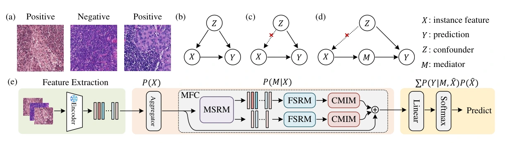
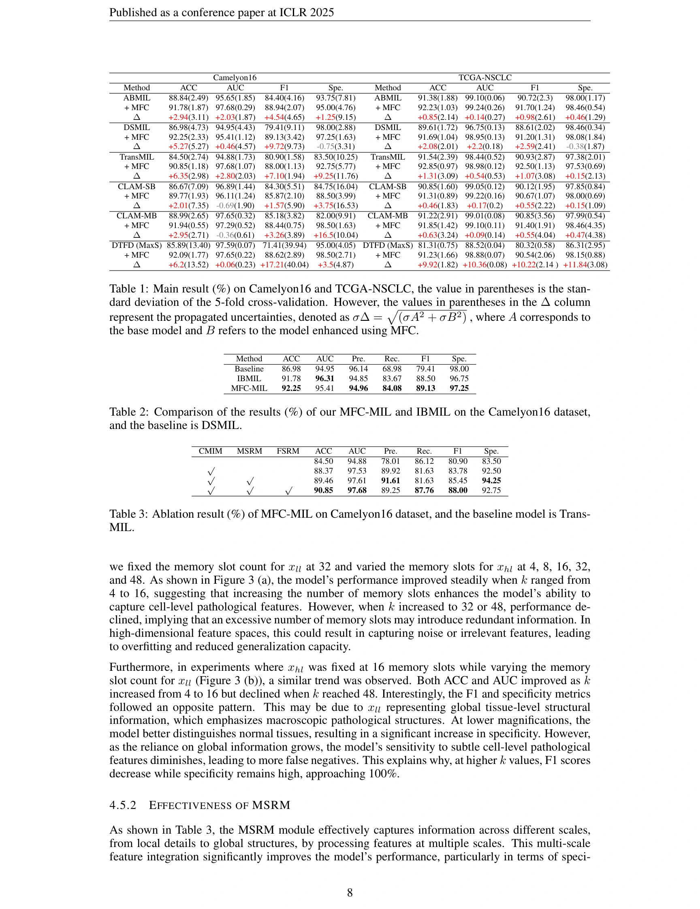
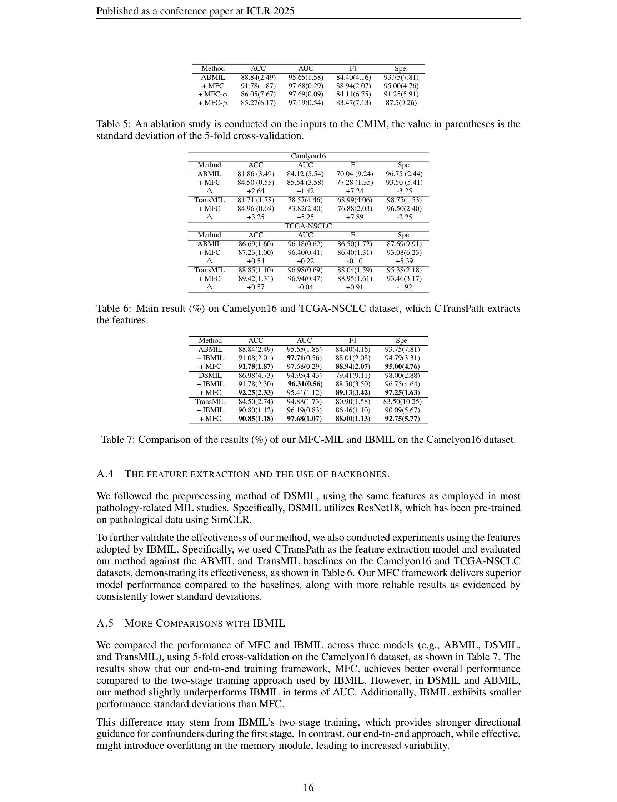
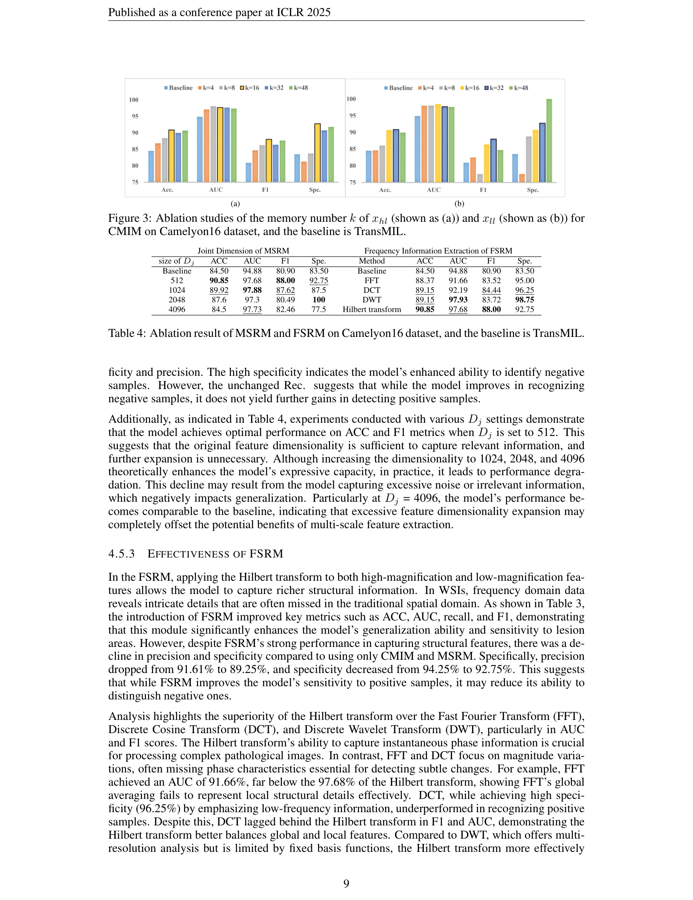

## A Multiscale Frequency Domain Causal Framework for Enhanced Pathological Analysis

> data: CAMELYON16、TCGA-NSCLC
>
> ICLR 2025 · [论文](https://openreview.net/forum?id=6xrDPHhwD3) · [作者代码](https://github.com/WissingChen/MFC-MIL)

#### 引言

联合多尺度空间、频域结构和因果记忆干预模块，用记忆库估计数据分布并减轻混杂影响，可接入不同 MIL 模型。

#### 方法

（1）多尺度空间：MSRM 提取局部与较大范围的组织结构。

（2）频域结构：FSRM 强调结构线索，降低对颜色等易混杂信息的依赖。

（3）因果记忆：CMIM 用可训练记忆近似整体分布并实施干预式融合。

<!-- wsi-complete-model -->
##### 模型结构图

**图 1 · 模型结构**（PDF 第 3 页）

> 原文图注：Figure 1: (a) WSI sample. (b-d) Causal diagrams for no intervention, back-door intervention, and front-door intervention. (e) We propose Multi-Scale Frequency Domain Causal Multi-Instance Learning (MFC-MIL), a framework that is plug-and-play compatible with various MIL models. In the MIL model, WSI is typically encoded as CLS tokens and feature tokens (patch tokens). Our MFC framework extends this approach by applying the MSRM and FSRM modules specifically to the feature tokens. The output from these modules is then fed into the memory module of the CMIM for interaction, ultimately influencing the CLS token.

[查看原尺寸](assest/MFC-MIL/figure-1-complete.webp)

<!-- /wsi-complete-model -->

#### 实验

##### 实验设置

TCGA 按 7:1:2 划分；主表报告五折结果，比较 MFC-MIL、IBMIL 及不同 MIL 聚合器。

##### 主要结果

因果记忆干预增强特异度，但作者同时指出 recall 可能下降，说明决策边界存在敏感度/特异度权衡。

<!-- wsi-complete-results -->
##### 完整实验指标与对照

下列实验原页保留表头、全部行列、子图、误差说明和脚注，点击可查看原尺寸。比较时请对应相同的数据集、特征编码器和训练设置；`±`、置信区间、百分比和小数均保留原文的单位与统计口径。

| 原表/图中指标 | 读取方式 |
| --- | --- |
| Recall / Sensitivity | 越高越好；与固定敏感度下的特异度区别读取 |

| 原文页 | 阅读内容 | 图表及正文引用 |
| --- | --- | --- |
| PDF 第 8 页 | 实验结果 | Table 1、Table 2、Table 3 |
| PDF 第 9 页 | 消融与参数分析 | Figure 3、Table 4 |
| PDF 第 16 页 | 实验结果 | Table 5、Table 6、Table 7 |

**实验原页 · PDF 第 8 页**（图表及正文引用：Table 1、Table 2、Table 3）

[查看原尺寸](assest/MFC-MIL/experiment-page-08.webp)

**实验原页 · PDF 第 16 页**（图表及正文引用：Table 5、Table 6、Table 7）

[查看原尺寸](assest/MFC-MIL/experiment-page-16.webp)

展开消融、参数、数据设置及效率原页

**实验原页 · PDF 第 9 页**（图表及正文引用：Figure 3、Table 4）

[查看原尺寸](assest/MFC-MIL/experiment-page-09.webp)

<!-- /wsi-complete-results -->

##### 消融与讨论

分别考察多尺度空间、频域结构和因果记忆模块，不能把特异度改善概括成全部指标无代价上升。

#### 参考文献

> A Multiscale Frequency Domain Causal Framework for Enhanced Pathological Analysis
>
> ICLR 2025 · [论文](https://openreview.net/forum?id=6xrDPHhwD3) · [作者代码](https://github.com/WissingChen/MFC-MIL)
