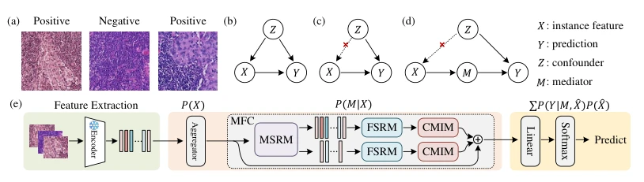
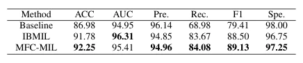

## A Multiscale Frequency Domain Causal Framework for Enhanced Pathological Analysis

> data: CAMELYON16、TCGA-NSCLC
>
> ICLR 2025 · [论文](https://openreview.net/forum?id=6xrDPHhwD3) · [作者代码](https://github.com/WissingChen/MFC-MIL)

#### 引言

联合多尺度空间、频域结构和因果记忆干预模块，用记忆库估计数据分布并减轻混杂影响，可接入不同 MIL 模型。

#### 方法

（1）多尺度空间：MSRM 提取局部与较大范围的组织结构。

（2）频域结构：FSRM 强调结构线索，降低对颜色等易混杂信息的依赖。

（3）因果记忆：CMIM 用可训练记忆近似整体分布并实施干预式融合。

原文Figure 1，PDF 第 3 页。

#### 实验

##### 实验设置

TCGA 按 7:1:2 划分；主表报告五折结果，比较 MFC-MIL、IBMIL 及不同 MIL 聚合器。

##### 主要结果

因果记忆干预增强特异度，但作者同时指出 recall 可能下降，说明决策边界存在敏感度/特异度权衡。

原文Table 2，PDF 第 8 页。

##### 消融与讨论

分别考察多尺度空间、频域结构和因果记忆模块，不能把特异度改善概括成全部指标无代价上升。

#### 参考文献

> A Multiscale Frequency Domain Causal Framework for Enhanced Pathological Analysis
>
> ICLR 2025 · [论文](https://openreview.net/forum?id=6xrDPHhwD3) · [作者代码](https://github.com/WissingChen/MFC-MIL)
