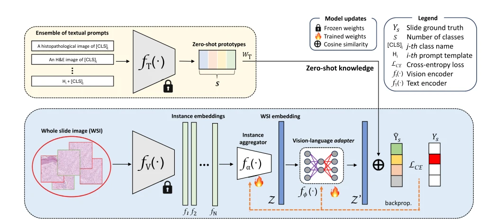

## MIL-Adapter: Coupling multiple instance learning and vision-language adapters for few-shot slide-level classification

> data: TCGA-BRCA、TCGA-RCC、TCGA-NSCLC
>
> Medical Image Analysis 2026 · [论文](https://doi.org/10.1016/j.media.2026.103964) · [作者代码](https://github.com/cvblab/MIL-Adapter)

#### 引言

把可训练 MIL 聚合器与轻量视觉语言适配器结合，以文本集成构建零样本原型，为少样本切片分类提供更稳健的初始化。

#### 方法

（1）文本集成：用多种类别描述构建零样本原型。

（2）MIL 聚合：把大量 patch 汇总成切片表征。

（3）轻量适配：以视觉语言适配器在少量切片上更新，避免完整微调大模型。

原文Fig. 1，PDF 第 3 页。

#### 实验

##### 实验设置

比较不同 few-shot 样本数、MIL 聚合器和视觉语言适配器，并报告参数量/FLOPs。

##### 主要结果

作者指出 MIL 层可能扭曲原始图文对齐特征；因此分类收益与图文对齐保持需要同时分析。

##### 消融与讨论

比较文本集成零样本原型、随机分类头和轻量适配器；复杂度评估使用 CONCH 的 512 维特征与指定平均包长度。

#### 参考文献

> MIL-Adapter: Coupling multiple instance learning and vision-language adapters for few-shot slide-level classification
>
> Medical Image Analysis 2026 · [论文](https://doi.org/10.1016/j.media.2026.103964) · [作者代码](https://github.com/cvblab/MIL-Adapter)
