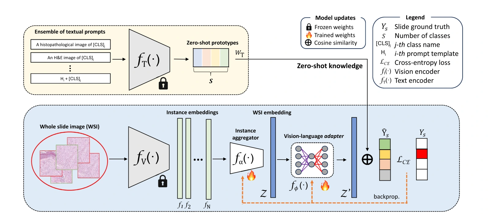
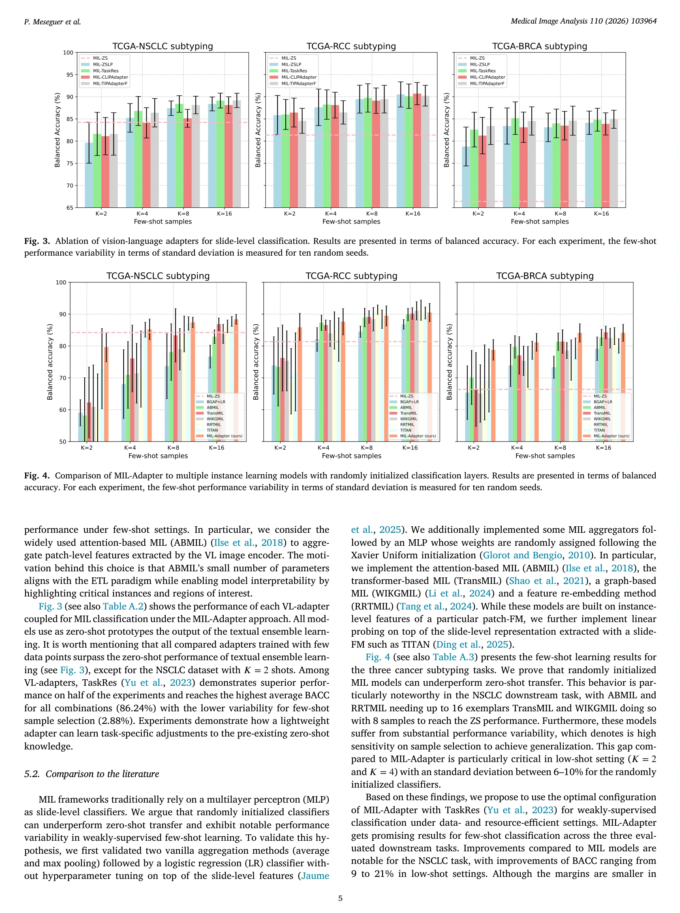
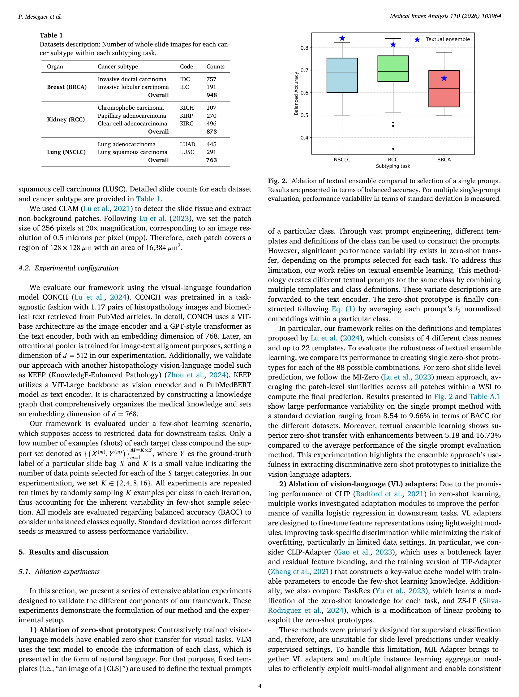
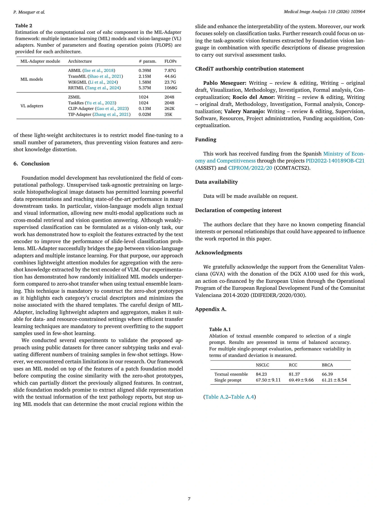

## MIL-Adapter: Coupling multiple instance learning and vision-language adapters for few-shot slide-level classification

> data: TCGA-BRCA、TCGA-RCC、TCGA-NSCLC
>
> Medical Image Analysis 2026 · [论文](https://doi.org/10.1016/j.media.2026.103964) · [作者代码](https://github.com/cvblab/MIL-Adapter)

#### 引言

把可训练 MIL 聚合器与轻量视觉语言适配器结合，以文本集成构建零样本原型，为少样本切片分类提供更稳健的初始化。

#### 方法

（1）文本集成：用多种类别描述构建零样本原型。

（2）MIL 聚合：把大量 patch 汇总成切片表征。

（3）轻量适配：以视觉语言适配器在少量切片上更新，避免完整微调大模型。

<!-- wsi-complete-model -->
##### 模型结构图

**图 1 · 模型结构**（PDF 第 3 页）

> 原文图注：Fig. 1. Method overview: Multiple Instance Learning Adapter (MIL-Adapter) relies on textual ensemble learning, which defines 𝐼 hard templates (𝐻) and combines them with 𝐽 different class names ([𝐶𝐿𝑆]𝑠) to construct the text prompts. It computes the zero-shot prototypes (𝑊𝑇) using the text model 𝑓𝑇(⋅) to encode the prompts of the targeted classes. The visual encoder 𝑓𝑉(⋅) extracts patch-level features (𝑓𝑛) and an instance aggregator 𝑓𝛼(⋅) obtains the slide-representation (𝑍). 𝑍 is forwarded to the vision-language adapter for obtaining the refined feature WSI-level representation (𝑍′). Finally, the cosine similarity between 𝑍′ and 𝑊𝑇 is calculated to obtain the bag-level prediction ( ̂𝑌𝑠) and compute the cross-entropy loss ().

[查看原尺寸](assest/MIL-Adapter/figure-1-complete.webp)

<!-- /wsi-complete-model -->

#### 实验

##### 实验设置

比较不同 few-shot 样本数、MIL 聚合器和视觉语言适配器，并报告参数量/FLOPs。

##### 主要结果

作者指出 MIL 层可能扭曲原始图文对齐特征；因此分类收益与图文对齐保持需要同时分析。

<!-- wsi-complete-results -->
##### 完整实验指标与对照

下列实验原页保留表头、全部行列、子图、误差说明和脚注，点击可查看原尺寸。比较时请对应相同的数据集、特征编码器和训练设置；`±`、置信区间、百分比和小数均保留原文的单位与统计口径。

| 原表/图中指标 | 读取方式 |
| --- | --- |
| ACC / Accuracy | 越高越好；平衡准确率、平均准确率以原表标注为准 |
| 时间 / FLOPs / 参数量 | 结合硬件、包长度和计时范围比较；小模型不一定推理更快 |

| 原文页 | 阅读内容 | 图表及正文引用 |
| --- | --- | --- |
| PDF 第 4 页 | 消融与参数分析 | Table 1、Figure 2 |
| PDF 第 5 页 | 实验结果 | Figure 3、Figure 4 |
| PDF 第 7 页 | 消融与参数分析 | Table 2 |

**实验原页 · PDF 第 5 页**（图表及正文引用：Figure 3、Figure 4）

[查看原尺寸](assest/MIL-Adapter/experiment-page-05.webp)

展开消融、参数、数据设置及效率原页

**实验原页 · PDF 第 4 页**（图表及正文引用：Table 1、Figure 2）

[查看原尺寸](assest/MIL-Adapter/experiment-page-04.webp)

**实验原页 · PDF 第 7 页**（图表及正文引用：Table 2）

[查看原尺寸](assest/MIL-Adapter/experiment-page-07.webp)

<!-- /wsi-complete-results -->

##### 消融与讨论

比较文本集成零样本原型、随机分类头和轻量适配器；复杂度评估使用 CONCH 的 512 维特征与指定平均包长度。

#### 参考文献

> MIL-Adapter: Coupling multiple instance learning and vision-language adapters for few-shot slide-level classification
>
> Medical Image Analysis 2026 · [论文](https://doi.org/10.1016/j.media.2026.103964) · [作者代码](https://github.com/cvblab/MIL-Adapter)
