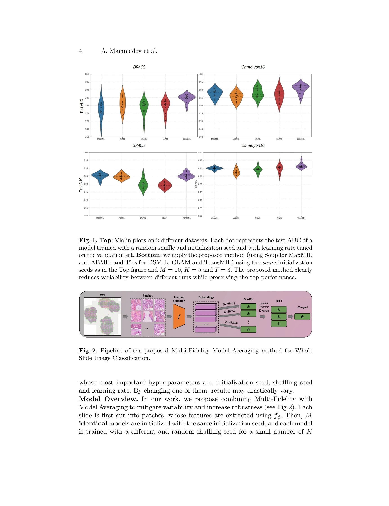
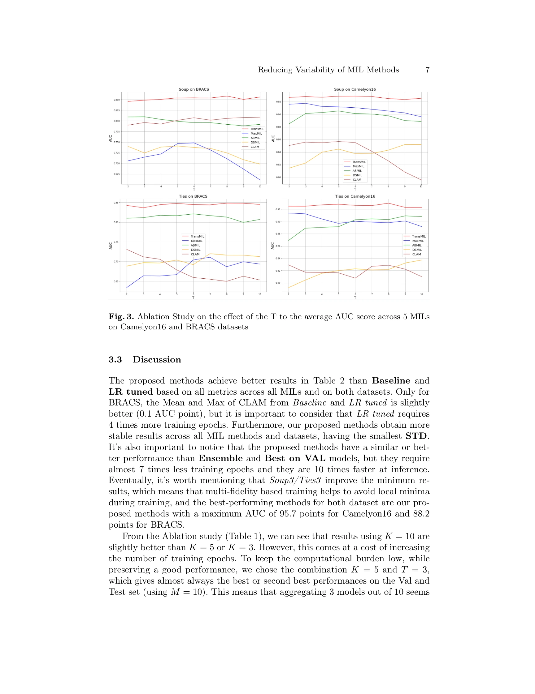
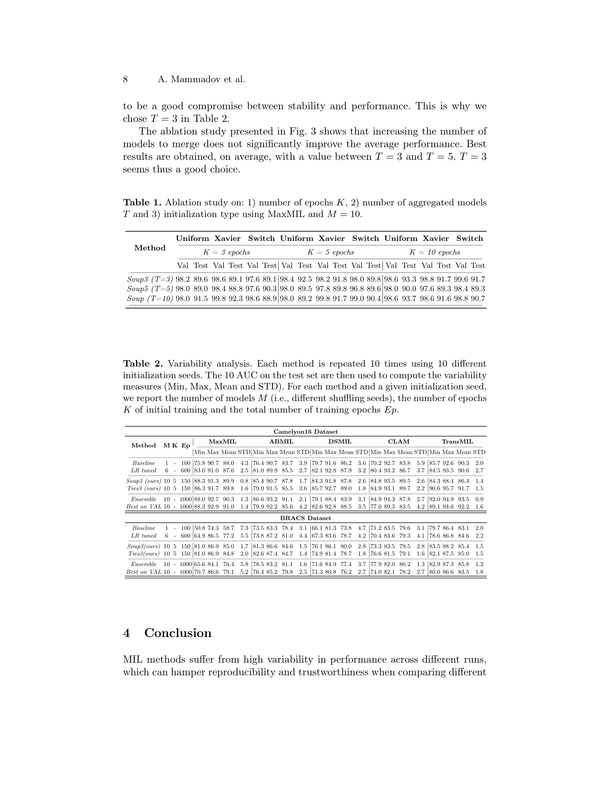

## Reducing Variability of Multiple Instance Learning Methods for Digital Pathology

> data: CAMELYON16、BRACS
>
> MICCAI 2025 · [论文](https://doi.org/10.1007/978-3-032-04981-0_48)

#### 引言

先短时训练多个 MIL 模型，再根据验证表现融合稳定候选，以减小初始化、样本顺序和学习率造成的性能波动。

#### 方法

（1）短时多启动：从不同初始化训练多个早期候选模型。

（2）多保真选择：依据验证结果筛选较稳定、有希望的候选。

（3）模型融合：采用 Soup/Ties 等参数组合后继续训练，降低最终性能方差。

<!-- wsi-complete-model -->
##### 模型结构图

**图 2 · 模型结构**（PDF 第 4 页）

> 原文图注：Fig. 2. Pipeline of the proposed Multi-Fidelity Model Averaging method for Whole Slide Image Classification.

[查看原尺寸](assest/MIL-Merging/figure-2-complete.webp)

<!-- /wsi-complete-model -->

#### 实验

##### 实验设置

五类 MIL、每种重复十个初始化种子，报告最小/最大/平均 AUC 和标准差；比较 LR 搜索、集成、验证集最优选择。

##### 主要结果

Soup/Ties 在多数配置中降低波动；BRACS 的部分 CLAM 均值/最大值仍略优于融合方案，作者也报告了这个例外。

<!-- wsi-complete-results -->
##### 完整实验指标与对照

下列实验原页保留表头、全部行列、子图、误差说明和脚注，点击可查看原尺寸。比较时请对应相同的数据集、特征编码器和训练设置；`±`、置信区间、百分比和小数均保留原文的单位与统计口径。

| 原表/图中指标 | 读取方式 |
| --- | --- |
| ROC-AUC / AUROC | 越高越好；若原表明确为 PR-AUC，则按 PR 曲线面积读取 |

| 原文页 | 阅读内容 | 图表及正文引用 |
| --- | --- | --- |
| PDF 第 4 页 | 实验结果 | Figure 1 |
| PDF 第 7 页 | 消融与参数分析 | Figure 3 |
| PDF 第 8 页 | 消融与参数分析 | Table 1、Table 2 |

**实验原页 · PDF 第 4 页**（图表及正文引用：Figure 1）

[查看原尺寸](assest/MIL-Merging/experiment-page-04.webp)

展开消融、参数、数据设置及效率原页

**实验原页 · PDF 第 7 页**（图表及正文引用：Figure 3）

[查看原尺寸](assest/MIL-Merging/experiment-page-07.webp)

**实验原页 · PDF 第 8 页**（图表及正文引用：Table 1、Table 2）

[查看原尺寸](assest/MIL-Merging/experiment-page-08.webp)

<!-- /wsi-complete-results -->

##### 消融与讨论

改变早期训练 epochs K、融合模型数 T 与初始化；结果重点是稳定性和训练/推理成本。

#### 参考文献

> Reducing Variability of Multiple Instance Learning Methods for Digital Pathology
>
> MICCAI 2025 · [论文](https://doi.org/10.1007/978-3-032-04981-0_48)
