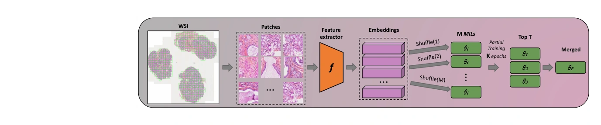

## Reducing Variability of Multiple Instance Learning Methods for Digital Pathology

> data: CAMELYON16、BRACS
>
> MICCAI 2025 · [论文](https://doi.org/10.1007/978-3-032-04981-0_48)

#### 引言

先短时训练多个 MIL 模型，再根据验证表现融合稳定候选，以减小初始化、样本顺序和学习率造成的性能波动。

#### 方法

（1）短时多启动：从不同初始化训练多个早期候选模型。

（2）多保真选择：依据验证结果筛选较稳定、有希望的候选。

（3）模型融合：采用 Soup/Ties 等参数组合后继续训练，降低最终性能方差。

##### 模型结构图

图 2（PDF 第 4 页）

#### 实验

##### 实验设置

五类 MIL、每种重复十个初始化种子，报告最小/最大/平均 AUC 和标准差；比较 LR 搜索、集成、验证集最优选择。

##### 关键指标 { #key-results }

| 训练设置 | 测试 AUC 均值（%） | AUC 标准差（百分点） |
| --- | --- | --- |
| 普通训练 | 88.0 | 4.3 |
| Soup3 | 89.9 | 0.8 |
| Ties3 | 89.8 | 1.6 |

数据来源为原文表 2，PDF 第 8 页，CAMELYON16，MaxMIL，十个初始化种子。

##### 结果解读

MaxMIL 加 Soup3 后的平均 AUC 更高，种子间标准差也更小。BRACS 上的部分 CLAM 配置则保留了普通训练的优势。

##### 消融与讨论

改变早期训练 epochs K、融合模型数 T 与初始化；结果重点是稳定性和训练/推理成本。

#### 参考文献

> Reducing Variability of Multiple Instance Learning Methods for Digital Pathology
>
> MICCAI 2025 · [论文](https://doi.org/10.1007/978-3-032-04981-0_48)
