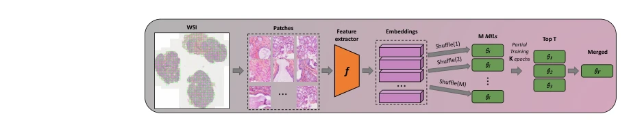

## Reducing Variability of Multiple Instance Learning Methods for Digital Pathology

> data: CAMELYON16、BRACS
>
> MICCAI 2025 · [论文](https://doi.org/10.1007/978-3-032-04981-0_48)

#### 引言

先短时训练多个 MIL 模型，再根据验证表现融合稳定候选，以减小初始化、样本顺序和学习率造成的性能波动。

#### 方法

（1）短时多启动：从不同初始化训练多个早期候选模型。

（2）多保真选择：依据验证结果筛选较稳定、有希望的候选。

（3）模型融合：采用 Soup/Ties 等参数组合后继续训练，降低最终性能方差。

原文Fig. 2，PDF 第 4 页。

#### 实验

##### 实验设置

五类 MIL、每种重复十个初始化种子，报告最小/最大/平均 AUC 和标准差；比较 LR 搜索、集成、验证集最优选择。

##### 主要结果

Soup/Ties 在多数配置中降低波动；BRACS 的部分 CLAM 均值/最大值仍略优于融合方案，作者也报告了这个例外。

##### 消融与讨论

改变早期训练 epochs K、融合模型数 T 与初始化；结果重点是稳定性和训练/推理成本。

#### 参考文献

> Reducing Variability of Multiple Instance Learning Methods for Digital Pathology
>
> MICCAI 2025 · [论文](https://doi.org/10.1007/978-3-032-04981-0_48)
