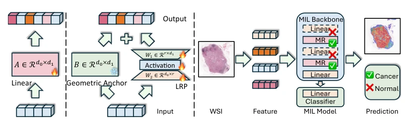
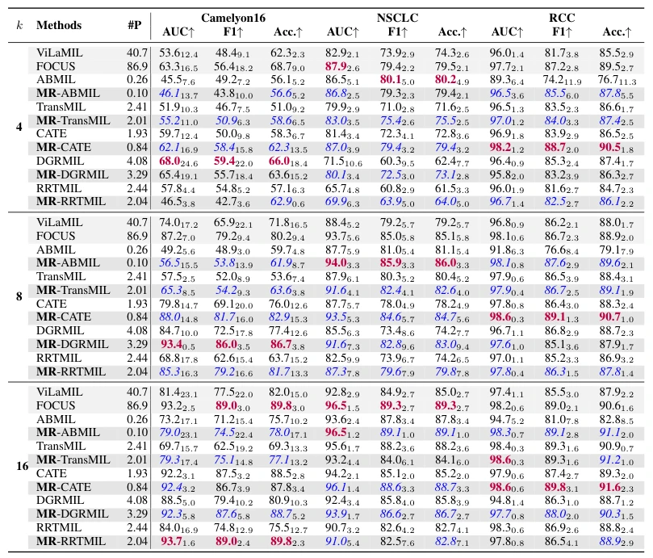

## Exploiting Low-Dimensional Manifold of Features for Few-Shot Whole Slide Image Classification

> data: CAMELYON16、TCGA-NSCLC、TCGA-RCC
>
> ICLR 2026 · [论文](https://openreview.net/forum?id=HBP9uSEYME) · [作者代码](https://github.com/BearCleverProud/MR-Block)

#### 引言

把任务适配拆分为固定随机几何锚点和可训练低秩残差分支，以尽量保留基础模型特征的低维流形结构，改善少样本分类。

#### 方法

（1）固定锚点：以随机映射尽量保留原始特征几何关系。

（2）低秩残差：只学习任务所需的小幅调整。

（3）残差组合：把基础几何与可训练适配相加，降低少样本过拟合自由度。

原文Figure 2，PDF 第 4 页。

#### 实验

##### 实验设置

比较不同 shot 数，使用 AUC、AUPRC、宏 F1 和 ACC，另测参数量与几何性质。

##### 主要结果

结果支持几何锚点与低秩残差的组合；少样本收益必须对应相同训练样本数。

原文Table 1，PDF 第 6 页。

##### 消融与讨论

消融固定随机分支、低秩残差和秩/维度等配置，检查表征流形与分类表现的共同变化。

#### 参考文献

> Exploiting Low-Dimensional Manifold of Features for Few-Shot Whole Slide Image Classification
>
> ICLR 2026 · [论文](https://openreview.net/forum?id=HBP9uSEYME) · [作者代码](https://github.com/BearCleverProud/MR-Block)
