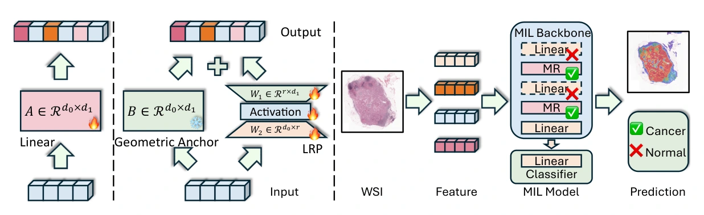
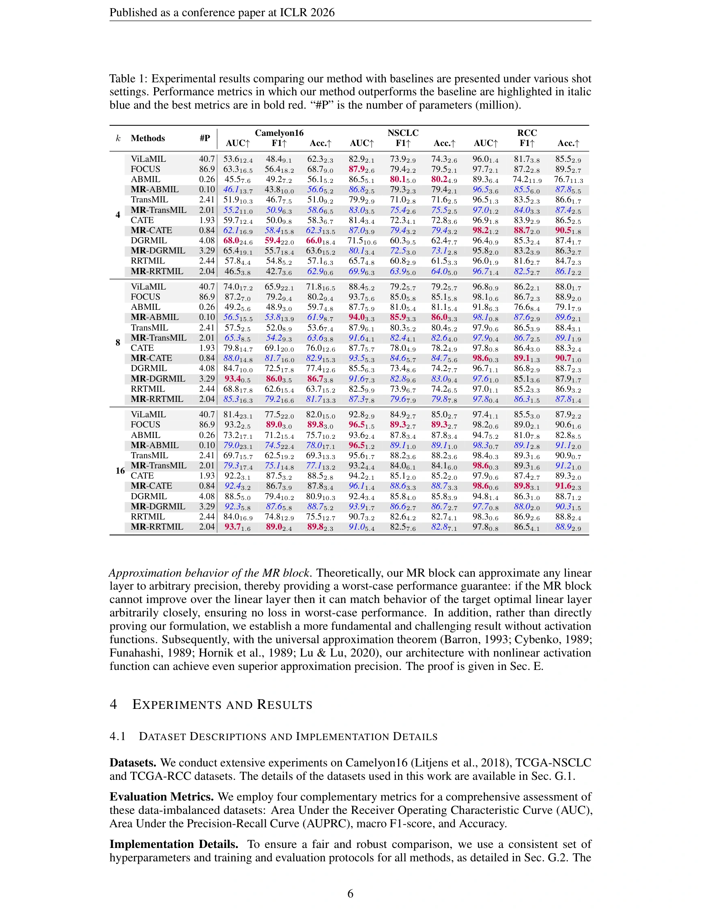
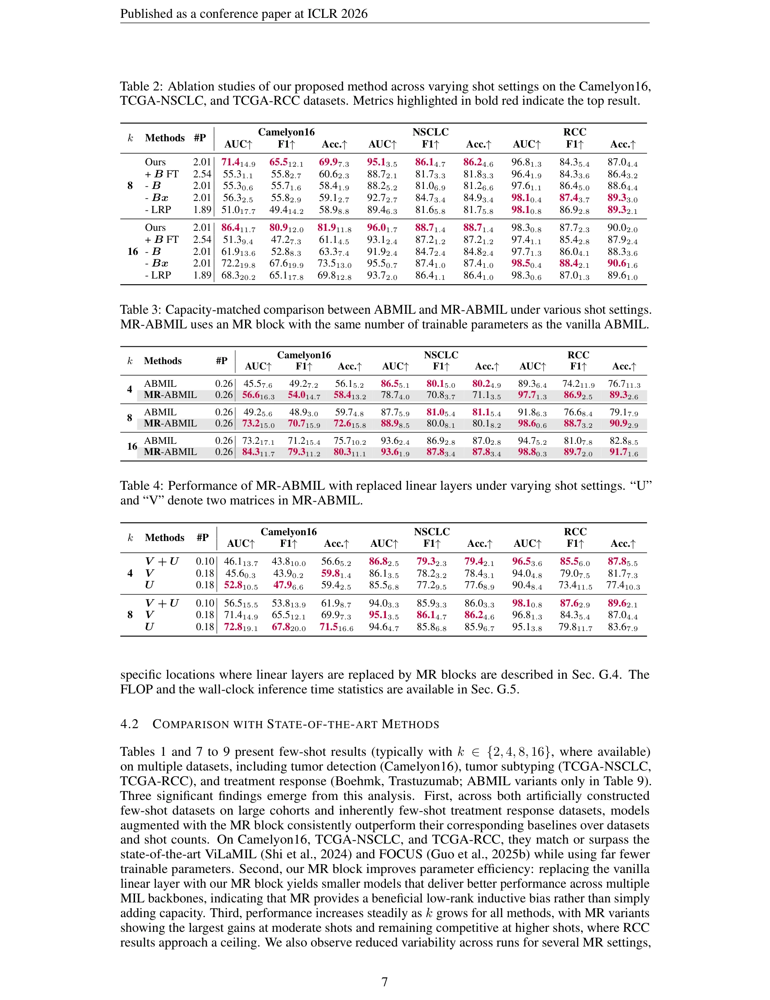
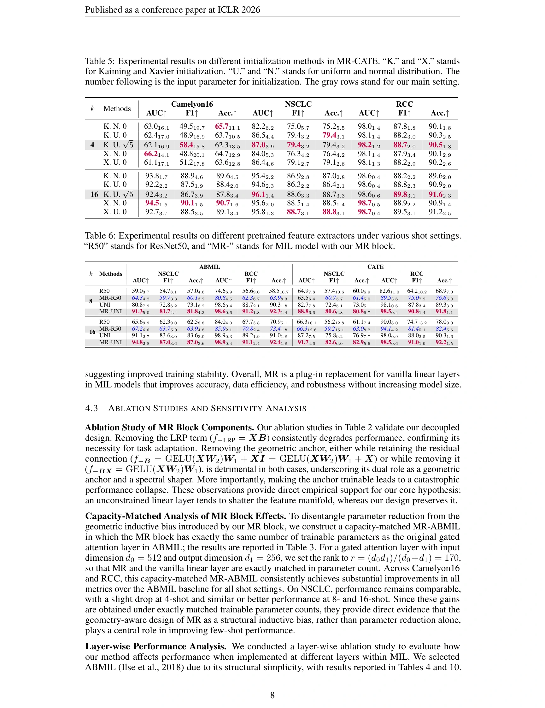
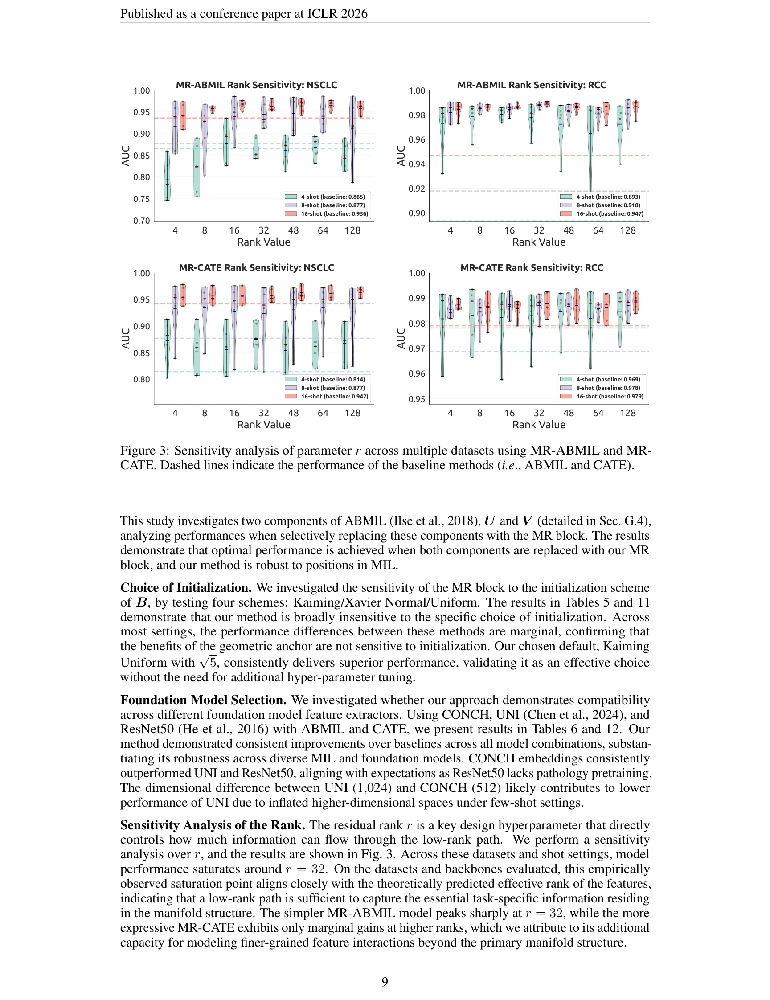
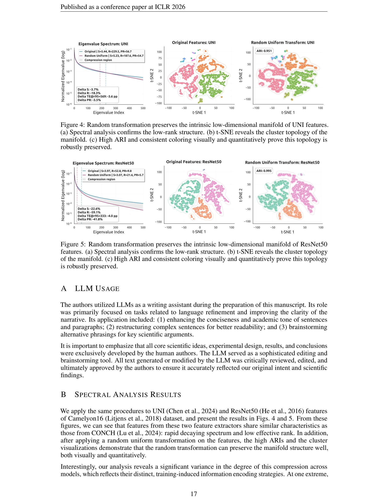
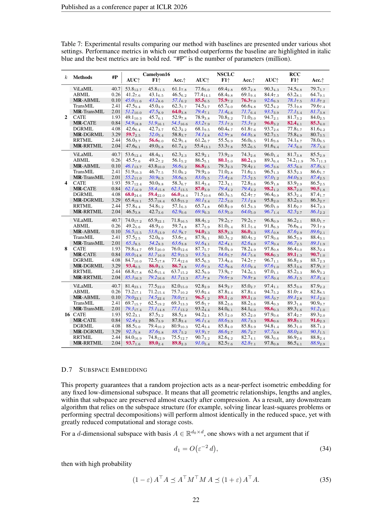
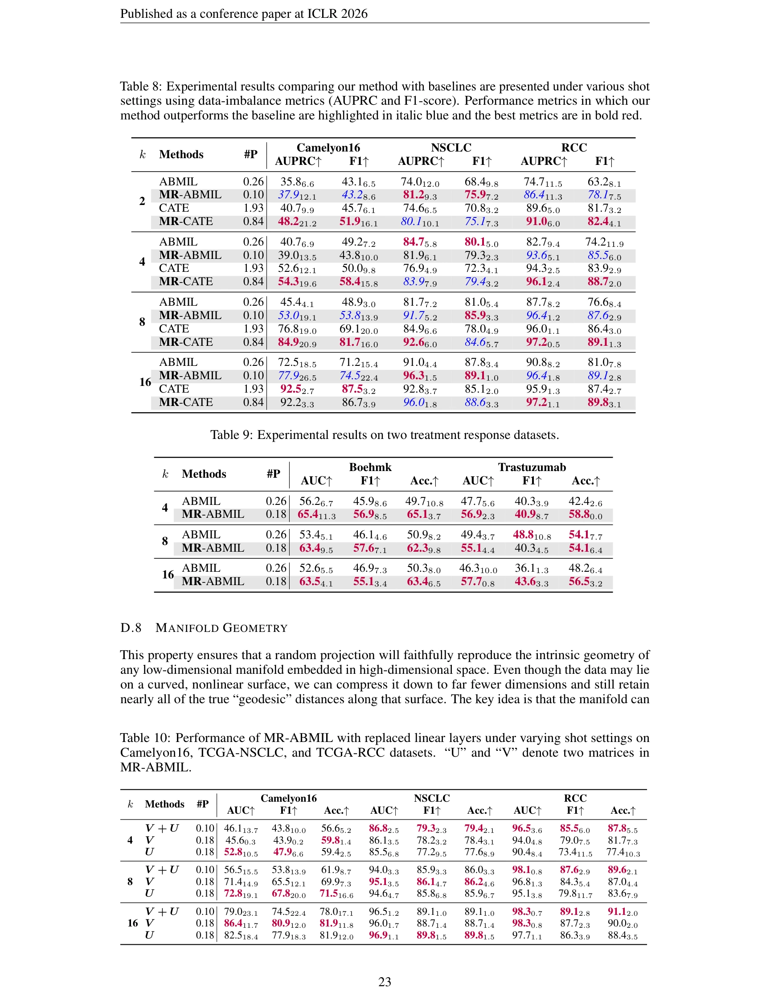
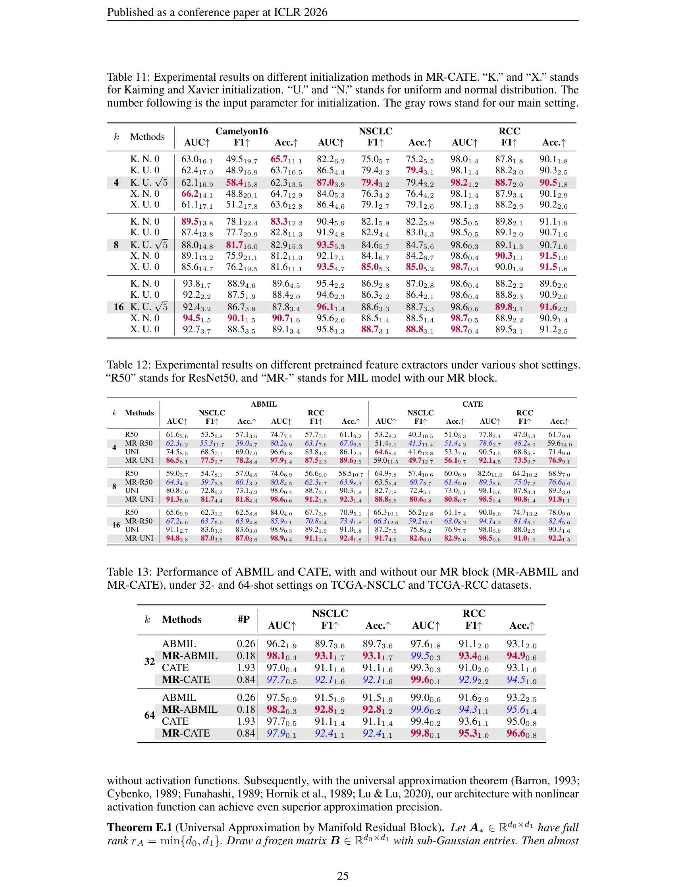
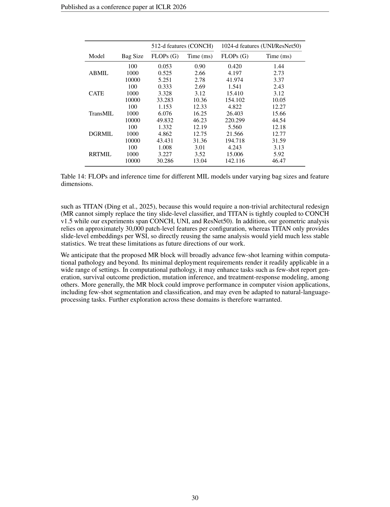

## Exploiting Low-Dimensional Manifold of Features for Few-Shot Whole Slide Image Classification

> data: CAMELYON16、TCGA-NSCLC、TCGA-RCC
>
> ICLR 2026 · [论文](https://openreview.net/forum?id=HBP9uSEYME) · [作者代码](https://github.com/BearCleverProud/MR-Block)

#### 引言

把任务适配拆分为固定随机几何锚点和可训练低秩残差分支，以尽量保留基础模型特征的低维流形结构，改善少样本分类。

#### 方法

（1）固定锚点：以随机映射尽量保留原始特征几何关系。

（2）低秩残差：只学习任务所需的小幅调整。

（3）残差组合：把基础几何与可训练适配相加，降低少样本过拟合自由度。

<!-- wsi-complete-model -->
##### 模型结构图

**图 2 · 模型结构**（PDF 第 4 页）

> 原文图注：Figure 2: Illustration of the linear transformation (a), our proposed MR block (b), and the overall pipeline of MIL for WSI classification task and where our MR block takes effect (c). Specifically, the MR block is applied only to some of the internal linear layers within the MIL backbone, while the final linear classification head (the classifier) is left unchanged.

[查看原尺寸](assest/MR-Block/figure-2-complete.webp)

<!-- /wsi-complete-model -->

#### 实验

##### 实验设置

比较不同 shot 数，使用 AUC、AUPRC、宏 F1 和 ACC，另测参数量与几何性质。

##### 主要结果

结果支持几何锚点与低秩残差的组合；少样本收益必须对应相同训练样本数。

<!-- wsi-complete-results -->
##### 完整实验指标与对照

下列实验原页保留表头、全部行列、子图、误差说明和脚注，点击可查看原尺寸。比较时请对应相同的数据集、特征编码器和训练设置；`±`、置信区间、百分比和小数均保留原文的单位与统计口径。

| 原表/图中指标 | 读取方式 |
| --- | --- |
| ROC-AUC / AUROC | 越高越好；若原表明确为 PR-AUC，则按 PR 曲线面积读取 |
| ACC / Accuracy | 越高越好；平衡准确率、平均准确率以原表标注为准 |
| F1 | 越高越好；保留 macro / weighted / micro 等平均方式 |
| Recall / Sensitivity | 越高越好；与固定敏感度下的特异度区别读取 |
| AP / AUPRC / mAP | 越高越好；与 ROC-AUC 不同，保留任务和召回定义 |
| 时间 / FLOPs / 参数量 | 结合硬件、包长度和计时范围比较；小模型不一定推理更快 |

| 原文页 | 阅读内容 | 图表及正文引用 |
| --- | --- | --- |
| PDF 第 6 页 | 实验结果 | Table 1 |
| PDF 第 7 页 | 实验结果 | Table 2、Table 3、Table 4 |
| PDF 第 8 页 | 实验结果 | Table 5、Table 6 |
| PDF 第 9 页 | 实验结果 | Figure 3 |
| PDF 第 17 页 | 实验结果 | Figure 4、Figure 5 |
| PDF 第 22 页 | 实验结果 | Table 7 |
| PDF 第 23 页 | 实验结果 | Table 8、Table 9、Table 10 |
| PDF 第 25 页 | 实验结果 | Table 11、Table 12、Table 13 |
| PDF 第 30 页 | 实验结果 | Table 14 |

**实验原页 · PDF 第 6 页**（图表及正文引用：Table 1）

[查看原尺寸](assest/MR-Block/experiment-page-06.webp)

**实验原页 · PDF 第 7 页**（图表及正文引用：Table 2、Table 3、Table 4）

[查看原尺寸](assest/MR-Block/experiment-page-07.webp)

**实验原页 · PDF 第 8 页**（图表及正文引用：Table 5、Table 6）

[查看原尺寸](assest/MR-Block/experiment-page-08.webp)

**实验原页 · PDF 第 9 页**（图表及正文引用：Figure 3）

[查看原尺寸](assest/MR-Block/experiment-page-09.webp)

**实验原页 · PDF 第 17 页**（图表及正文引用：Figure 4、Figure 5）

[查看原尺寸](assest/MR-Block/experiment-page-17.webp)

**实验原页 · PDF 第 22 页**（图表及正文引用：Table 7）

[查看原尺寸](assest/MR-Block/experiment-page-22.webp)

**实验原页 · PDF 第 23 页**（图表及正文引用：Table 8、Table 9、Table 10）

[查看原尺寸](assest/MR-Block/experiment-page-23.webp)

**实验原页 · PDF 第 25 页**（图表及正文引用：Table 11、Table 12、Table 13）

[查看原尺寸](assest/MR-Block/experiment-page-25.webp)

**实验原页 · PDF 第 30 页**（图表及正文引用：Table 14）

[查看原尺寸](assest/MR-Block/experiment-page-30.webp)

<!-- /wsi-complete-results -->

##### 消融与讨论

消融固定随机分支、低秩残差和秩/维度等配置，检查表征流形与分类表现的共同变化。

#### 参考文献

> Exploiting Low-Dimensional Manifold of Features for Few-Shot Whole Slide Image Classification
>
> ICLR 2026 · [论文](https://openreview.net/forum?id=HBP9uSEYME) · [作者代码](https://github.com/BearCleverProud/MR-Block)
