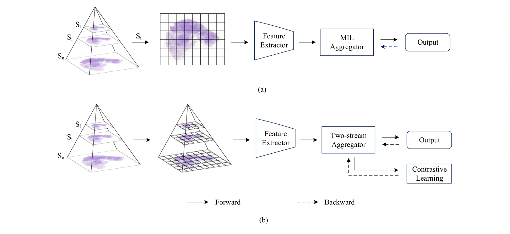
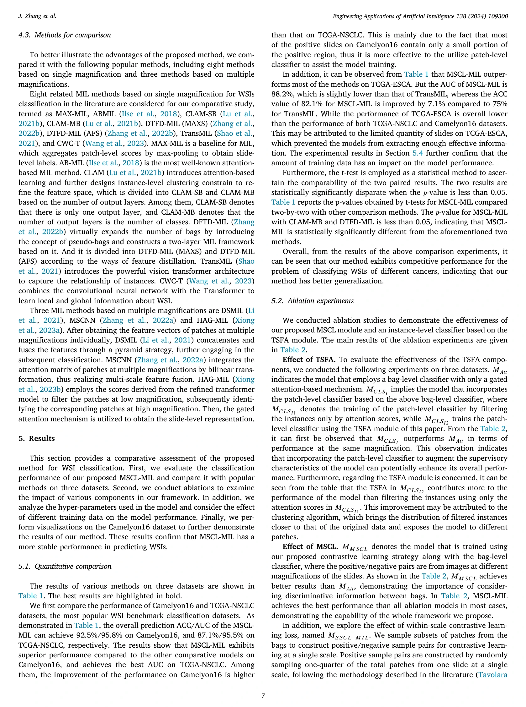
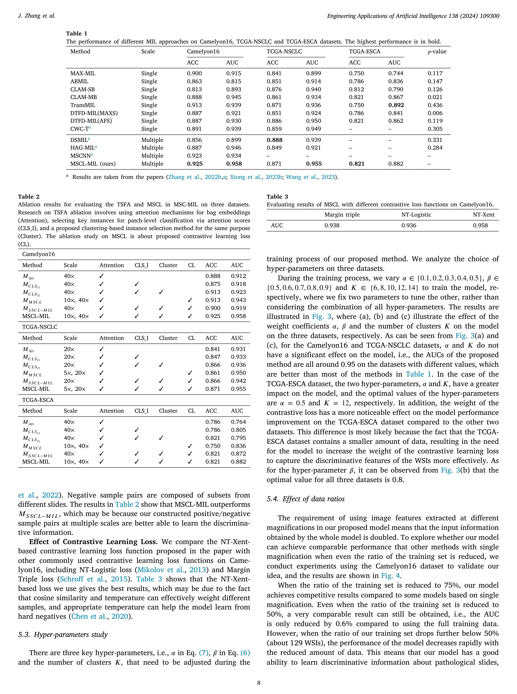
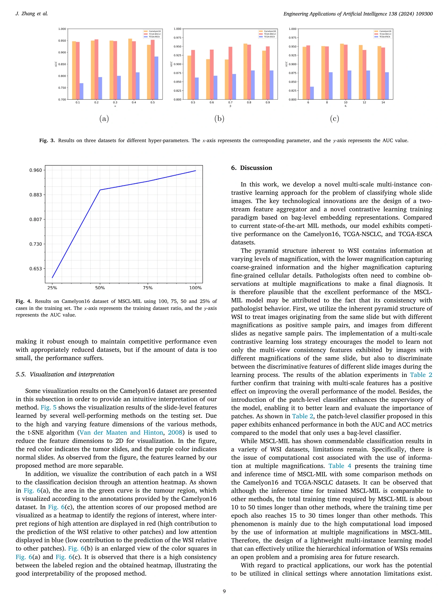
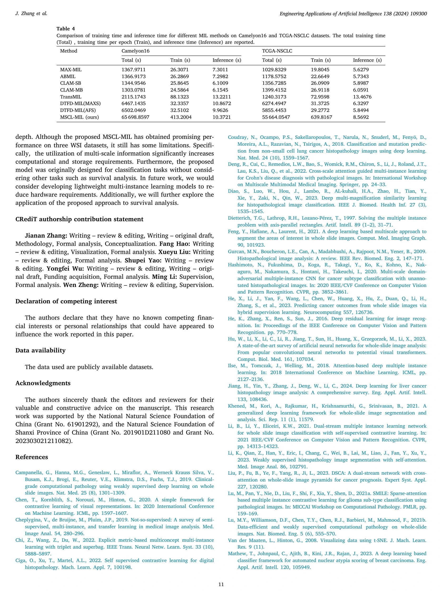

## Multi-scale multi-instance contrastive learning for whole slide image classification

> data: CAMELYON16、TCGA-NSCLC、TCGA-ESCA
>
> Engineering Applications of Artificial Intelligence 2024 · [论文](https://doi.org/10.1016/j.engappai.2024.109300)

#### 引言

以双流模块同时生成切片表示和选择代表实例，结合跨倍率对比学习及实例级辅助分类，强化多尺度特征监督。

#### 方法

（1）双流聚合：一条分支形成包嵌入，另一条选择代表实例。

（2）跨尺度对比：利用 WSI 金字塔结构约束不同倍率的全局表示。

（3）实例辅助：训练选中 patch 的分类器，给弱监督聚合增加细粒度信号。

<!-- wsi-complete-model -->
##### 模型结构图

**图 1 · 模型结构**（PDF 第 2 页）

> 原文图注：Fig. 1. (a) Common MIL model for WSI classification. Typically WSIs are stored in the form of a pyramid containing images at multiple magnifications. Common MIL frameworks typically select an image at a specific magnification level to be used in model training. The chosen image is then divided into thousands of patches, which are subsequently passed through a feature extractor to obtain instance feature vectors, followed by a MIL aggregator for aggregation and prediction. (b) Our proposed method. Compared with the traditional MIL-based methods, our proposed method utilizes WSI images at different magnifications and obtains distinguishable features of WSIs through contrastive learning.

[查看原尺寸](assest/MSCL-MIL/figure-1-complete.webp)

<!-- /wsi-complete-model -->

#### 实验

##### 实验设置

比较不同倍率及实例级辅助分类，并以 ACC/AUC 评估。

##### 主要结果

CAMELYON16 的 ACC/AUC 为 92.5%/95.8%，TCGA-NSCLC 为 87.1%/95.5%；TCGA 上最佳的是 AUC，并非全部指标。

<!-- wsi-complete-results -->
##### 完整实验指标与对照

下列实验原页保留表头、全部行列、子图、误差说明和脚注，点击可查看原尺寸。比较时请对应相同的数据集、特征编码器和训练设置；`±`、置信区间、百分比和小数均保留原文的单位与统计口径。

| 原表/图中指标 | 读取方式 |
| --- | --- |
| ROC-AUC / AUROC | 越高越好；若原表明确为 PR-AUC，则按 PR 曲线面积读取 |
| ACC / Accuracy | 越高越好；平衡准确率、平均准确率以原表标注为准 |
| 时间 / FLOPs / 参数量 | 结合硬件、包长度和计时范围比较；小模型不一定推理更快 |

| 原文页 | 阅读内容 | 图表及正文引用 |
| --- | --- | --- |
| PDF 第 7 页 | 实验结果 | Table 1 |
| PDF 第 8 页 | 实验结果 | Table 1、Table 2、Table 3 |
| PDF 第 9 页 | 实验结果 | Figure 3、Figure 4 |
| PDF 第 11 页 | 实验结果 | Table 4 |

**实验原页 · PDF 第 7 页**（图表及正文引用：Table 1）

[查看原尺寸](assest/MSCL-MIL/experiment-page-07.webp)

**实验原页 · PDF 第 8 页**（图表及正文引用：Table 1、Table 2、Table 3）

[查看原尺寸](assest/MSCL-MIL/experiment-page-08.webp)

**实验原页 · PDF 第 9 页**（图表及正文引用：Figure 3、Figure 4）

[查看原尺寸](assest/MSCL-MIL/experiment-page-09.webp)

**实验原页 · PDF 第 11 页**（图表及正文引用：Table 4）

[查看原尺寸](assest/MSCL-MIL/experiment-page-11.webp)

<!-- /wsi-complete-results -->

##### 消融与讨论

消融双流特征聚合和跨尺度对比学习，并对比仅按注意力挑选实例的辅助分类器。

#### 参考文献

> Multi-scale multi-instance contrastive learning for whole slide image classification
>
> Engineering Applications of Artificial Intelligence 2024 · [论文](https://doi.org/10.1016/j.engappai.2024.109300)
