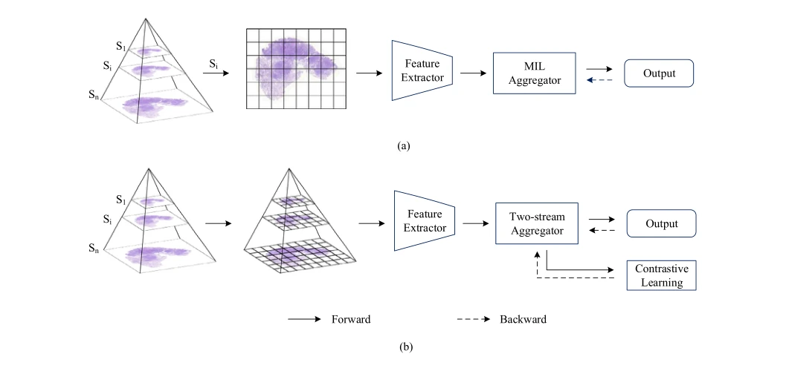

## Multi-scale multi-instance contrastive learning for whole slide image classification

> data: CAMELYON16、TCGA-NSCLC、TCGA-ESCA
>
> Engineering Applications of Artificial Intelligence 2024 · [论文](https://doi.org/10.1016/j.engappai.2024.109300)

#### 引言

以双流模块同时生成切片表示和选择代表实例，结合跨倍率对比学习及实例级辅助分类，强化多尺度特征监督。

#### 方法

（1）双流聚合：一条分支形成包嵌入，另一条选择代表实例。

（2）跨尺度对比：利用 WSI 金字塔结构约束不同倍率的全局表示。

（3）实例辅助：训练选中 patch 的分类器，给弱监督聚合增加细粒度信号。

原文Fig. 1，PDF 第 2 页。

#### 实验

##### 实验设置

比较不同倍率及实例级辅助分类，并以 ACC/AUC 评估。

##### 主要结果

CAMELYON16 的 ACC/AUC 为 92.5%/95.8%，TCGA-NSCLC 为 87.1%/95.5%；TCGA 上最佳的是 AUC，并非全部指标。

##### 消融与讨论

消融双流特征聚合和跨尺度对比学习，并对比仅按注意力挑选实例的辅助分类器。

#### 参考文献

> Multi-scale multi-instance contrastive learning for whole slide image classification
>
> Engineering Applications of Artificial Intelligence 2024 · [论文](https://doi.org/10.1016/j.engappai.2024.109300)
