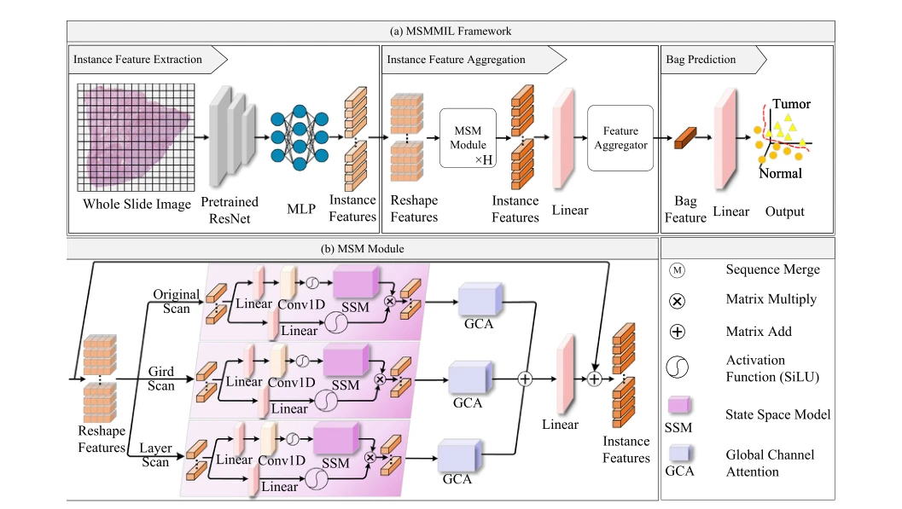

## MSMMIL: Multi-scan Mamba-based Multiple Instance Learning for whole slide image classification

> data: CAMELYON16、TCGA-Lung
>
> Knowledge-Based Systems 2025 · [论文](https://doi.org/10.1016/j.knosys.2025.113871) · [作者代码](https://github.com/cool-breeze-and-rain/MSMMIL)

#### 引言

结合网格扫描、分层扫描和原始扫描，再以全局上下文注意力强化关键实例，兼顾长序列建模与组织空间连续性。

#### 方法

（1）多扫描：组合原始、网格和分层三条序列。

（2）Mamba 更新：分别学习不同方向及层次的长序列关系。

（3）GCA：用轻量全局上下文注意力增强重要实例，再完成合并预测。

原文Fig. 2，PDF 第 4 页。

#### 实验

##### 实验设置

C16 官方训练部分再按 4:1 划分；TCGA 按 3:1:1 划分，patch 大小为 256×256。

##### 主要结果

摘要报告 TCGA-Lung 与 C16 的 ACC/AUC 分别为 89.81%/95.44%、92.87%/96.41%。

##### 消融与讨论

比较原始、网格、分层三种扫描的单用/组合，并在不加 GCA 时检验扫描策略本身。

#### 参考文献

> MSMMIL: Multi-scan Mamba-based Multiple Instance Learning for whole slide image classification
>
> Knowledge-Based Systems 2025 · [论文](https://doi.org/10.1016/j.knosys.2025.113871) · [作者代码](https://github.com/cool-breeze-and-rain/MSMMIL)
