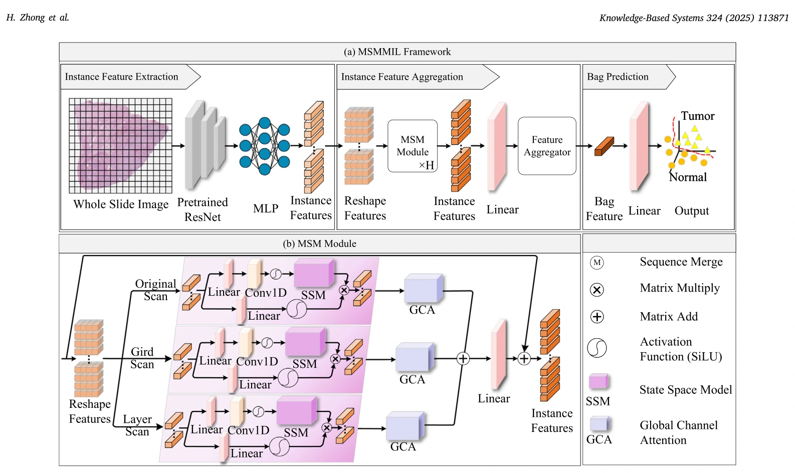
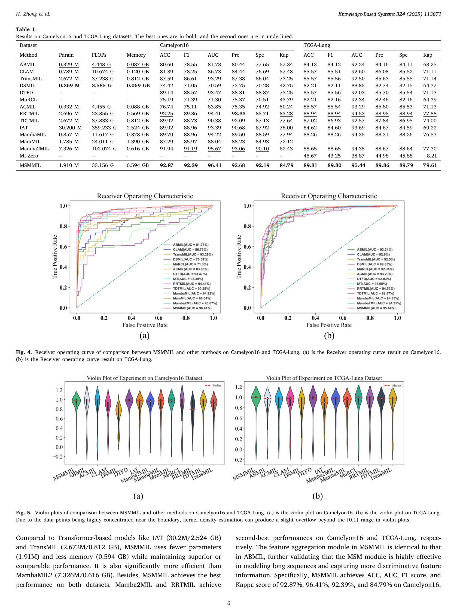
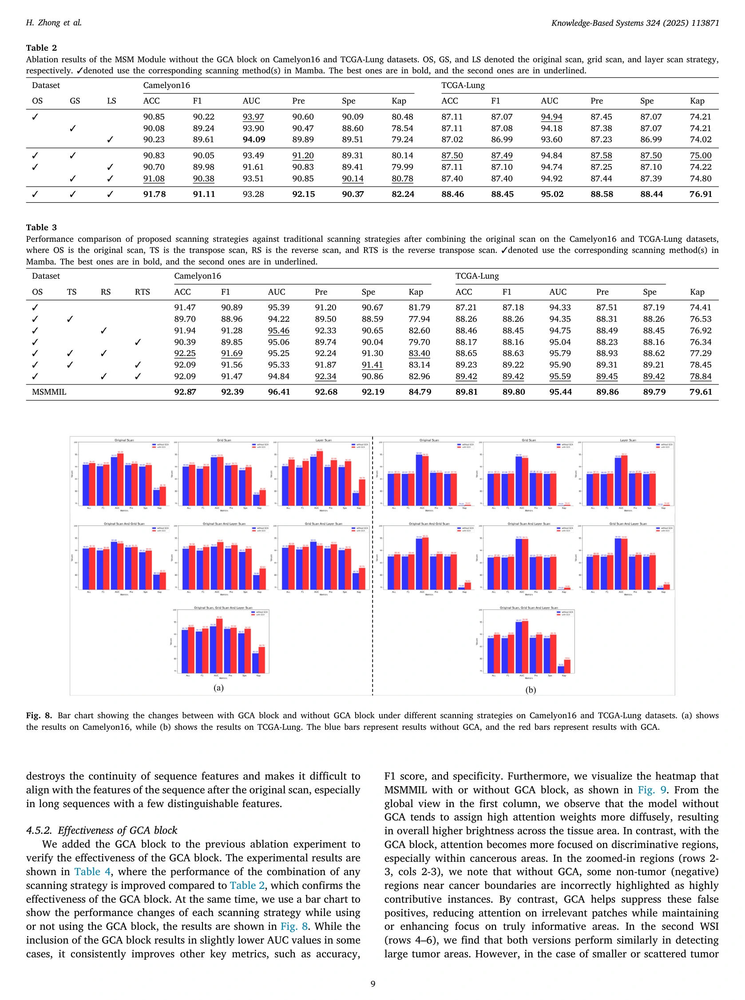
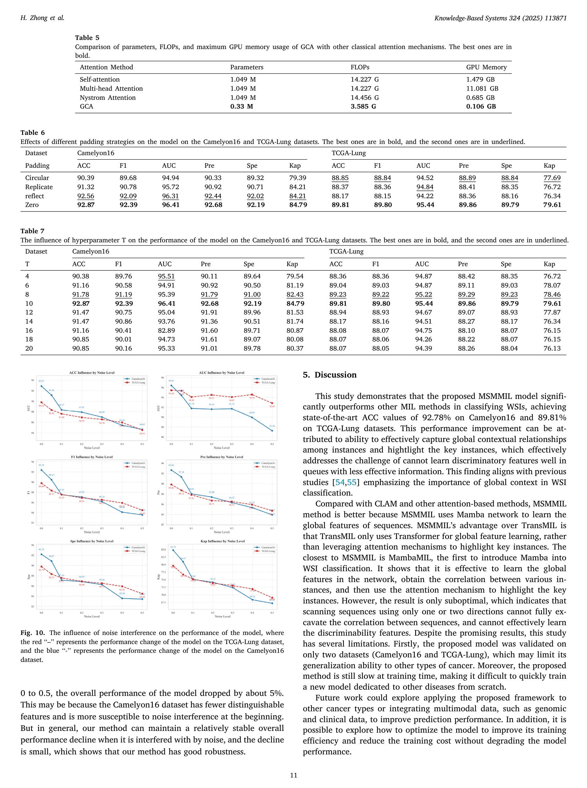
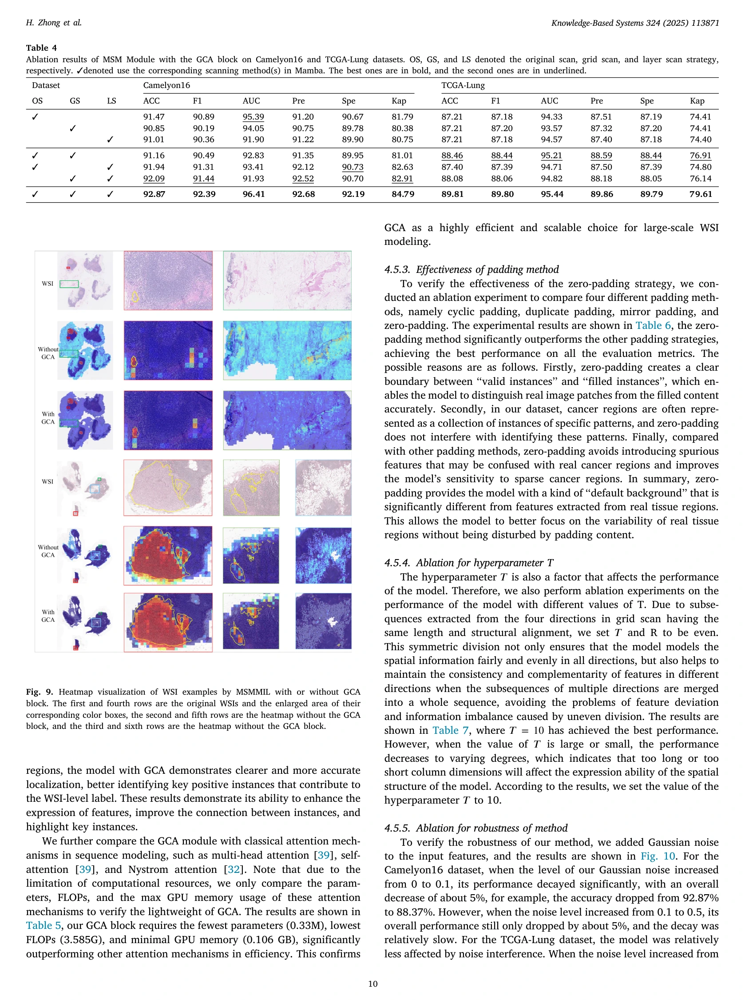

## MSMMIL: Multi-scan Mamba-based Multiple Instance Learning for whole slide image classification

> data: CAMELYON16、TCGA-Lung
>
> Knowledge-Based Systems 2025 · [论文](https://doi.org/10.1016/j.knosys.2025.113871) · [作者代码](https://github.com/cool-breeze-and-rain/MSMMIL)

#### 引言

结合网格扫描、分层扫描和原始扫描，再以全局上下文注意力强化关键实例，兼顾长序列建模与组织空间连续性。

#### 方法

（1）多扫描：组合原始、网格和分层三条序列。

（2）Mamba 更新：分别学习不同方向及层次的长序列关系。

（3）GCA：用轻量全局上下文注意力增强重要实例，再完成合并预测。

<!-- wsi-complete-model -->
##### 模型结构图

**图 2 · 模型结构**（PDF 第 4 页）

> 原文图注：Fig. 2. An overview of the MSMMIL framework, which is composed of an instance feature extraction process, an instance feature aggregation process, and a bag prediction process.

[查看原尺寸](assest/MSMMIL/figure-2-complete.webp)

<!-- /wsi-complete-model -->

#### 实验

##### 实验设置

C16 官方训练部分再按 4:1 划分；TCGA 按 3:1:1 划分，patch 大小为 256×256。

##### 主要结果

摘要报告 TCGA-Lung 与 C16 的 ACC/AUC 分别为 89.81%/95.44%、92.87%/96.41%。

<!-- wsi-complete-results -->
##### 完整实验指标与对照

下列实验原页保留表头、全部行列、子图、误差说明和脚注，点击可查看原尺寸。比较时请对应相同的数据集、特征编码器和训练设置；`±`、置信区间、百分比和小数均保留原文的单位与统计口径。

| 原表/图中指标 | 读取方式 |
| --- | --- |
| ROC-AUC / AUROC | 越高越好；若原表明确为 PR-AUC，则按 PR 曲线面积读取 |
| ACC / Accuracy | 越高越好；平衡准确率、平均准确率以原表标注为准 |
| 时间 / FLOPs / 参数量 | 结合硬件、包长度和计时范围比较；小模型不一定推理更快 |

| 原文页 | 阅读内容 | 图表及正文引用 |
| --- | --- | --- |
| PDF 第 6 页 | 实验结果 | Table 1 |
| PDF 第 9 页 | 实验结果 | Table 2、Table 3 |
| PDF 第 10 页 | 消融与参数分析 | Table 4 |
| PDF 第 11 页 | 实验结果 | Table 5、Table 6、Table 7、Figure 10 |

**实验原页 · PDF 第 6 页**（图表及正文引用：Table 1）

[查看原尺寸](assest/MSMMIL/experiment-page-06.webp)

**实验原页 · PDF 第 9 页**（图表及正文引用：Table 2、Table 3）

[查看原尺寸](assest/MSMMIL/experiment-page-09.webp)

**实验原页 · PDF 第 11 页**（图表及正文引用：Table 5、Table 6、Table 7、Figure 10）

[查看原尺寸](assest/MSMMIL/experiment-page-11.webp)

展开消融、参数、数据设置及效率原页

**实验原页 · PDF 第 10 页**（图表及正文引用：Table 4）

[查看原尺寸](assest/MSMMIL/experiment-page-10.webp)

<!-- /wsi-complete-results -->

##### 消融与讨论

比较原始、网格、分层三种扫描的单用/组合，并在不加 GCA 时检验扫描策略本身。

#### 参考文献

> MSMMIL: Multi-scan Mamba-based Multiple Instance Learning for whole slide image classification
>
> Knowledge-Based Systems 2025 · [论文](https://doi.org/10.1016/j.knosys.2025.113871) · [作者代码](https://github.com/cool-breeze-and-rain/MSMMIL)
