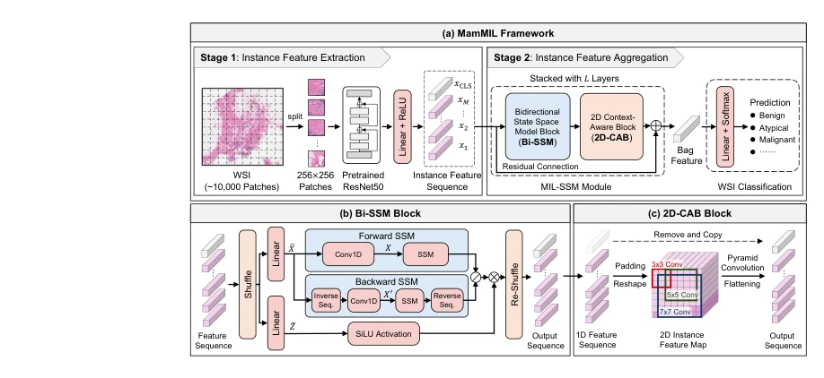
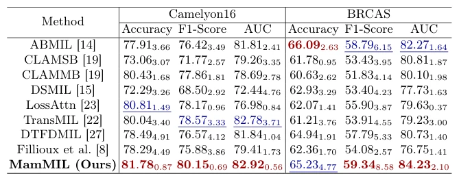

## MamMIL: Multiple Instance Learning for Whole Slide Images with State Space Models

> data: CAMELYON16、BRACS
>
> arXiv 2024 · [论文](https://arxiv.org/abs/2403.05160)

#### 引言

结合双向状态空间模型与二维上下文模块，以线性复杂度建模实例依赖和空间关系，降低长序列 WSI 分类的显存需求。

#### 方法

（1）双向 SSM：分别建模前向和后向实例依赖，弥补单向扫描局限。

（2）二维上下文：把平面空间关系重新引入一维实例序列。

（3）切片预测：以线性复杂度的状态空间模块替代高开销自注意力。

原文Fig. 1，PDF 第 4 页。

#### 实验

##### 实验设置

沿用官方测试集；CAMELYON16 训练/验证为 2:1，BRACS 采用 395/65/87 张的官方划分。

##### 主要结果

多数指标优于比较模型，但 BRACS 的 ACC 略低于 ABMIL，不能写成全面最优。

原文Table 1，PDF 第 6 页。

##### 消融与讨论

消融双向 SSM、二维上下文和打乱策略；作者观察到 shuffle 对减轻过拟合较关键。

#### 参考文献

> MamMIL: Multiple Instance Learning for Whole Slide Images with State Space Models
>
> arXiv 2024 · [论文](https://arxiv.org/abs/2403.05160)
