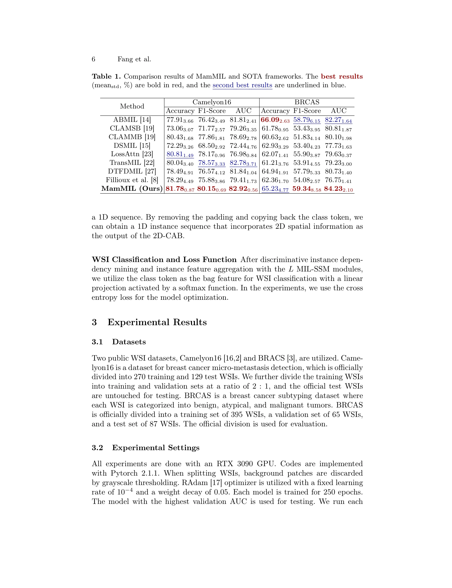
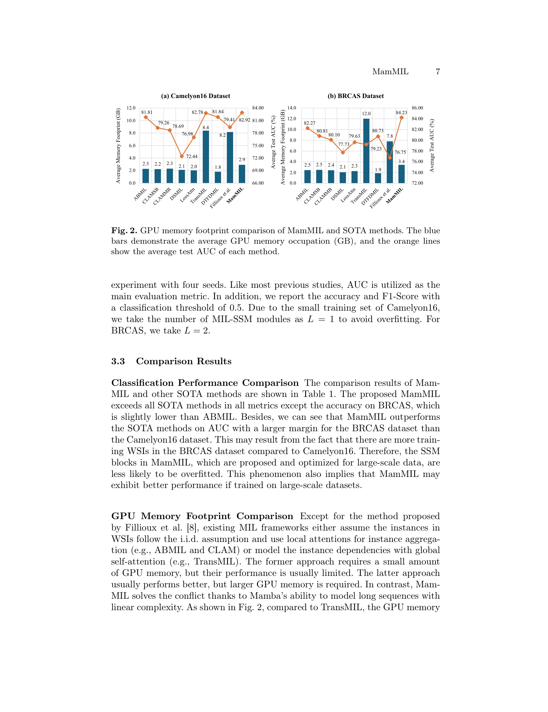
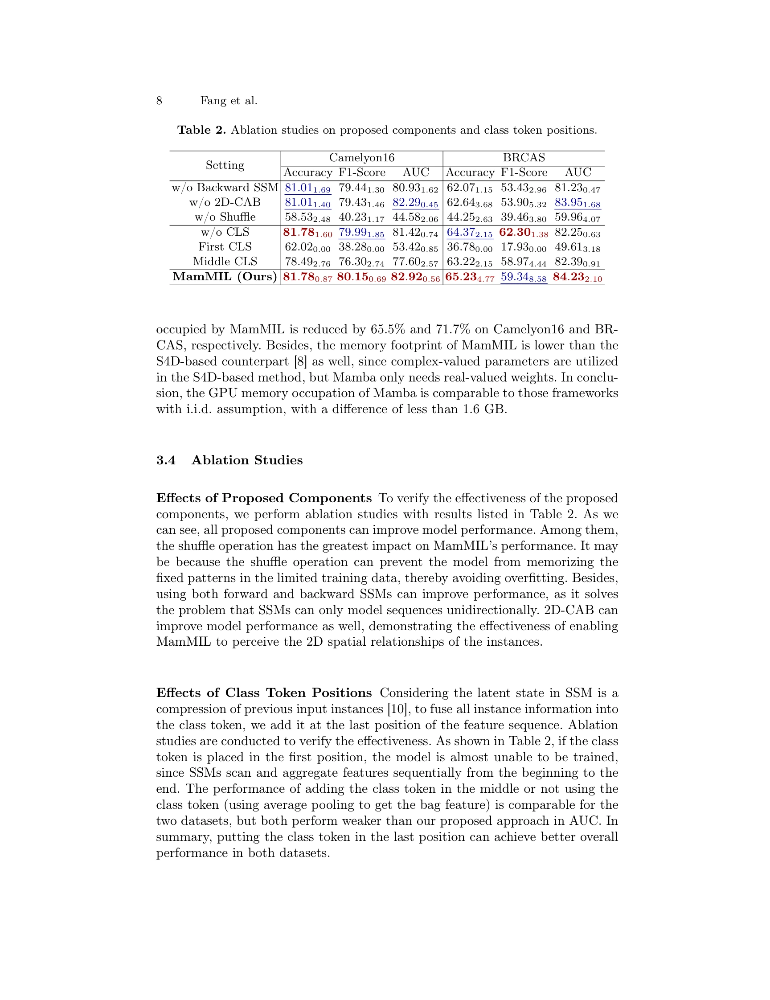

## MamMIL: Multiple Instance Learning for Whole Slide Images with State Space Models

> data: CAMELYON16、BRACS
>
> arXiv 2024 · [论文](https://arxiv.org/abs/2403.05160)

#### 引言

结合双向状态空间模型与二维上下文模块，以线性复杂度建模实例依赖和空间关系，降低长序列 WSI 分类的显存需求。

#### 方法

（1）双向 SSM：分别建模前向和后向实例依赖，弥补单向扫描局限。

（2）二维上下文：把平面空间关系重新引入一维实例序列。

（3）切片预测：以线性复杂度的状态空间模块替代高开销自注意力。

<!-- wsi-complete-model -->
##### 模型结构图

**图 1 · 模型结构**（PDF 第 4 页）

> 原文图注：Fig. 1. An overview of the MamMIL framework, which is composed of an instance fea- ture extraction stage and an instance feature aggregation stage. ⊘, ⊕and ⊗represent element-wise averaging, addition, and multiplication, respectively.

[查看原尺寸](assest/MamMIL/figure-1-complete.webp)

<!-- /wsi-complete-model -->

#### 实验

##### 实验设置

沿用官方测试集；CAMELYON16 训练/验证为 2:1，BRACS 采用 395/65/87 张的官方划分。

##### 主要结果

多数指标优于比较模型，但 BRACS 的 ACC 略低于 ABMIL，不能写成全面最优。

<!-- wsi-complete-results -->
##### 完整实验指标与对照

下列实验原页保留表头、全部行列、子图、误差说明和脚注，点击可查看原尺寸。比较时请对应相同的数据集、特征编码器和训练设置；`±`、置信区间、百分比和小数均保留原文的单位与统计口径。

| 原表/图中指标 | 读取方式 |
| --- | --- |
| ROC-AUC / AUROC | 越高越好；若原表明确为 PR-AUC，则按 PR 曲线面积读取 |
| ACC / Accuracy | 越高越好；平衡准确率、平均准确率以原表标注为准 |

| 原文页 | 阅读内容 | 图表及正文引用 |
| --- | --- | --- |
| PDF 第 6 页 | 实验结果 | Table 1 |
| PDF 第 7 页 | 实验结果 | Figure 2 |
| PDF 第 8 页 | 消融与参数分析 | Table 2 |

**实验原页 · PDF 第 6 页**（图表及正文引用：Table 1）

[查看原尺寸](assest/MamMIL/experiment-page-06.webp)

**实验原页 · PDF 第 7 页**（图表及正文引用：Figure 2）

[查看原尺寸](assest/MamMIL/experiment-page-07.webp)

展开消融、参数、数据设置及效率原页

**实验原页 · PDF 第 8 页**（图表及正文引用：Table 2）

[查看原尺寸](assest/MamMIL/experiment-page-08.webp)

<!-- /wsi-complete-results -->

##### 消融与讨论

消融双向 SSM、二维上下文和打乱策略；作者观察到 shuffle 对减轻过拟合较关键。

#### 参考文献

> MamMIL: Multiple Instance Learning for Whole Slide Images with State Space Models
>
> arXiv 2024 · [论文](https://arxiv.org/abs/2403.05160)
