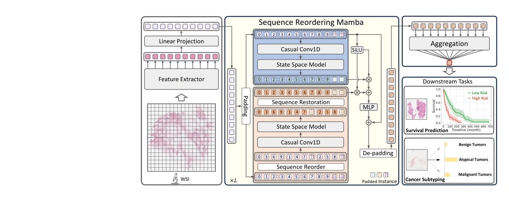
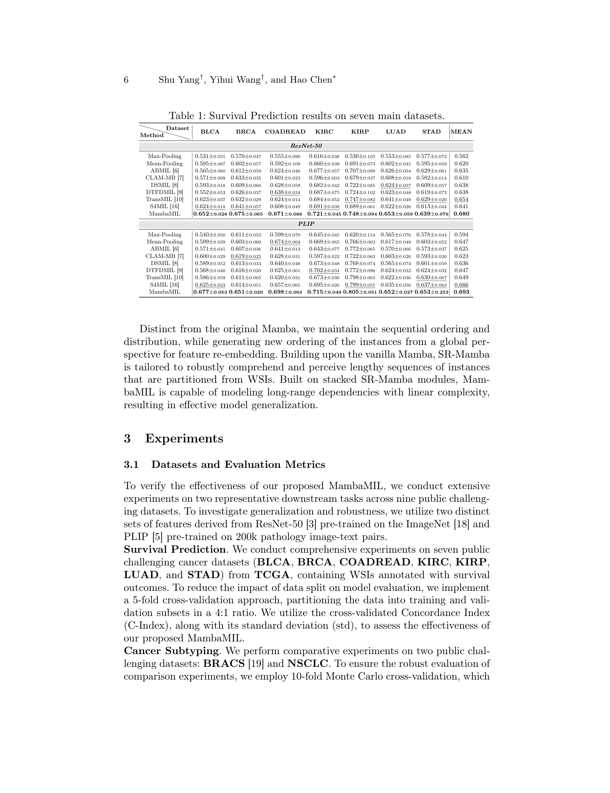
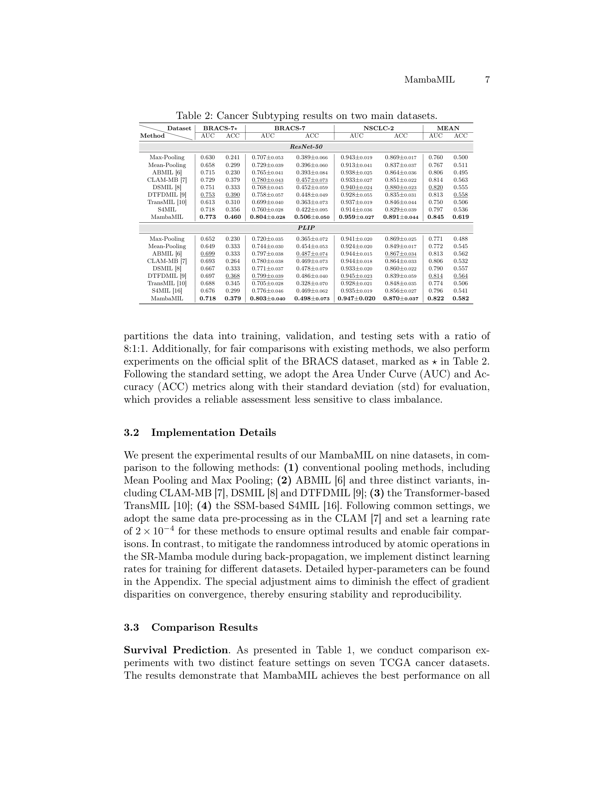
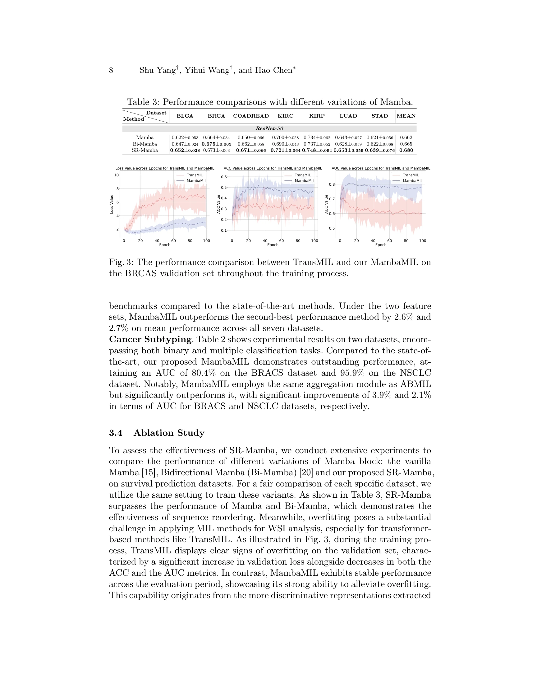
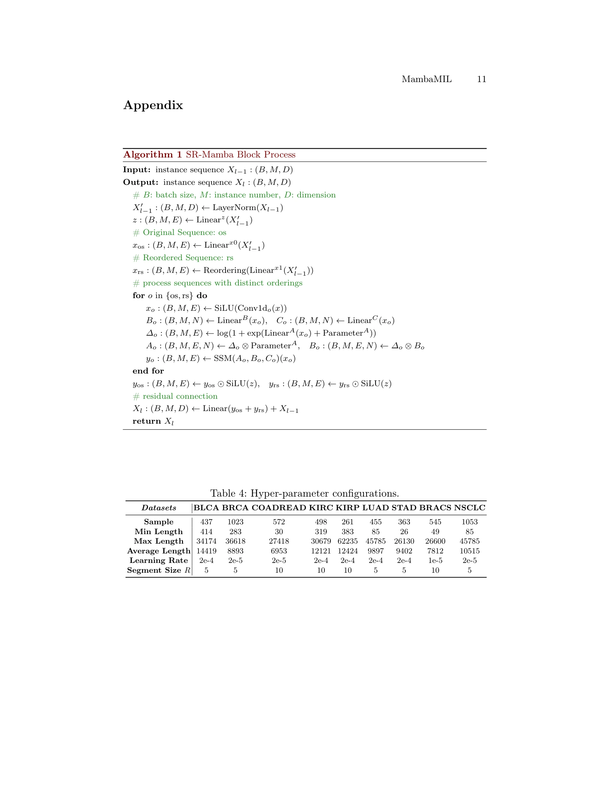

## MambaMIL: Enhancing Long Sequence Modeling with Sequence Reordering in Computational Pathology

> data: 七个 TCGA 生存队列：BLCA、BRCA、COADREAD、KIRC、KIRP、LUAD、STAD；另有两个亚型任务
>
> MICCAI 2024 · [论文](https://arxiv.org/abs/2403.06800) · [作者代码](https://github.com/isyangshu/MambaMIL)

#### 引言

将 Mamba 引入 WSI 长序列建模，通过序列重排感知实例顺序和分布，在控制复杂度的同时学习远程关系。

#### 方法

（1）选择性扫描：以 Mamba 在线性复杂度下处理长实例序列。

（2）序列重排：从原顺序与变换顺序捕获分散实例间联系。

（3）任务聚合：形成切片表示，分别接分类或生存预测目标。

<!-- wsi-complete-model -->
##### 模型结构图

**图 1 · 模型结构**（PDF 第 4 页）

> 原文图注：Fig. 1: Overview of MambaMIL. Given a set of patches cropped from a slide, we sequentially utilize Feature Extractor, Linear Projection, stacked SR-Mamba modules and Aggregation for WSI analysis.

[查看原尺寸](assest/MambaMIL/figure-1-complete.webp)

<!-- /wsi-complete-model -->

#### 实验

##### 实验设置

在 ResNet50 与 PLIP 两类特征下评估；生存任务使用五折 C-index。

##### 主要结果

跨不同特征与任务的主表支持序列重排建模；生存预测结果不能用分类 AUC 代替。

<!-- wsi-complete-results -->
##### 完整实验指标与对照

下列实验原页保留表头、全部行列、子图、误差说明和脚注，点击可查看原尺寸。比较时请对应相同的数据集、特征编码器和训练设置；`±`、置信区间、百分比和小数均保留原文的单位与统计口径。

| 原表/图中指标 | 读取方式 |
| --- | --- |
| ROC-AUC / AUROC | 越高越好；若原表明确为 PR-AUC，则按 PR 曲线面积读取 |
| C-index | 越高越好；用于生存预测，需保留终点及删失设置 |

| 原文页 | 阅读内容 | 图表及正文引用 |
| --- | --- | --- |
| PDF 第 6 页 | 实验结果 | Table 1 |
| PDF 第 7 页 | 实验结果 | Table 2 |
| PDF 第 8 页 | 实验结果 | Table 3、Figure 3 |
| PDF 第 11 页 | 数据与实验设置 | Table 4 |

**实验原页 · PDF 第 6 页**（图表及正文引用：Table 1）

[查看原尺寸](assest/MambaMIL/experiment-page-06.webp)

**实验原页 · PDF 第 7 页**（图表及正文引用：Table 2）

[查看原尺寸](assest/MambaMIL/experiment-page-07.webp)

**实验原页 · PDF 第 8 页**（图表及正文引用：Table 3、Figure 3）

[查看原尺寸](assest/MambaMIL/experiment-page-08.webp)

展开消融、参数、数据设置及效率原页

**实验原页 · PDF 第 11 页**（图表及正文引用：Table 4）

[查看原尺寸](assest/MambaMIL/experiment-page-11.webp)

<!-- /wsi-complete-results -->

##### 消融与讨论

比较 SR-Mamba 与原始序列建模，检查长程依赖、顺序变化和计算效率。

#### 参考文献

> MambaMIL: Enhancing Long Sequence Modeling with Sequence Reordering in Computational Pathology
>
> MICCAI 2024 · [论文](https://arxiv.org/abs/2403.06800) · [作者代码](https://github.com/isyangshu/MambaMIL)
