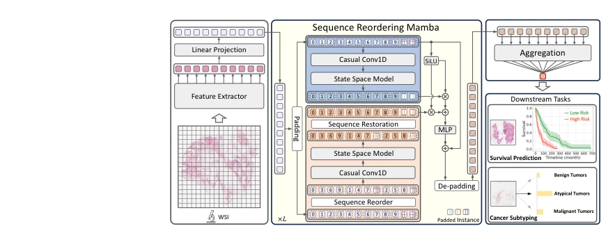
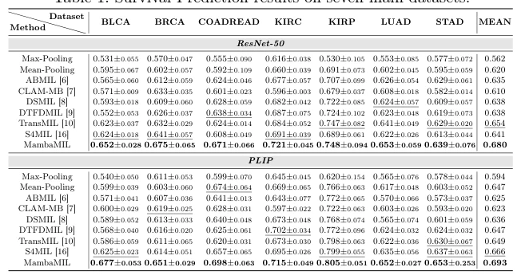

## MambaMIL: Enhancing Long Sequence Modeling with Sequence Reordering in Computational Pathology

> data: 七个 TCGA 生存队列：BLCA、BRCA、COADREAD、KIRC、KIRP、LUAD、STAD；另有两个亚型任务
>
> MICCAI 2024 · [论文](https://arxiv.org/abs/2403.06800) · [作者代码](https://github.com/isyangshu/MambaMIL)

#### 引言

将 Mamba 引入 WSI 长序列建模，通过序列重排感知实例顺序和分布，在控制复杂度的同时学习远程关系。

#### 方法

（1）选择性扫描：以 Mamba 在线性复杂度下处理长实例序列。

（2）序列重排：从原顺序与变换顺序捕获分散实例间联系。

（3）任务聚合：形成切片表示，分别接分类或生存预测目标。

原文Fig. 1，PDF 第 4 页。

#### 实验

##### 实验设置

在 ResNet50 与 PLIP 两类特征下评估；生存任务使用五折 C-index。

##### 主要结果

跨不同特征与任务的主表支持序列重排建模；生存预测结果不能用分类 AUC 代替。

原文Table 1，PDF 第 6 页。

##### 消融与讨论

比较 SR-Mamba 与原始序列建模，检查长程依赖、顺序变化和计算效率。

#### 参考文献

> MambaMIL: Enhancing Long Sequence Modeling with Sequence Reordering in Computational Pathology
>
> MICCAI 2024 · [论文](https://arxiv.org/abs/2403.06800) · [作者代码](https://github.com/isyangshu/MambaMIL)
