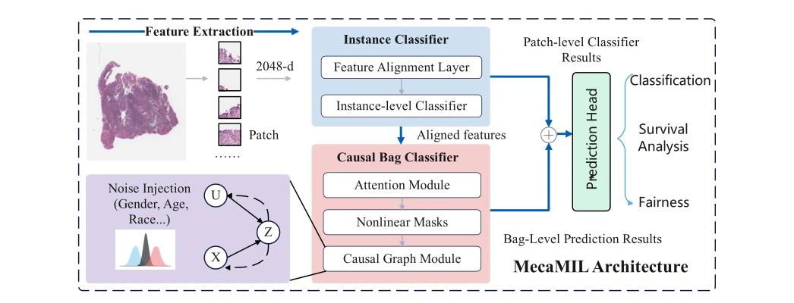
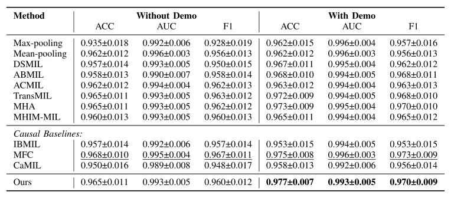

## MeCaMIL: Causality-Aware Multiple Instance Learning for Fair and Interpretable Whole Slide Image Diagnosis

> data: CAMELYON16、TCGA-Lung、TCGA-Multi
>
> IEEE Transactions on Medical Imaging 2026 · [论文](https://doi.org/10.1109/TMI.2026.3711803) · [作者代码](https://github.com/zongzi13545329/MeCaMIL)

#### 引言

通过结构因果图建模年龄、性别等人口统计混杂因素，研究疾病信号与人口相关信息的解耦，并评价诊断表现和群体公平性。

#### 方法

（1）结构因果图：显式表示人口属性与组织/疾病信号关系。

（2）信息解耦：利用因果路径处理潜在混杂。

（3）群体评价：同时考察整体分类与年龄、性别等子群表现。

原文Fig. 1，PDF 第 2 页。

#### 实验

##### 实验设置

ResNet18 特征，Adam、50 epochs、早停；分别比较图像单模态与包含人口统计属性的配置。

##### 主要结果

C16 的 ACC/AUC/F1 为 0.939/0.983/0.946；TCGA 的图像单模态与包含人口属性的结果应分别读。

原文TABLE III，PDF 第 8 页。

##### 消融与讨论

消融因果图路径与人口统计信息，并报告群体差异；C16 人口信息有限，公平性证据主要依靠相应 TCGA 数据。

#### 参考文献

> MeCaMIL: Causality-Aware Multiple Instance Learning for Fair and Interpretable Whole Slide Image Diagnosis
>
> IEEE Transactions on Medical Imaging 2026 · [论文](https://doi.org/10.1109/TMI.2026.3711803) · [作者代码](https://github.com/zongzi13545329/MeCaMIL)
