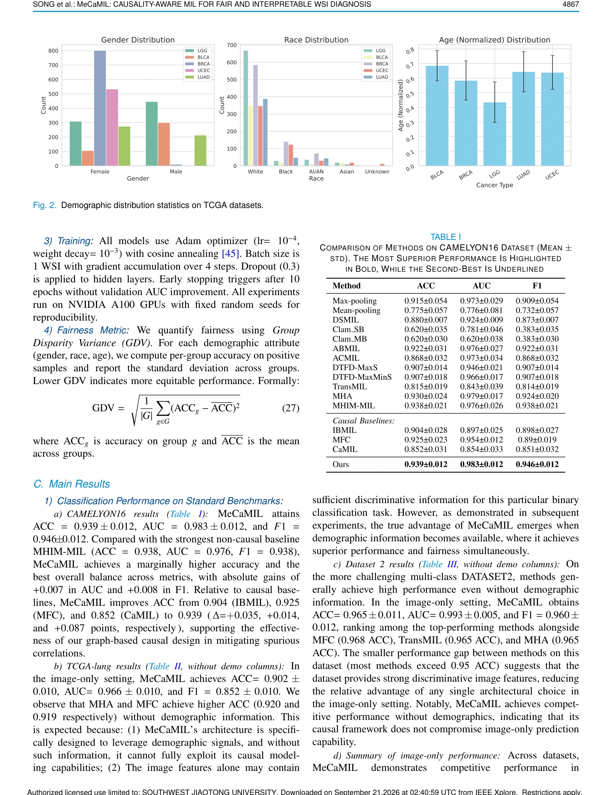
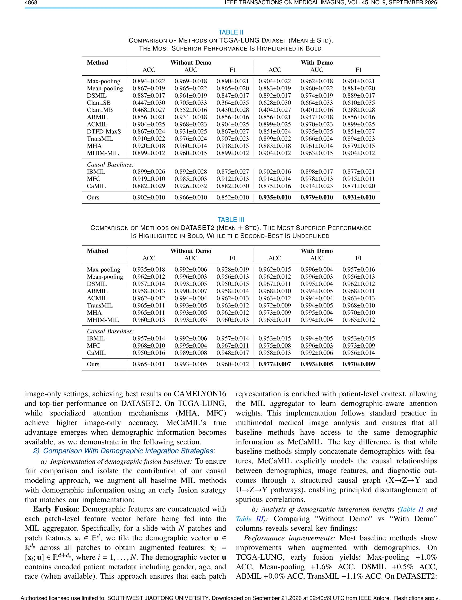
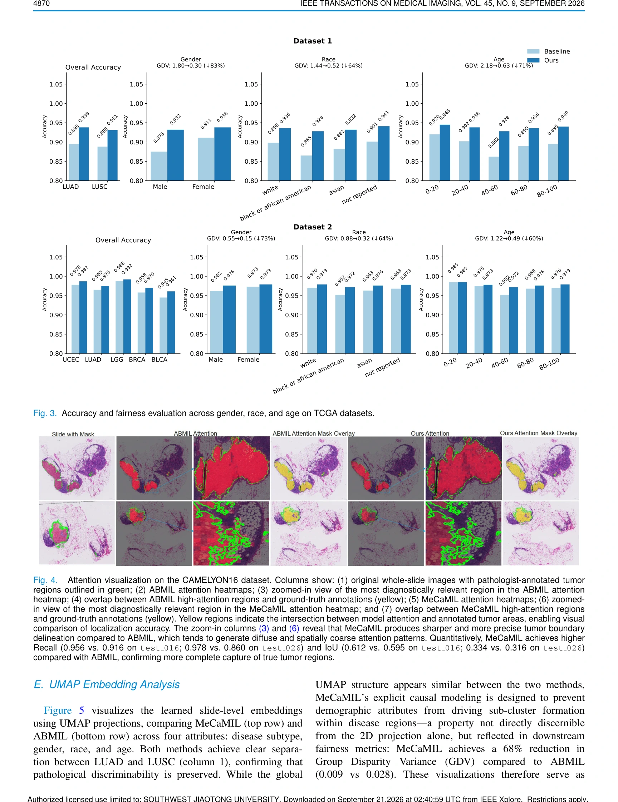
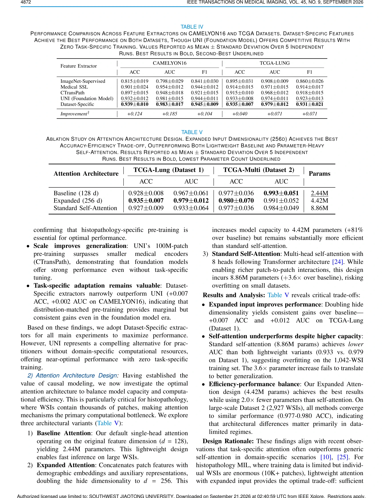
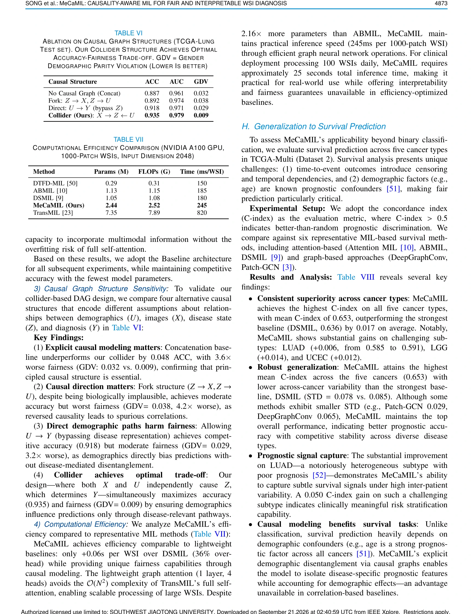
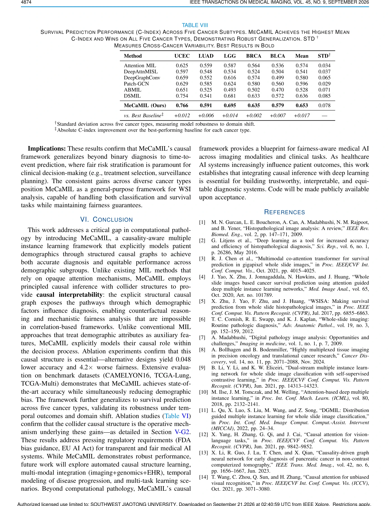

## MeCaMIL: Causality-Aware Multiple Instance Learning for Fair and Interpretable Whole Slide Image Diagnosis

> data: CAMELYON16、TCGA-Lung、TCGA-Multi
>
> IEEE Transactions on Medical Imaging 2026 · [论文](https://doi.org/10.1109/TMI.2026.3711803) · [作者代码](https://github.com/zongzi13545329/MeCaMIL)

#### 引言

通过结构因果图建模年龄、性别等人口统计混杂因素，研究疾病信号与人口相关信息的解耦，并评价诊断表现和群体公平性。

#### 方法

（1）结构因果图：显式表示人口属性与组织/疾病信号关系。

（2）信息解耦：利用因果路径处理潜在混杂。

（3）群体评价：同时考察整体分类与年龄、性别等子群表现。

<!-- wsi-complete-model -->
##### 模型结构图

**图 1 · 模型结构**（PDF 第 2 页）

> 原文图注：Fig. 1. Overview of the proposed MeCaMIL for whole slide image (WSI) diagnosis. Each WSI is divided into image patches, which are independently encoded into 2048-dimensional instance features using a pretrained encoder. These features are first passed to the Instance Classifier, which comprises a Feature Alignment Layer and a shallow Instance-Level Classifier, generating per-patch predictions and aligned feature representations. In parallel, features are aggregated in the Causal Bag Classifier via a multi-head Attention Module to produce a bag-level embedding. This embedding is further processed through Nonlinear Masking Blocks and a Causal Graph Module to capture structured dependencies and inject exogenous demographic priors (e.g., gender, race, age) for debiasing. In the Causal Graph Module, solid arrows denote causal edges that persist during both training and inference, while dashed arrows represent auxiliary edges used exclusively for gradient backpropagation during training. The resulting representations from both instance and bag branches are integrated in the Prediction Head, supporting diverse downstream tasks including classification, survival prediction, and fairness-aware modeling. Arrows denote the data flow and transformation at each module, with exogenous priors influencing the causal path through latent variable modulation.

[查看原尺寸](assest/MeCaMIL/figure-1-complete.webp)

<!-- /wsi-complete-model -->

#### 实验

##### 实验设置

ResNet18 特征，Adam、50 epochs、早停；分别比较图像单模态与包含人口统计属性的配置。

##### 主要结果

C16 的 ACC/AUC/F1 为 0.939/0.983/0.946；TCGA 的图像单模态与包含人口属性的结果应分别读。

<!-- wsi-complete-results -->
##### 完整实验指标与对照

下列实验原页保留表头、全部行列、子图、误差说明和脚注，点击可查看原尺寸。比较时请对应相同的数据集、特征编码器和训练设置；`±`、置信区间、百分比和小数均保留原文的单位与统计口径。

| 原表/图中指标 | 读取方式 |
| --- | --- |
| ROC-AUC / AUROC | 越高越好；若原表明确为 PR-AUC，则按 PR 曲线面积读取 |
| ACC / Accuracy | 越高越好；平衡准确率、平均准确率以原表标注为准 |
| F1 | 越高越好；保留 macro / weighted / micro 等平均方式 |
| Recall / Sensitivity | 越高越好；与固定敏感度下的特异度区别读取 |
| C-index | 越高越好；用于生存预测，需保留终点及删失设置 |
| Dice / IoU | 越高越好；区分像素/实例分割与切片分类 |
| AP / AUPRC / mAP | 越高越好；与 ROC-AUC 不同，保留任务和召回定义 |

| 原文页 | 阅读内容 | 图表及正文引用 |
| --- | --- | --- |
| PDF 第 7 页 | 实验结果 | Table I |
| PDF 第 8 页 | 实验结果 | Table II、Table III |
| PDF 第 10 页 | 实验结果 | Figure 3、Figure 4 |
| PDF 第 12 页 | 实验结果 | Table IV、Table V |
| PDF 第 13 页 | 实验结果 | Table VI、Table VII |
| PDF 第 14 页 | 实验结果 | Table VIII |

**实验原页 · PDF 第 7 页**（图表及正文引用：Table I）

[查看原尺寸](assest/MeCaMIL/experiment-page-07.webp)

**实验原页 · PDF 第 8 页**（图表及正文引用：Table II、Table III）

[查看原尺寸](assest/MeCaMIL/experiment-page-08.webp)

**实验原页 · PDF 第 10 页**（图表及正文引用：Figure 3、Figure 4）

[查看原尺寸](assest/MeCaMIL/experiment-page-10.webp)

**实验原页 · PDF 第 12 页**（图表及正文引用：Table IV、Table V）

[查看原尺寸](assest/MeCaMIL/experiment-page-12.webp)

**实验原页 · PDF 第 13 页**（图表及正文引用：Table VI、Table VII）

[查看原尺寸](assest/MeCaMIL/experiment-page-13.webp)

**实验原页 · PDF 第 14 页**（图表及正文引用：Table VIII）

[查看原尺寸](assest/MeCaMIL/experiment-page-14.webp)

<!-- /wsi-complete-results -->

##### 消融与讨论

消融因果图路径与人口统计信息，并报告群体差异；C16 人口信息有限，公平性证据主要依靠相应 TCGA 数据。

#### 参考文献

> MeCaMIL: Causality-Aware Multiple Instance Learning for Fair and Interpretable Whole Slide Image Diagnosis
>
> IEEE Transactions on Medical Imaging 2026 · [论文](https://doi.org/10.1109/TMI.2026.3711803) · [作者代码](https://github.com/zongzi13545329/MeCaMIL)
