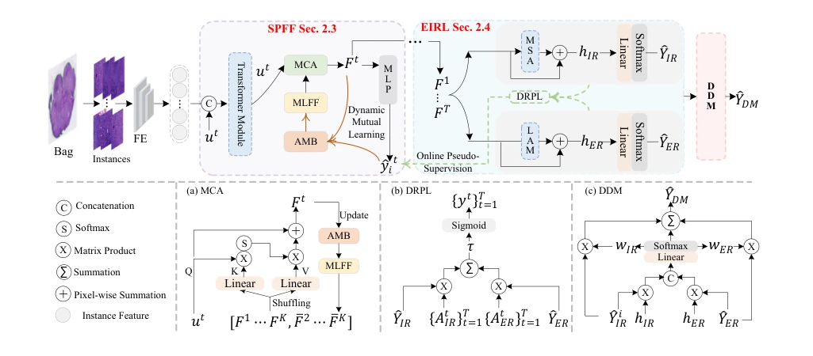
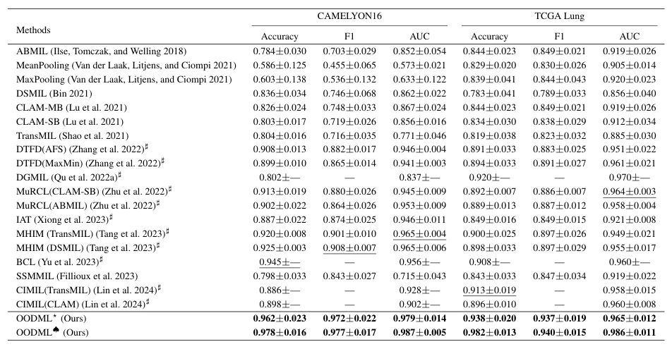

## OODML: Whole Slide Image Classification Meets Online Pseudo-Supervision and Dynamic Mutual Learning

> data: CAMELYON16、TCGA Lung、TCGA-ESCA、BRACS
>
> AAAI 2025 · [论文](https://doi.org/10.1609/aaai.v39i10.33154)

#### 引言

用自适应记忆库融合历史与当前特征，再联合修正伪标签和动态决策，使实例表示与伪监督相互促进。

#### 方法

（1）历史记忆：AMB 保存与标签相关的有效表示。

（2）伪监督修正：DRPL 根据伪包表示和包预测调整伪标签。

（3）互促决策：SPFF 更新表示与记忆，DDM 综合显式和隐式预测。

原文Figure 2，PDF 第 3 页。

#### 实验

##### 实验设置

对比包级与伪包/伪标签方法，并逐一移除记忆、伪标签修正、特征融合和动态决策。

##### 主要结果

DRPL 相对直接使用包标签的伪监督取得提升；完整框架还依赖记忆库提供的信息，不能单独归功于标签修正。

原文Table 1，PDF 第 6 页。

##### 消融与讨论

论文表 4 逐步比较 PBCE、DRPL、SPFF、DDM 等组合，并分析表示与伪监督之间的互促。

#### 参考文献

> OODML: Whole Slide Image Classification Meets Online Pseudo-Supervision and Dynamic Mutual Learning
>
> AAAI 2025 · [论文](https://doi.org/10.1609/aaai.v39i10.33154)
