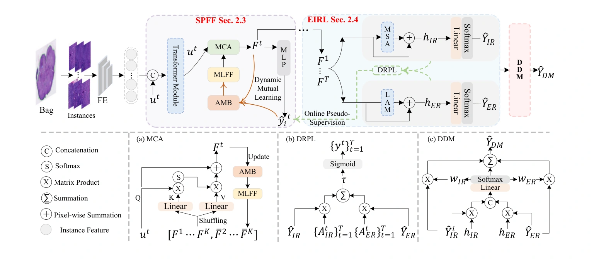
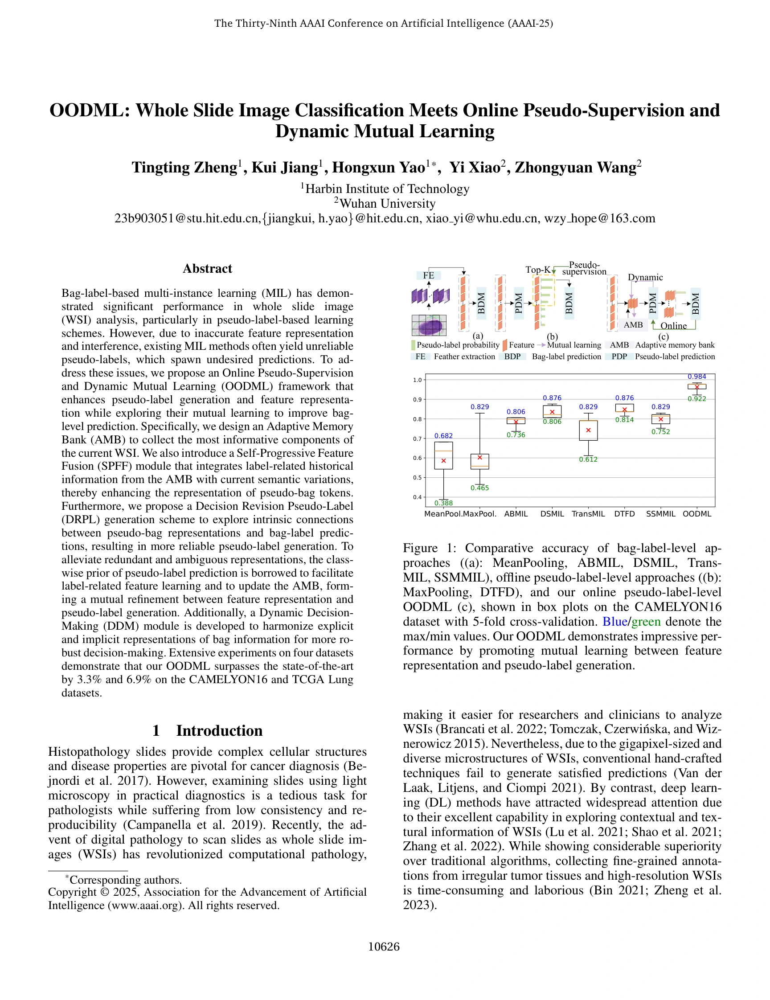
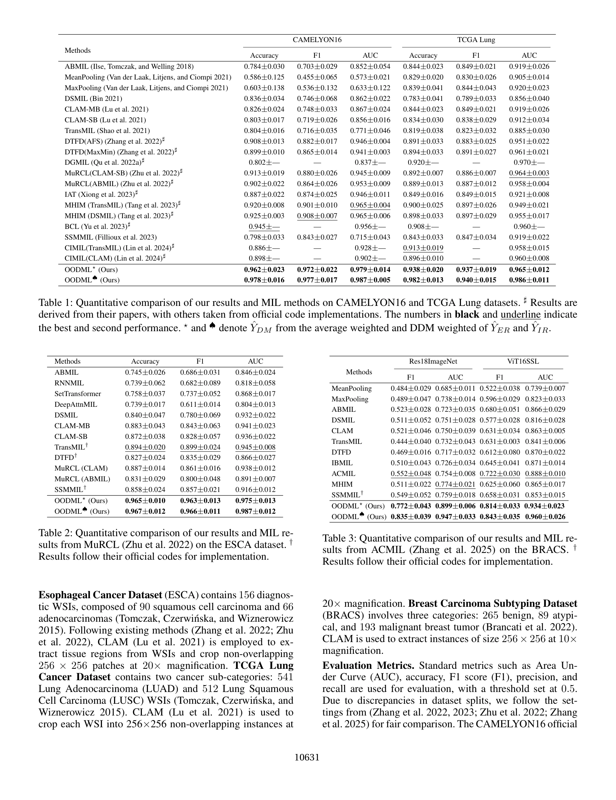
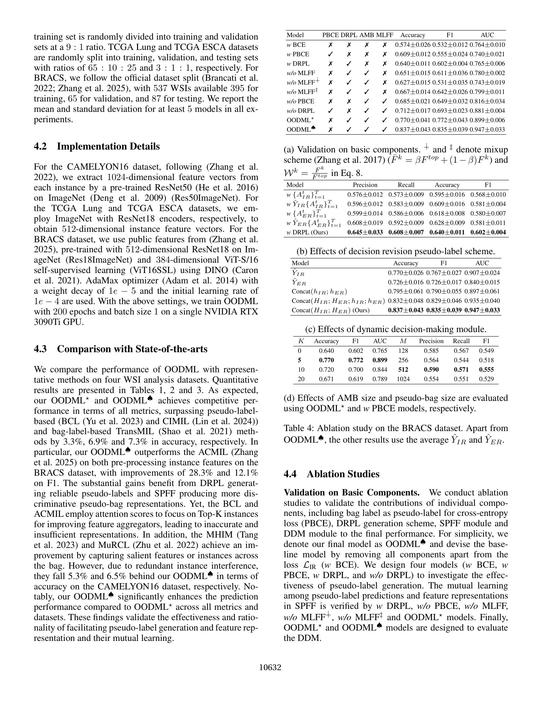

## OODML: Whole Slide Image Classification Meets Online Pseudo-Supervision and Dynamic Mutual Learning

> data: CAMELYON16、TCGA Lung、TCGA-ESCA、BRACS
>
> AAAI 2025 · [论文](https://doi.org/10.1609/aaai.v39i10.33154)

#### 引言

用自适应记忆库融合历史与当前特征，再联合修正伪标签和动态决策，使实例表示与伪监督相互促进。

#### 方法

（1）历史记忆：AMB 保存与标签相关的有效表示。

（2）伪监督修正：DRPL 根据伪包表示和包预测调整伪标签。

（3）互促决策：SPFF 更新表示与记忆，DDM 综合显式和隐式预测。

<!-- wsi-complete-model -->
##### 模型结构图

**图 2 · 模型结构**（PDF 第 3 页）

> 原文图注：Figure 2: The architecture of our proposed Online Pseudo-Supervision and Dynamic Mutual Learning (OODML) framework. It consists of a Self-Progressive Feature Fusion (SPFF) module and an Explicit-Implicit Representation Learning (EIRL) mod- ule for feature representation, a Decision Revision Pseudo-Label (DRPL) scheme for pseudo-label generation, and a Dynamic Decision-Making (DDM) module for bag label prediction. OODML employs a Feature Extractor (FE) to embed all instances into feature vectors and randomly sample vt at t. The SPFF takes vt and an initial class token ut as inputs into a Transformer module, enhancing ut using a Memory-based Cross-Attention (MCA) mechanism to fuse label-related information from the Adaptive Memory Bank (AMB) and Multi-Level Feature Fusion (MLFF) scheme into F t for reliable pseudo-label prediction ˆyt while updating the AMB. After that, the EIRL explores the explicit (hER) and implicit (hIR) bag representations by employ- ing a Linear Attention Module (LAM) and Multi-head Self-Attention (MSA), and predicts bag label probabilities ˆYER, ˆYIR, respectively. The DRPL introduces ˆYER, ˆYIR and attention scores (At ER, At IR) to generate pseudo-labels yt for supervision ˆyt. Finally, the DDM takes bag representations and label probabilities as inputs for better bag decision-making ˆYDM.

[查看原尺寸](assest/OODML/figure-2-complete.webp)

<!-- /wsi-complete-model -->

#### 实验

##### 实验设置

对比包级与伪包/伪标签方法，并逐一移除记忆、伪标签修正、特征融合和动态决策。

##### 主要结果

DRPL 相对直接使用包标签的伪监督取得提升；完整框架还依赖记忆库提供的信息，不能单独归功于标签修正。

<!-- wsi-complete-results -->
##### 完整实验指标与对照

下列实验原页保留表头、全部行列、子图、误差说明和脚注，点击可查看原尺寸。比较时请对应相同的数据集、特征编码器和训练设置；`±`、置信区间、百分比和小数均保留原文的单位与统计口径。

| 原表/图中指标 | 读取方式 |
| --- | --- |
| ACC / Accuracy | 越高越好；平衡准确率、平均准确率以原表标注为准 |

| 原文页 | 阅读内容 | 图表及正文引用 |
| --- | --- | --- |
| PDF 第 1 页 | 实验结果 | Figure 1 |
| PDF 第 6 页 | 实验结果 | Table 1、Table 2、Table 3 |
| PDF 第 7 页 | 消融与参数分析 | Table 4 |

**实验原页 · PDF 第 1 页**（图表及正文引用：Figure 1）

[查看原尺寸](assest/OODML/experiment-page-01.webp)

**实验原页 · PDF 第 6 页**（图表及正文引用：Table 1、Table 2、Table 3）

[查看原尺寸](assest/OODML/experiment-page-06.webp)

展开消融、参数、数据设置及效率原页

**实验原页 · PDF 第 7 页**（图表及正文引用：Table 4）

[查看原尺寸](assest/OODML/experiment-page-07.webp)

<!-- /wsi-complete-results -->

##### 消融与讨论

论文表 4 逐步比较 PBCE、DRPL、SPFF、DDM 等组合，并分析表示与伪监督之间的互促。

#### 参考文献

> OODML: Whole Slide Image Classification Meets Online Pseudo-Supervision and Dynamic Mutual Learning
>
> AAAI 2025 · [论文](https://doi.org/10.1609/aaai.v39i10.33154)
