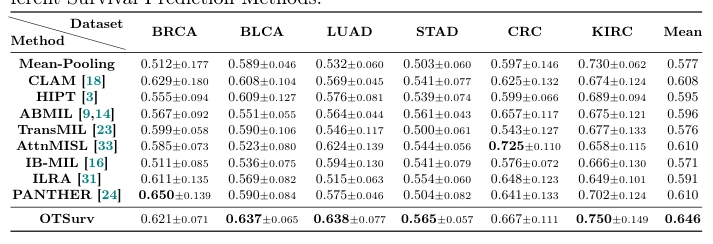

## OTSurv: A Novel Multiple Instance Learning Framework for Survival Prediction with Heterogeneity-aware Optimal Transport

> data: TCGA-BLCA、BRCA、LUAD、STAD、CRC、KIRC
>
> MICCAI 2025（PDF 与作者代码） · [论文](https://papers.miccai.org/miccai-2025/0660-Paper1359.html) · [作者代码](https://github.com/Y-Research-SBU/OTSurv)

#### 引言

将 WSI 生存预测写为异质性感知的非平衡最优传输问题，联合全局长尾形态约束与局部不确定性约束筛选信息。

#### 方法

（1）全局约束：把长尾组织形态先验写进传输质量分配。

（2）局部约束：按实例不确定性抑制噪声并渐增传输质量。

（3）非平衡 OT：用高效矩阵缩放求解后聚合为生存表示。

#### 实验

##### 实验设置

采用 UNI 特征、疾病特异生存标签和按来源分层的五折 C-index；K=16，传输质量比例在前十个 epochs 逐步增大。

##### 主要结果

六个癌种的高/低风险 log-rank 检验均报告 p<0.05；风险分组采用预测风险中位数。

原文Table 1，PDF 第 7 页。

##### 消融与讨论

消融全局长尾与局部不确定性约束，以及 OT 正则参数；病理组织类型热图另用于解释性验证。

#### 参考文献

> OTSurv: A Novel Multiple Instance Learning Framework for Survival Prediction with Heterogeneity-aware Optimal Transport
>
> MICCAI 2025（PDF 与作者代码） · [论文](https://papers.miccai.org/miccai-2025/0660-Paper1359.html) · [作者代码](https://github.com/Y-Research-SBU/OTSurv)
