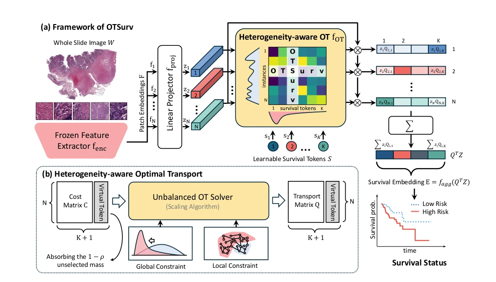
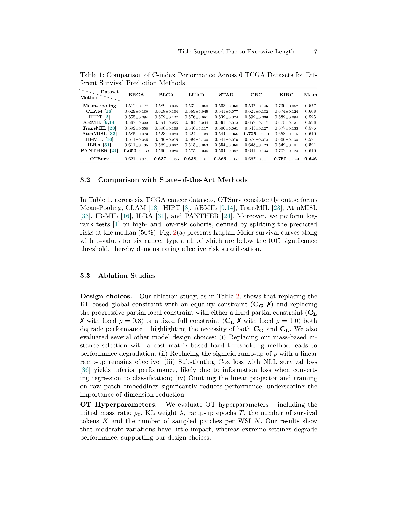
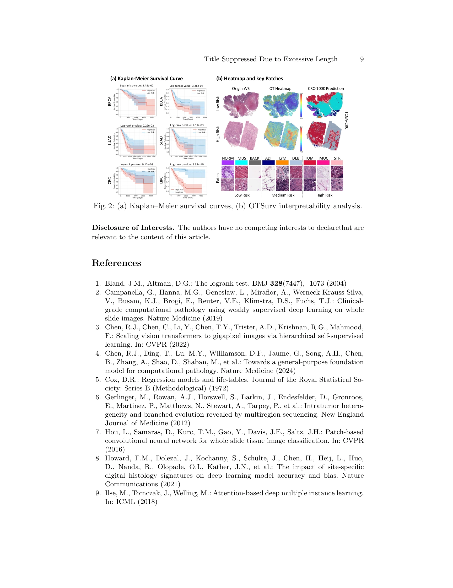
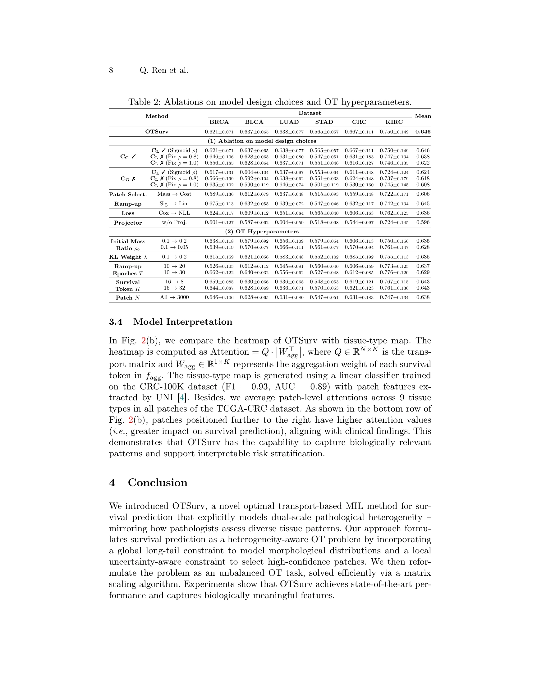

## OTSurv: A Novel Multiple Instance Learning Framework for Survival Prediction with Heterogeneity-aware Optimal Transport

> data: TCGA-BLCA、BRCA、LUAD、STAD、CRC、KIRC
>
> MICCAI 2025（PDF 与作者代码） · [论文](https://papers.miccai.org/miccai-2025/0660-Paper1359.html) · [作者代码](https://github.com/Y-Research-SBU/OTSurv)

#### 引言

将 WSI 生存预测写为异质性感知的非平衡最优传输问题，联合全局长尾形态约束与局部不确定性约束筛选信息。

#### 方法

（1）全局约束：把长尾组织形态先验写进传输质量分配。

（2）局部约束：按实例不确定性抑制噪声并渐增传输质量。

（3）非平衡 OT：用高效矩阵缩放求解后聚合为生存表示。

<!-- wsi-complete-model -->
##### 模型结构图

**图 1 · 模型结构**（PDF 第 3 页）

> 原文图注：Fig. 1: Overview of the OTSurv framework. (a) Framework of OTSurv: A WSI W is processed into patch features Z, aligned with survival tokens S via heterogeneity-aware OT, and aggregated into a survival embedding E. (b) heterogeneity-aware Optimal Transport: By extending the cost matrix with an additional column of zeros (i.e., virtual token), the unbalanced OT solver can be used for solving heterogeneity-aware OT with global and local constraints.

[查看原尺寸](assest/OTSurv/figure-1-complete.webp)

<!-- /wsi-complete-model -->

#### 实验

##### 实验设置

采用 UNI 特征、疾病特异生存标签和按来源分层的五折 C-index；K=16，传输质量比例在前十个 epochs 逐步增大。

##### 主要结果

六个癌种的高/低风险 log-rank 检验均报告 p<0.05；风险分组采用预测风险中位数。

<!-- wsi-complete-results -->
##### 完整实验指标与对照

下列实验原页保留表头、全部行列、子图、误差说明和脚注，点击可查看原尺寸。比较时请对应相同的数据集、特征编码器和训练设置；`±`、置信区间、百分比和小数均保留原文的单位与统计口径。

| 原表/图中指标 | 读取方式 |
| --- | --- |
| C-index | 越高越好；用于生存预测，需保留终点及删失设置 |

| 原文页 | 阅读内容 | 图表及正文引用 |
| --- | --- | --- |
| PDF 第 7 页 | 实验结果 | Table 1 |
| PDF 第 8 页 | 消融与参数分析 | Table 2 |
| PDF 第 9 页 | 实验结果 | Figure 2 |

**实验原页 · PDF 第 7 页**（图表及正文引用：Table 1）

[查看原尺寸](assest/OTSurv/experiment-page-07.webp)

**实验原页 · PDF 第 9 页**（图表及正文引用：Figure 2）

[查看原尺寸](assest/OTSurv/experiment-page-09.webp)

展开消融、参数、数据设置及效率原页

**实验原页 · PDF 第 8 页**（图表及正文引用：Table 2）

[查看原尺寸](assest/OTSurv/experiment-page-08.webp)

<!-- /wsi-complete-results -->

##### 消融与讨论

消融全局长尾与局部不确定性约束，以及 OT 正则参数；病理组织类型热图另用于解释性验证。

#### 参考文献

> OTSurv: A Novel Multiple Instance Learning Framework for Survival Prediction with Heterogeneity-aware Optimal Transport
>
> MICCAI 2025（PDF 与作者代码） · [论文](https://papers.miccai.org/miccai-2025/0660-Paper1359.html) · [作者代码](https://github.com/Y-Research-SBU/OTSurv)
