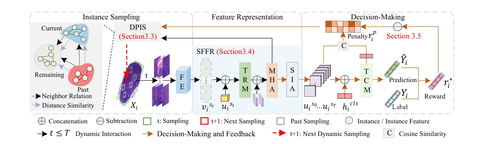
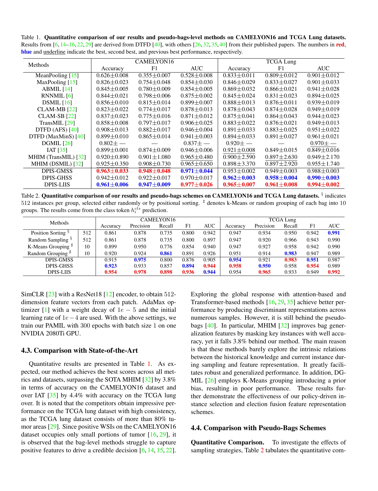
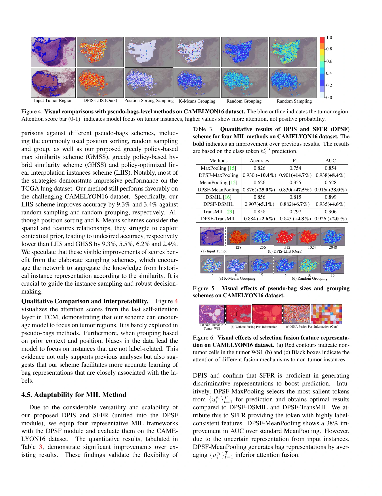
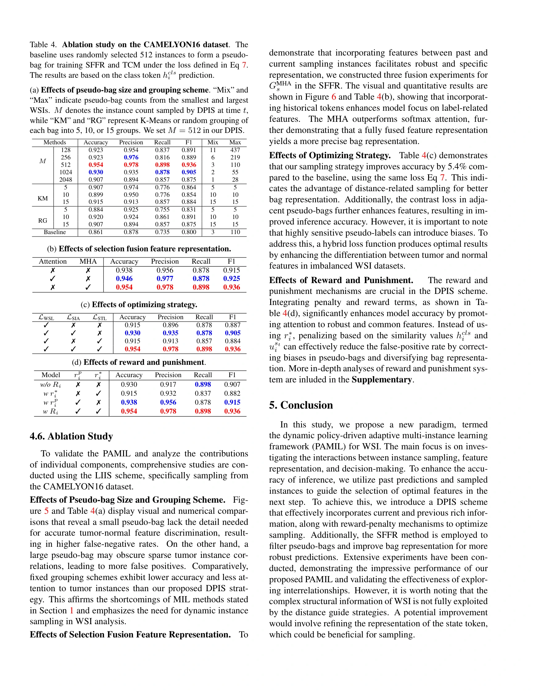

## Dynamic Policy-Driven Adaptive Multi-Instance Learning for Whole Slide Image Classification

> data: CAMELYON16、TCGA Lung Cancer
>
> CVPR 2024 · [论文](https://arxiv.org/abs/2403.07939) · [作者项目](https://vilab.hit.edu.cn/projects/pamil)

#### 引言

将动态实例采样和强化学习统一起来，结合实例关系建模、对比学习及奖惩机制，减少预处理负担和伪包偏差。

#### 方法

（1）动态采样：根据历史选择与奖励调整下一轮实例采样。

（2）关系表征：学习实例间潜在全局联系，生成更可靠的伪包特征。

（3）对比校正：借助奖惩和对比目标减少伪包先验偏差，完成包决策。

<!-- wsi-complete-model -->
##### 模型结构图

**图 2 · 模型结构**（PDF 第 3 页）

> 原文图注：Figure 2. Architecture of our proposed dynamic policy-driven adaptive multi-instance learning (PAMIL) framework. PAMIL consists of a dynamic policy-driven instance selection (DPIS) scheme, a selection fusion feature representation (SFFR) module, and a Transformer- based classification module (TCM). DPIS learns relationships among past, current, and remaining instances of Xi, and samples instances embedded as vst i using a feature extractor (FE). Then, SFFR takes vst i and an initial token ust i as inputs, refining ust i by utilizing a

[查看原尺寸](assest/PAMIL-Policy/figure-2-complete.webp)

<!-- /wsi-complete-model -->

#### 实验

##### 实验设置

对比包级 MIL、伪包/伪标签方法，以及不同实例分组和采样策略。

##### 主要结果

主表分别比较传统聚合器与伪包方法；各组件的效果应在相同采样预算下对照。

<!-- wsi-complete-results -->
##### 完整实验指标与对照

下列实验原页保留表头、全部行列、子图、误差说明和脚注，点击可查看原尺寸。比较时请对应相同的数据集、特征编码器和训练设置；`±`、置信区间、百分比和小数均保留原文的单位与统计口径。

| 原文页 | 阅读内容 | 图表及正文引用 |
| --- | --- | --- |
| PDF 第 6 页 | 实验结果 | Table 1、Table 2 |
| PDF 第 7 页 | 实验结果 | Table 3 |
| PDF 第 8 页 | 消融与参数分析 | Table 4 |

**实验原页 · PDF 第 6 页**（图表及正文引用：Table 1、Table 2）

[查看原尺寸](assest/PAMIL-Policy/experiment-page-06.webp)

**实验原页 · PDF 第 7 页**（图表及正文引用：Table 3）

[查看原尺寸](assest/PAMIL-Policy/experiment-page-07.webp)

展开消融、参数、数据设置及效率原页

**实验原页 · PDF 第 8 页**（图表及正文引用：Table 4）

[查看原尺寸](assest/PAMIL-Policy/experiment-page-08.webp)

<!-- /wsi-complete-results -->

##### 消融与讨论

消融动态策略 DPIS、特征关系模块和对比学习，并检验动态采样方案在多个 MIL 基线中的适用性。

#### 参考文献

> Dynamic Policy-Driven Adaptive Multi-Instance Learning for Whole Slide Image Classification
>
> CVPR 2024 · [论文](https://arxiv.org/abs/2403.07939) · [作者项目](https://vilab.hit.edu.cn/projects/pamil)
