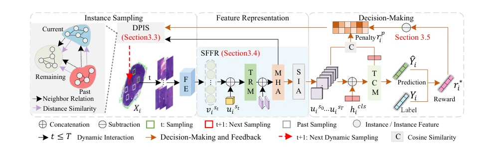
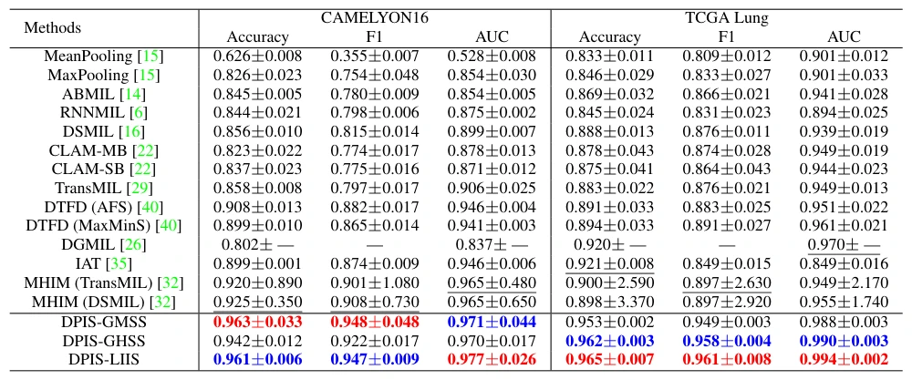

## Dynamic Policy-Driven Adaptive Multi-Instance Learning for Whole Slide Image Classification

> data: CAMELYON16、TCGA Lung Cancer
>
> CVPR 2024 · [论文](https://arxiv.org/abs/2403.07939) · [作者项目](https://vilab.hit.edu.cn/projects/pamil)

#### 引言

将动态实例采样和强化学习统一起来，结合实例关系建模、对比学习及奖惩机制，减少预处理负担和伪包偏差。

#### 方法

（1）动态采样：根据历史选择与奖励调整下一轮实例采样。

（2）关系表征：学习实例间潜在全局联系，生成更可靠的伪包特征。

（3）对比校正：借助奖惩和对比目标减少伪包先验偏差，完成包决策。

原文Figure 2，PDF 第 3 页。

#### 实验

##### 实验设置

对比包级 MIL、伪包/伪标签方法，以及不同实例分组和采样策略。

##### 主要结果

主表分别比较传统聚合器与伪包方法；各组件的效果应在相同采样预算下对照。

原文Table 1，PDF 第 6 页。

##### 消融与讨论

消融动态策略 DPIS、特征关系模块和对比学习，并检验动态采样方案在多个 MIL 基线中的适用性。

#### 参考文献

> Dynamic Policy-Driven Adaptive Multi-Instance Learning for Whole Slide Image Classification
>
> CVPR 2024 · [论文](https://arxiv.org/abs/2403.07939) · [作者项目](https://vilab.hit.edu.cn/projects/pamil)
