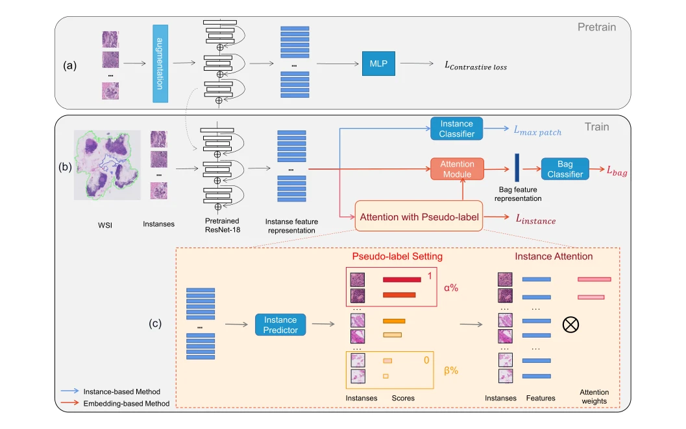
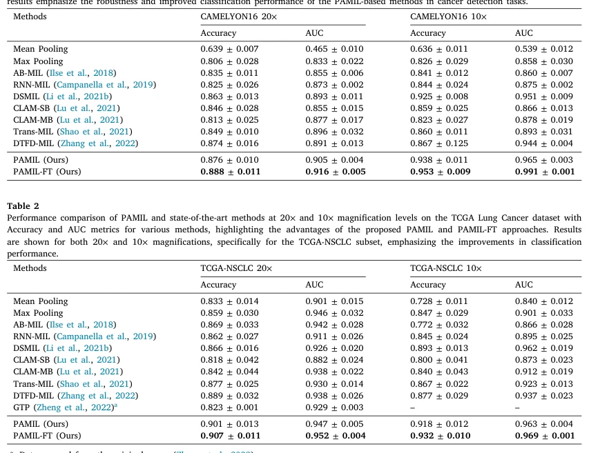

## Pseudo-label attention-based multiple instance learning for whole slide image classification

> data: CAMELYON16、TCGA-NSCLC
>
> Engineering Applications of Artificial Intelligence 2025 · [论文](https://doi.org/10.1016/j.engappai.2024.109908)

#### 引言

利用伪标签强化阳性区域的监督，并通过微调过滤假阳性、缓解正负区域不平衡；与动态策略 PAMIL 是不同论文。

#### 方法

（1）实例伪监督：以伪标签引导模型关注阳性组织。

（2）注意力聚合：按实例的下游贡献形成包表示。

（3）数据微调：过滤假阳性并缓解正负区域不平衡，改善后续训练。

原文Fig. 1，PDF 第 3 页。

#### 实验

##### 实验设置

使用切片级标签完成二分类，比较六类 MIL 基线与微调前后结果。

##### 主要结果

作者报告 TCGA-NSCLC 的 ACC/AUC 最高提升为 2.15/1.61 个百分点；需与动态策略 PAMIL 区分。

原文Table 1，PDF 第 6 页。

##### 消融与讨论

分析阳性伪标签注意力与假阳性数据过滤，两者对应不同训练环节。

#### 参考文献

> Pseudo-label attention-based multiple instance learning for whole slide image classification
>
> Engineering Applications of Artificial Intelligence 2025 · [论文](https://doi.org/10.1016/j.engappai.2024.109908)
