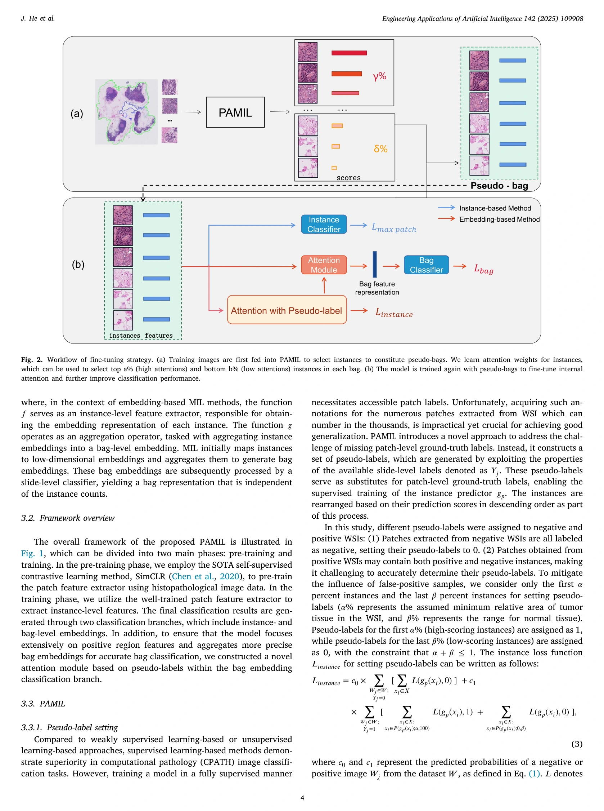
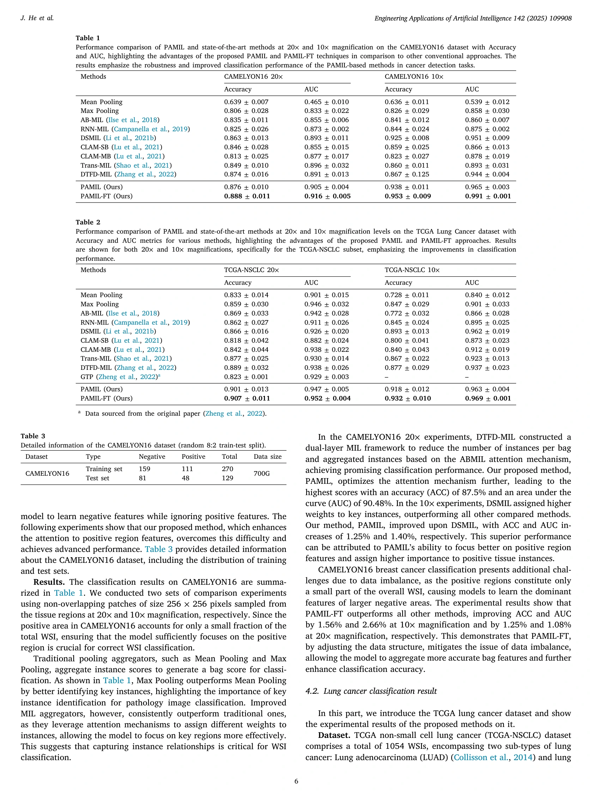
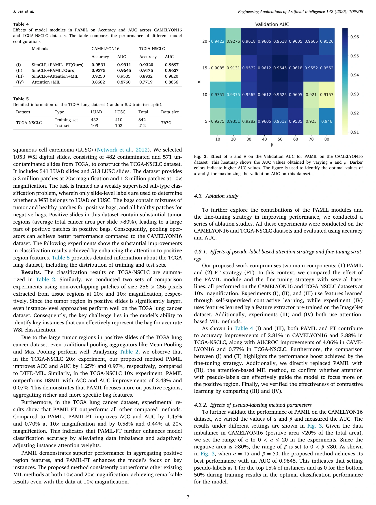
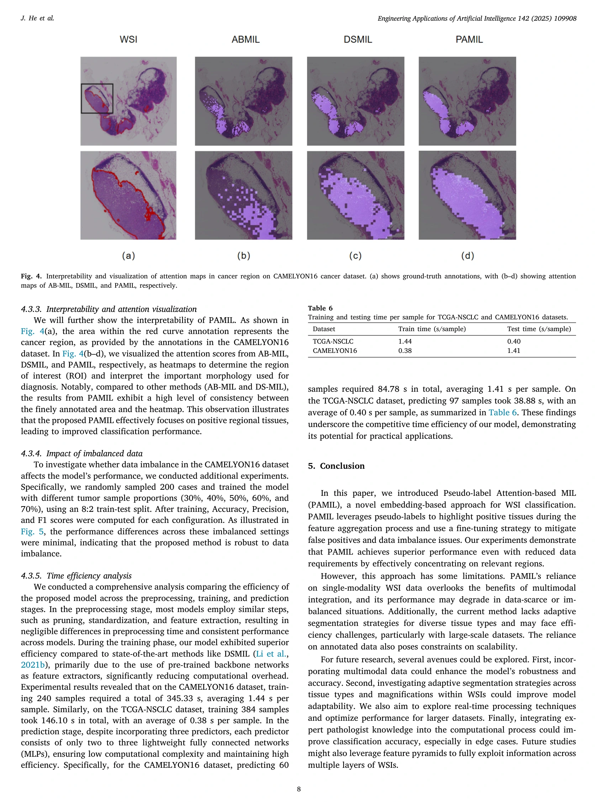
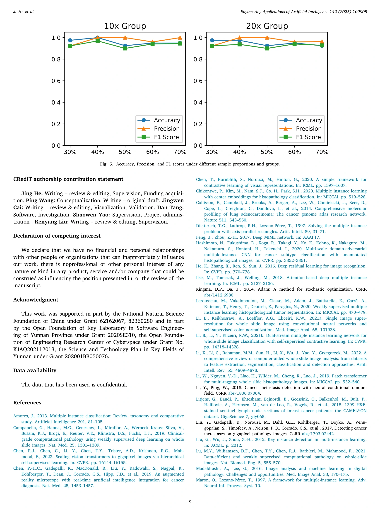

## Pseudo-label attention-based multiple instance learning for whole slide image classification

> data: CAMELYON16、TCGA-NSCLC
>
> Engineering Applications of Artificial Intelligence 2025 · [论文](https://doi.org/10.1016/j.engappai.2024.109908)

#### 引言

利用伪标签强化阳性区域的监督，并通过微调过滤假阳性、缓解正负区域不平衡；与动态策略 PAMIL 是不同论文。

#### 方法

（1）实例伪监督：以伪标签引导模型关注阳性组织。

（2）注意力聚合：按实例的下游贡献形成包表示。

（3）数据微调：过滤假阳性并缓解正负区域不平衡，改善后续训练。

<!-- wsi-complete-model -->
##### 模型结构图

**图 1 · 模型结构**（PDF 第 3 页）

> 原文图注：Fig. 1. Overview of PAMIL. (a) Each WSI is cropped into patches for feature extractor training by self-supervised contrastive learning. (b) Trained extractors are used to compute the embedding of each patch. Combination of instance-based and embedding-based methods are used together to obtain bag classification results, where key instance scores and bag ‘‘embeddings’’ aggregation are obtained based on attention with pseudo-label. (c) Attention with pseudo-label of PAMIL. The pseudo-label setting module scores instances by instance predictor and rearranges instances according to prediction scores. Selected top 𝛼% instances and bottom 𝛽% instances are pseudo-labeled as 1 and 0, respectively. The instance attention module aggregates instance probabilities into an attention matrix to weight top 𝛼% instances.

[查看原尺寸](assest/PAMIL-PseudoLabel/figure-1-complete.webp)

<!-- /wsi-complete-model -->

#### 实验

##### 实验设置

使用切片级标签完成二分类，比较六类 MIL 基线与微调前后结果。

##### 主要结果

作者报告 TCGA-NSCLC 的 ACC/AUC 最高提升为 2.15/1.61 个百分点；需与动态策略 PAMIL 区分。

<!-- wsi-complete-results -->
##### 完整实验指标与对照

下列实验原页保留表头、全部行列、子图、误差说明和脚注，点击可查看原尺寸。比较时请对应相同的数据集、特征编码器和训练设置；`±`、置信区间、百分比和小数均保留原文的单位与统计口径。

| 原表/图中指标 | 读取方式 |
| --- | --- |
| ROC-AUC / AUROC | 越高越好；若原表明确为 PR-AUC，则按 PR 曲线面积读取 |
| ACC / Accuracy | 越高越好；平衡准确率、平均准确率以原表标注为准 |
| F1 | 越高越好；保留 macro / weighted / micro 等平均方式 |
| Precision | 越高越好；需结合 Recall 及分类阈值 |

| 原文页 | 阅读内容 | 图表及正文引用 |
| --- | --- | --- |
| PDF 第 4 页 | 实验结果 | Figure 2 |
| PDF 第 6 页 | 实验结果 | Table 1、Table 2、Table 3 |
| PDF 第 7 页 | 实验结果 | Table 4、Table 5、Figure 3 |
| PDF 第 8 页 | 实验结果 | Table 6 |
| PDF 第 9 页 | 实验结果 | Figure 5 |

**实验原页 · PDF 第 4 页**（图表及正文引用：Figure 2）

[查看原尺寸](assest/PAMIL-PseudoLabel/experiment-page-04.webp)

**实验原页 · PDF 第 6 页**（图表及正文引用：Table 1、Table 2、Table 3）

[查看原尺寸](assest/PAMIL-PseudoLabel/experiment-page-06.webp)

**实验原页 · PDF 第 7 页**（图表及正文引用：Table 4、Table 5、Figure 3）

[查看原尺寸](assest/PAMIL-PseudoLabel/experiment-page-07.webp)

**实验原页 · PDF 第 8 页**（图表及正文引用：Table 6）

[查看原尺寸](assest/PAMIL-PseudoLabel/experiment-page-08.webp)

**实验原页 · PDF 第 9 页**（图表及正文引用：Figure 5）

[查看原尺寸](assest/PAMIL-PseudoLabel/experiment-page-09.webp)

<!-- /wsi-complete-results -->

##### 消融与讨论

分析阳性伪标签注意力与假阳性数据过滤，两者对应不同训练环节。

#### 参考文献

> Pseudo-label attention-based multiple instance learning for whole slide image classification
>
> Engineering Applications of Artificial Intelligence 2025 · [论文](https://doi.org/10.1016/j.engappai.2024.109908)
