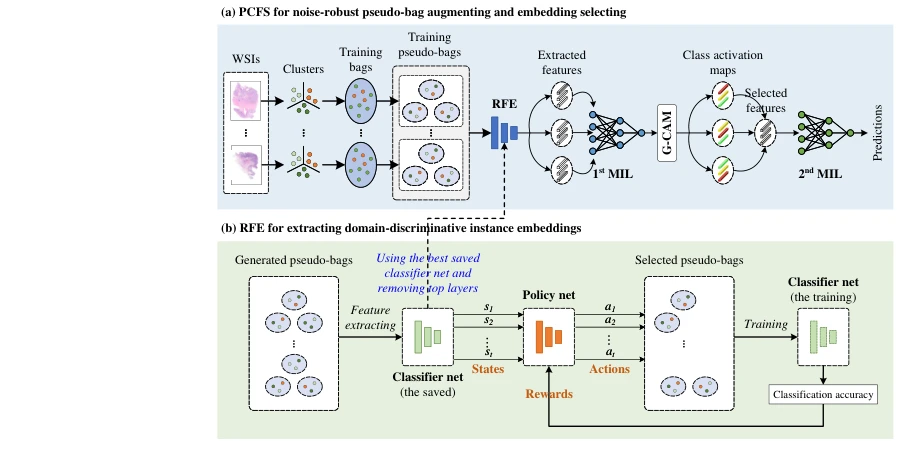
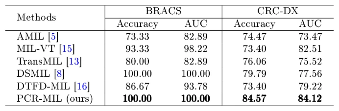

## PCR-MIL: Phenotype Clustering Reinforced Multiple Instance Learning for Whole Slide Image Classification

> data: BRACS、CRC-DX
>
> MICCAI 2025（PDF 与作者代码） · [论文](https://papers.miccai.org/miccai-2025/0681-Paper4174.html) · [作者代码](https://github.com/JingjiaoLou/PCR-MIL)

#### 引言

用表型聚类构建更可靠的伪包，并以 Grad-CAM 选择相关实例，再通过强化学习优化特征提取器，减少伪标签噪声。

#### 方法

（1）表型聚类：把不同组织模式的实例分配到较可靠的伪包。

（2）Grad-CAM 选择：寻找与正类有关的实例嵌入。

（3）强化编码器：利用较干净伪包优化特征提取器。

原文Fig. 4，PDF 第 5 页。

#### 实验

##### 实验设置

本文将 BRACS 处理为浸润性癌与非浸润病例的二分类，区别于常见三分类设置。

##### 主要结果

BRACS 的 ACC/AUC 均为 100%，与 DSMIL 持平；CRC-DX 的 ACC/AUC 为 84.57%/84.12%。

原文Table 1，PDF 第 7 页。

##### 消融与讨论

消融表型聚类选特征与强化学习编码器；不把小任务满分外推到原始完整 BRACS 分级。

#### 参考文献

> PCR-MIL: Phenotype Clustering Reinforced Multiple Instance Learning for Whole Slide Image Classification
>
> MICCAI 2025（PDF 与作者代码） · [论文](https://papers.miccai.org/miccai-2025/0681-Paper4174.html) · [作者代码](https://github.com/JingjiaoLou/PCR-MIL)
