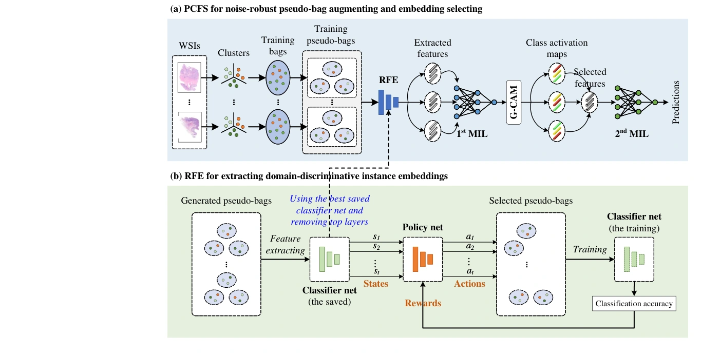
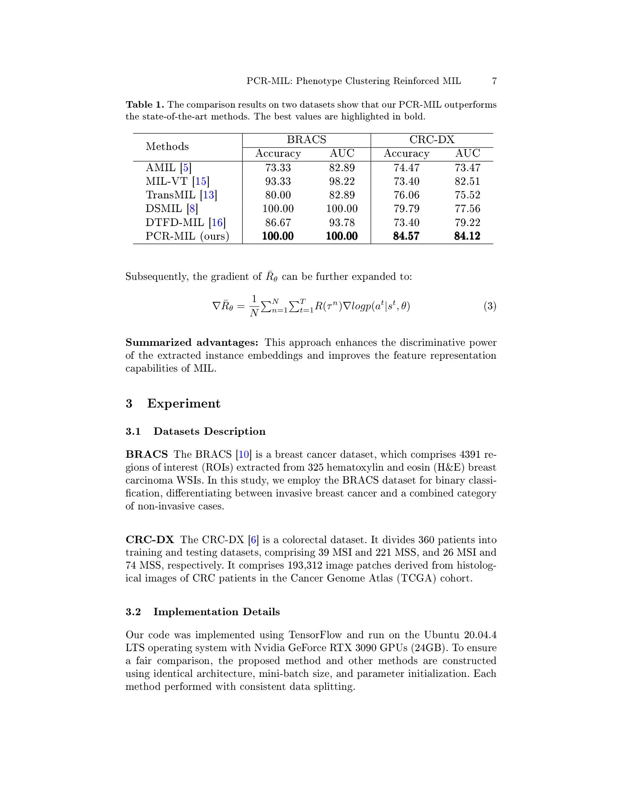
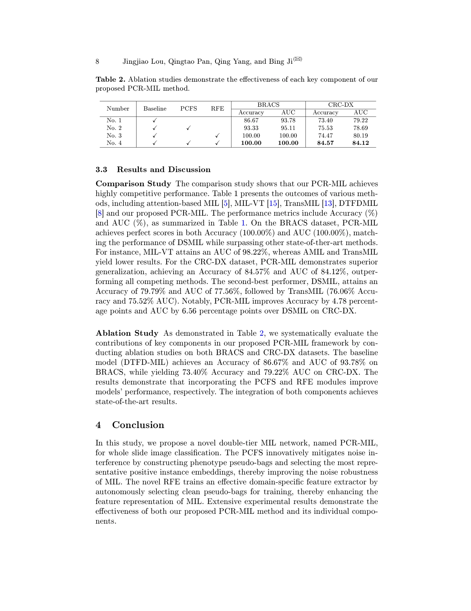

## PCR-MIL: Phenotype Clustering Reinforced Multiple Instance Learning for Whole Slide Image Classification

> data: BRACS、CRC-DX
>
> MICCAI 2025（PDF 与作者代码） · [论文](https://papers.miccai.org/miccai-2025/0681-Paper4174.html) · [作者代码](https://github.com/JingjiaoLou/PCR-MIL)

#### 引言

用表型聚类构建更可靠的伪包，并以 Grad-CAM 选择相关实例，再通过强化学习优化特征提取器，减少伪标签噪声。

#### 方法

（1）表型聚类：把不同组织模式的实例分配到较可靠的伪包。

（2）Grad-CAM 选择：寻找与正类有关的实例嵌入。

（3）强化编码器：利用较干净伪包优化特征提取器。

<!-- wsi-complete-model -->
##### 模型结构图

**图 4 · 模型结构**（PDF 第 5 页）

> 原文图注：Fig. 4. An overview of our proposed PCR-MIL. PCR-MIL comprises two primary components: (a) PCFS and (b) RFE. PCFS selects representative instance embeddings for nal prediction (the 2nd MIL). RFE uses RL to train an extractor to initially extract discriminative instance embeddings (the 1st MIL).

[查看原尺寸](assest/PCR-MIL/figure-4-complete.webp)

<!-- /wsi-complete-model -->

#### 实验

##### 实验设置

本文将 BRACS 处理为浸润性癌与非浸润病例的二分类，区别于常见三分类设置。

##### 主要结果

BRACS 的 ACC/AUC 均为 100%，与 DSMIL 持平；CRC-DX 的 ACC/AUC 为 84.57%/84.12%。

<!-- wsi-complete-results -->
##### 完整实验指标与对照

下列实验原页保留表头、全部行列、子图、误差说明和脚注，点击可查看原尺寸。比较时请对应相同的数据集、特征编码器和训练设置；`±`、置信区间、百分比和小数均保留原文的单位与统计口径。

| 原表/图中指标 | 读取方式 |
| --- | --- |
| ROC-AUC / AUROC | 越高越好；若原表明确为 PR-AUC，则按 PR 曲线面积读取 |
| ACC / Accuracy | 越高越好；平衡准确率、平均准确率以原表标注为准 |

| 原文页 | 阅读内容 | 图表及正文引用 |
| --- | --- | --- |
| PDF 第 7 页 | 实验结果 | Table 1 |
| PDF 第 8 页 | 消融与参数分析 | Table 2 |

**实验原页 · PDF 第 7 页**（图表及正文引用：Table 1）

[查看原尺寸](assest/PCR-MIL/experiment-page-07.webp)

展开消融、参数、数据设置及效率原页

**实验原页 · PDF 第 8 页**（图表及正文引用：Table 2）

[查看原尺寸](assest/PCR-MIL/experiment-page-08.webp)

<!-- /wsi-complete-results -->

##### 消融与讨论

消融表型聚类选特征与强化学习编码器；不把小任务满分外推到原始完整 BRACS 分级。

#### 参考文献

> PCR-MIL: Phenotype Clustering Reinforced Multiple Instance Learning for Whole Slide Image Classification
>
> MICCAI 2025（PDF 与作者代码） · [论文](https://papers.miccai.org/miccai-2025/0681-Paper4174.html) · [作者代码](https://github.com/JingjiaoLou/PCR-MIL)
