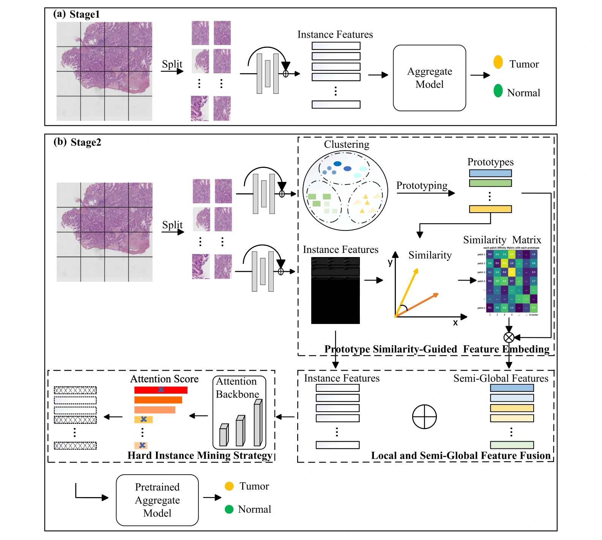
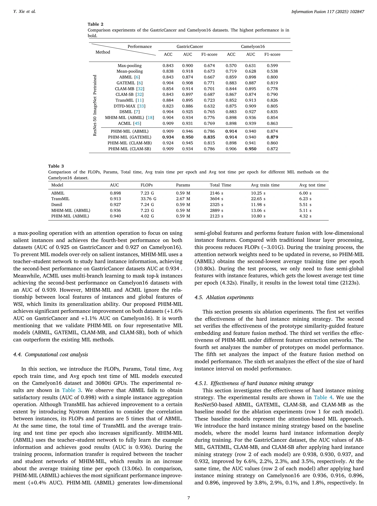
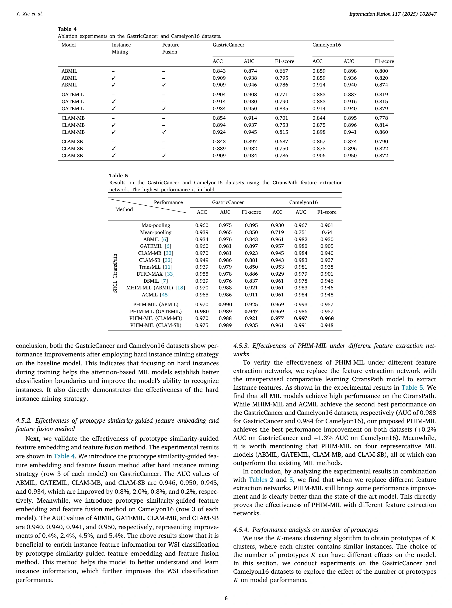
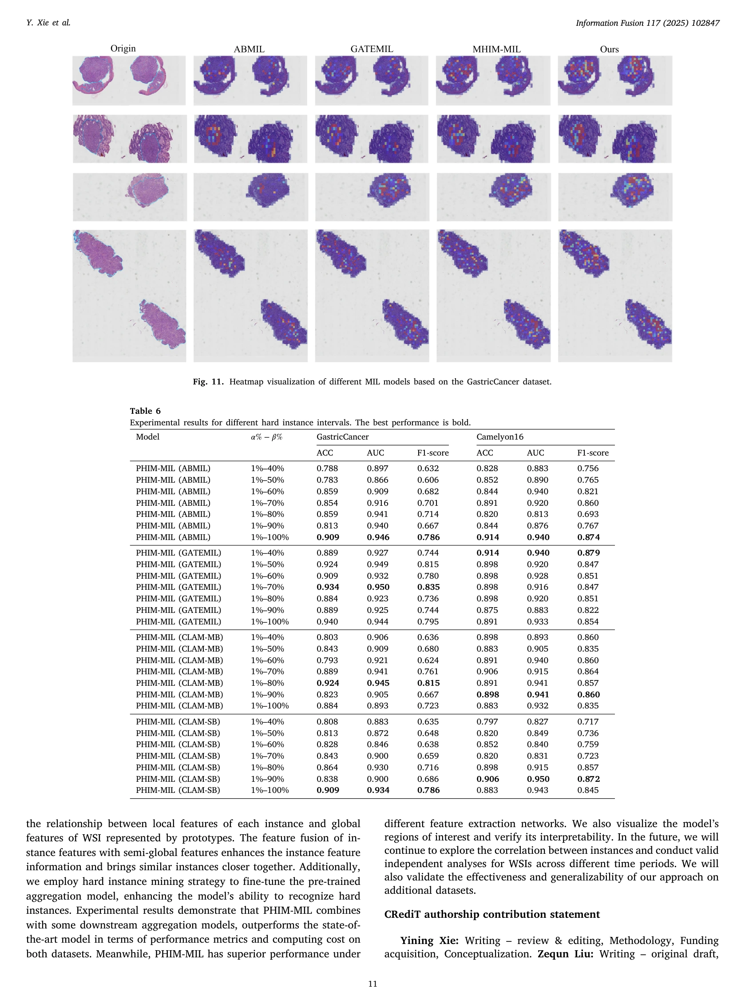
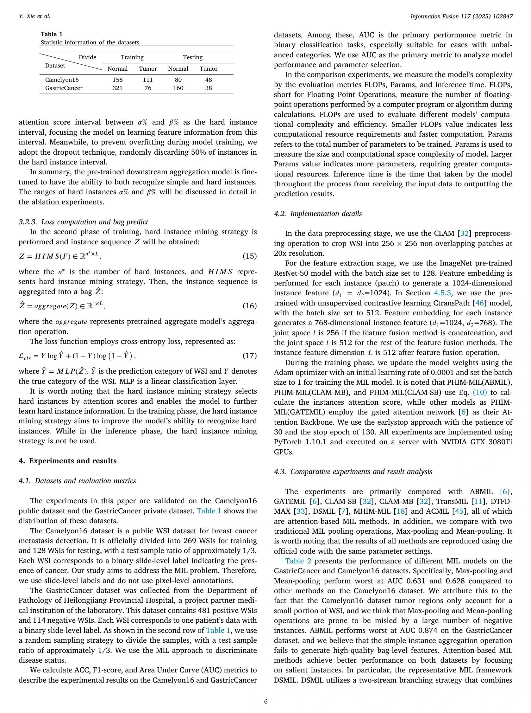

## PHIM-MIL: Multiple instance learning with prototype similarity-guided feature fusion and hard instance mining for whole slide image classification

> data: CAMELYON16、内部 GastricCancer
>
> Information Fusion 2025 · [论文](https://doi.org/10.1016/j.inffus.2024.102847) · [作者代码](https://github.com/Lliu666liuliu/PHIM-MIL)

#### 引言

先训练聚合器识别简单实例，再以原型相似度构建半全局特征并融合局部表示，结合困难实例挖掘加强复杂区域识别。

#### 方法

（1）聚合预训练：先让模型具备识别简单实例的能力。

（2）半全局融合：根据实例与原型相似度汇总同类组织上下文。

（3）困难实例：对融合后的表征进行 hard mining，再优化聚合器。

<!-- wsi-complete-model -->
##### 模型结构图

**图 3 · 模型结构**（PDF 第 4 页）

> 原文图注：Fig. 3. Overview of the proposed PHIM-MIL method. (a) The pre-trained process of the downstream aggregation model. (b) The fine-tuning process of the pre-trained downstream aggregation model. ⊕denotes the feature fusion operation.

[查看原尺寸](assest/PHIM-MIL/figure-3-complete.webp)

<!-- /wsi-complete-model -->

#### 实验

##### 实验设置

比较不同特征提取器、原型数 K 及两阶段训练；以 AUC 作为二分类主要指标。

##### 主要结果

主要证据是困难实例与原型引导融合的互补，而非仅增加一个聚类步骤；主表同时给出计算开销。

<!-- wsi-complete-results -->
##### 完整实验指标与对照

下列实验原页保留表头、全部行列、子图、误差说明和脚注，点击可查看原尺寸。比较时请对应相同的数据集、特征编码器和训练设置；`±`、置信区间、百分比和小数均保留原文的单位与统计口径。

| 原表/图中指标 | 读取方式 |
| --- | --- |
| ROC-AUC / AUROC | 越高越好；若原表明确为 PR-AUC，则按 PR 曲线面积读取 |
| 时间 / FLOPs / 参数量 | 结合硬件、包长度和计时范围比较；小模型不一定推理更快 |

| 原文页 | 阅读内容 | 图表及正文引用 |
| --- | --- | --- |
| PDF 第 6 页 | 数据与实验设置 | Table 1 |
| PDF 第 7 页 | 实验结果 | Table 2、Table 3 |
| PDF 第 8 页 | 实验结果 | Table 4、Table 5 |
| PDF 第 11 页 | 实验结果 | Table 6 |

**实验原页 · PDF 第 7 页**（图表及正文引用：Table 2、Table 3）

[查看原尺寸](assest/PHIM-MIL/experiment-page-07.webp)

**实验原页 · PDF 第 8 页**（图表及正文引用：Table 4、Table 5）

[查看原尺寸](assest/PHIM-MIL/experiment-page-08.webp)

**实验原页 · PDF 第 11 页**（图表及正文引用：Table 6）

[查看原尺寸](assest/PHIM-MIL/experiment-page-11.webp)

展开消融、参数、数据设置及效率原页

**实验原页 · PDF 第 6 页**（图表及正文引用：Table 1）

[查看原尺寸](assest/PHIM-MIL/experiment-page-06.webp)

<!-- /wsi-complete-results -->

##### 消融与讨论

分析原型数量、局部/半全局融合和困难实例挖掘，关注性能与计算成本的共同变化。

#### 参考文献

> PHIM-MIL: Multiple instance learning with prototype similarity-guided feature fusion and hard instance mining for whole slide image classification
>
> Information Fusion 2025 · [论文](https://doi.org/10.1016/j.inffus.2024.102847) · [作者代码](https://github.com/Lliu666liuliu/PHIM-MIL)
