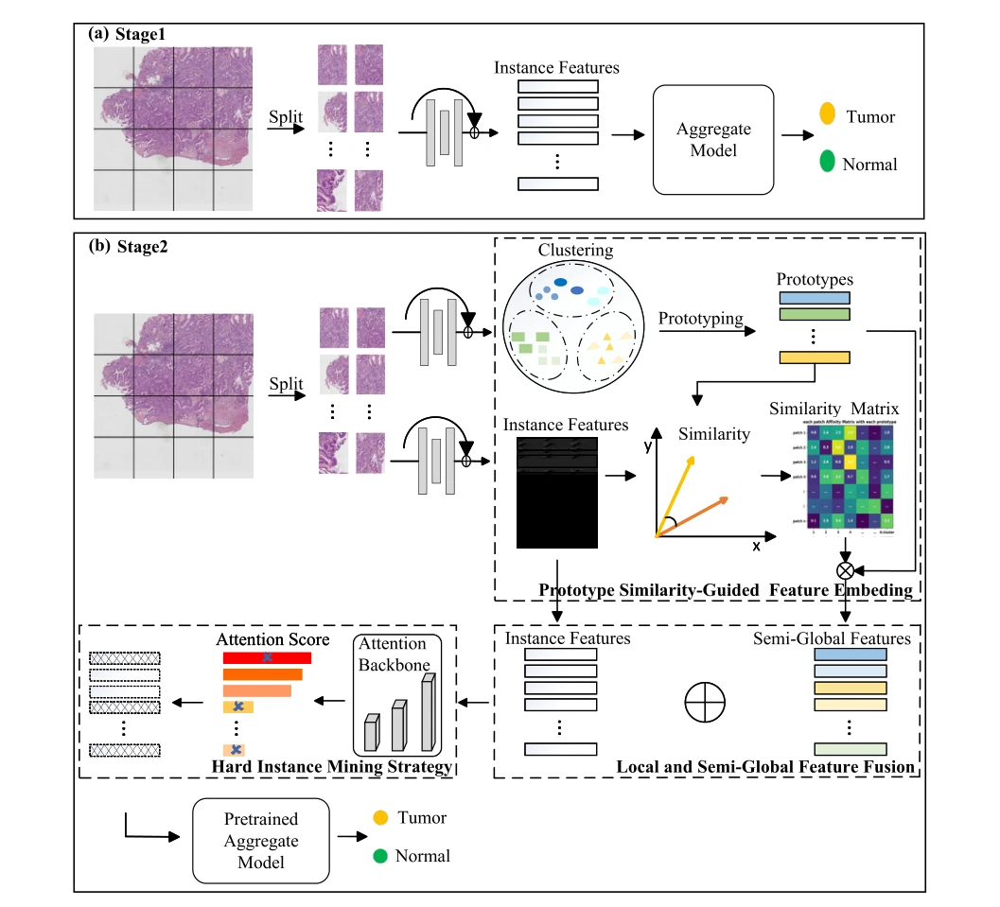
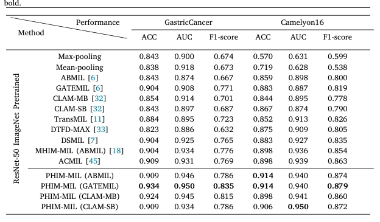

## PHIM-MIL: Multiple instance learning with prototype similarity-guided feature fusion and hard instance mining for whole slide image classification

> data: CAMELYON16、内部 GastricCancer
>
> Information Fusion 2025 · [论文](https://doi.org/10.1016/j.inffus.2024.102847) · [作者代码](https://github.com/Lliu666liuliu/PHIM-MIL)

#### 引言

先训练聚合器识别简单实例，再以原型相似度构建半全局特征并融合局部表示，结合困难实例挖掘加强复杂区域识别。

#### 方法

（1）聚合预训练：先让模型具备识别简单实例的能力。

（2）半全局融合：根据实例与原型相似度汇总同类组织上下文。

（3）困难实例：对融合后的表征进行 hard mining，再优化聚合器。

原文Fig. 3，PDF 第 4 页。

#### 实验

##### 实验设置

比较不同特征提取器、原型数 K 及两阶段训练；以 AUC 作为二分类主要指标。

##### 主要结果

主要证据是困难实例与原型引导融合的互补，而非仅增加一个聚类步骤；主表同时给出计算开销。

原文Table 2，PDF 第 7 页。

##### 消融与讨论

分析原型数量、局部/半全局融合和困难实例挖掘，关注性能与计算成本的共同变化。

#### 参考文献

> PHIM-MIL: Multiple instance learning with prototype similarity-guided feature fusion and hard instance mining for whole slide image classification
>
> Information Fusion 2025 · [论文](https://doi.org/10.1016/j.inffus.2024.102847) · [作者代码](https://github.com/Lliu666liuliu/PHIM-MIL)
