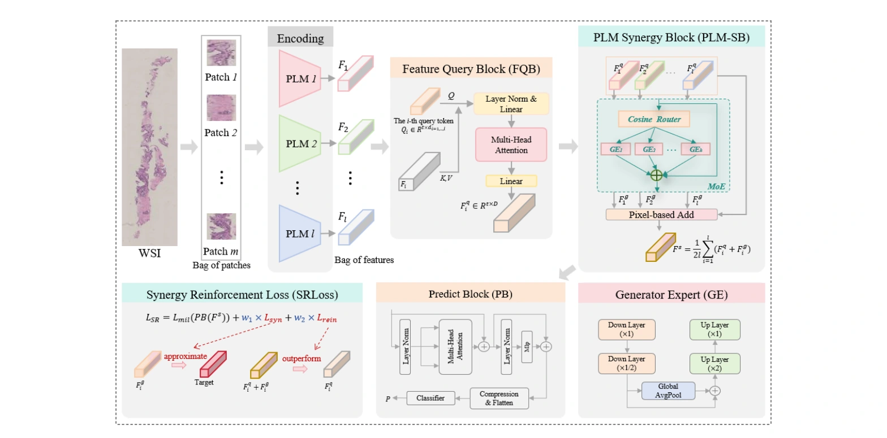
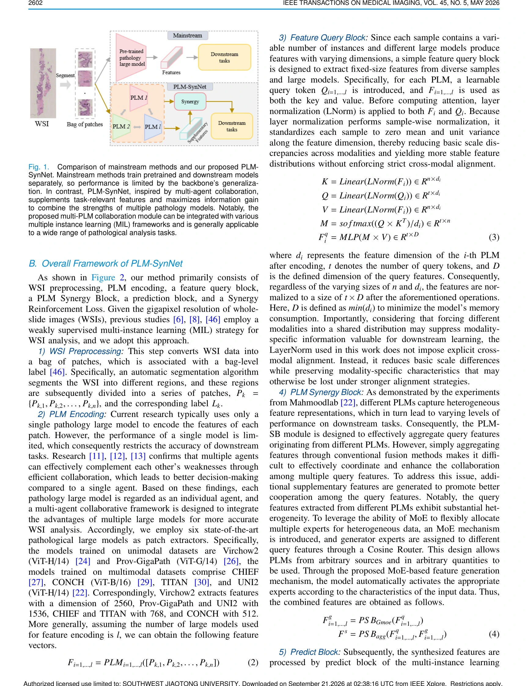
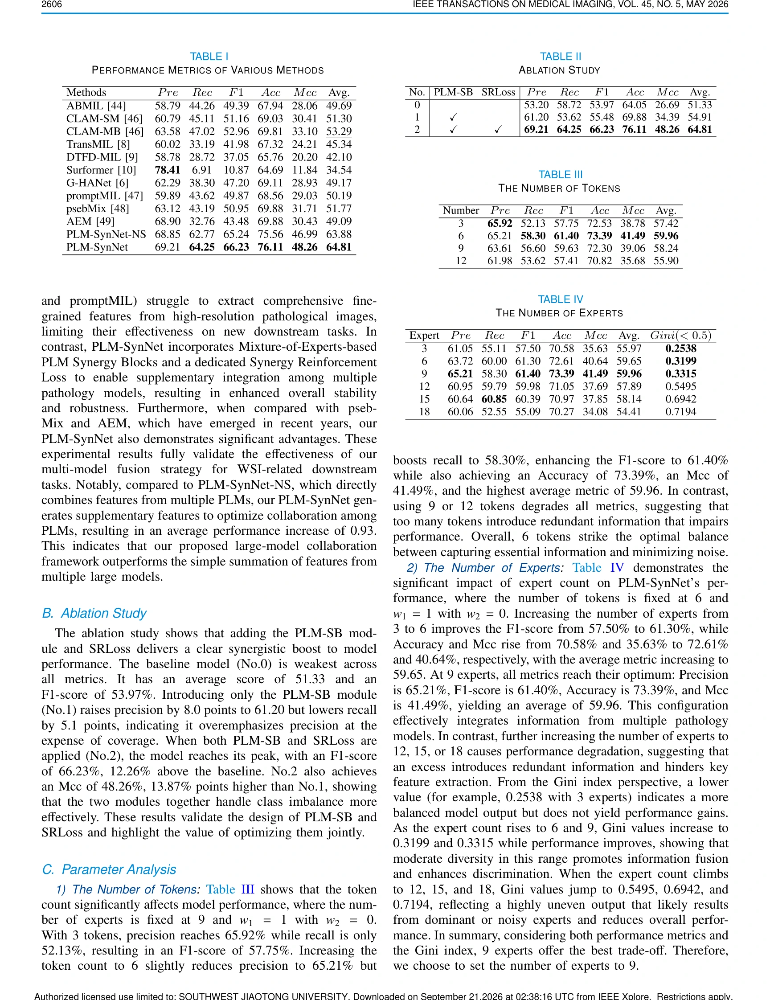
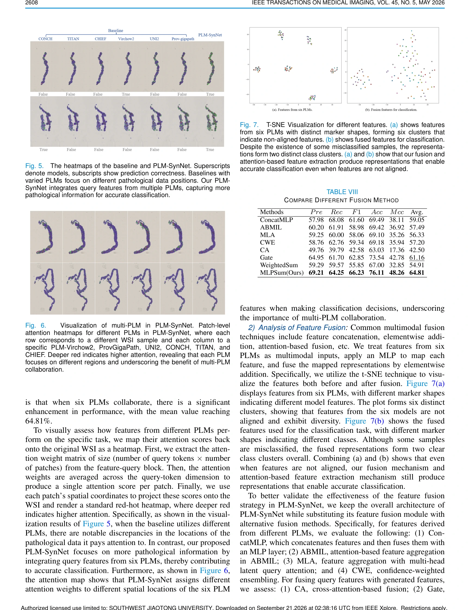
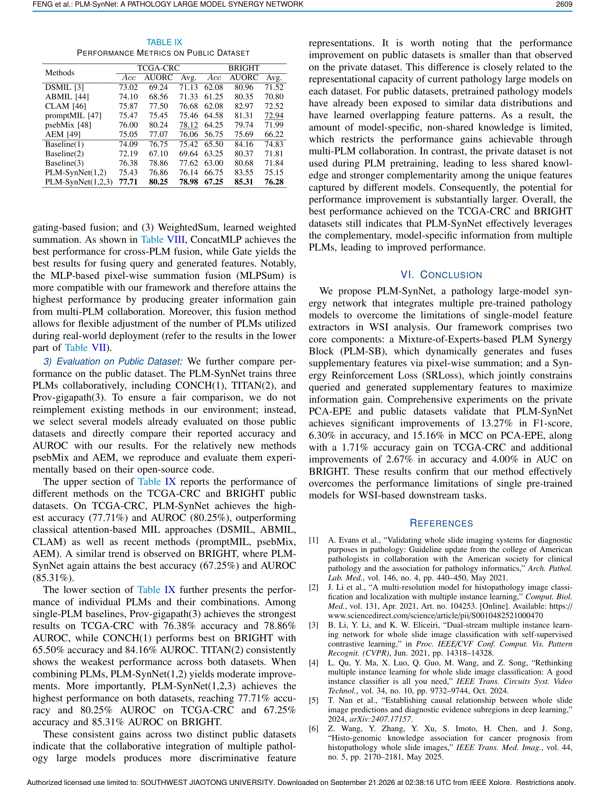
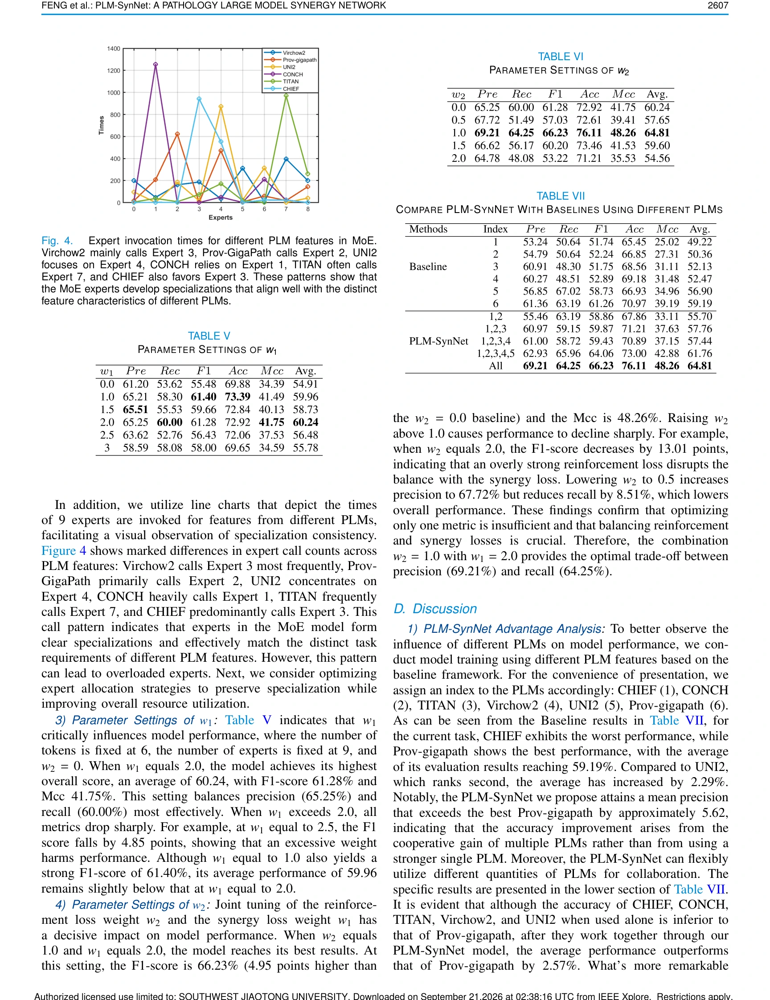

## PLM-SynNet: A Pathology Large Model Synergy Network Based on Multi-Instance Learning for Whole Slide Imaging Classification

> data: 内部 PCA-EPE、TCGA-CRC、BRIGHT
>
> IEEE Transactions on Medical Imaging 2026 · [论文](https://doi.org/10.1109/TMI.2026.3657524) · [作者代码](https://github.com/mathfyy/PLM-SynNet)

#### 引言

以专家混合模块协同多个病理基础模型，生成并融合互补特征，再通过协同强化损失提升任务相关的信息增益。

#### 方法

（1）多模型编码：从多个病理基础模型获得互补表征。

（2）PLM-SB：以 MoE 特征生成专家形成补充信息。

（3）SRLoss：共同约束查询与生成特征，增强协同带来的信息增益。

<!-- wsi-complete-model -->
##### 模型结构图

**图 2 · 模型结构**（PDF 第 5 页）

> 原文图注：Fig. 2. Overall framework of PLM-SynNet. Our method includes WSI preprocessing, PLM encoding, feature query block, PLM Synergy Block (PLM-SB), predict block, and Synergy Reinforcement Loss (SRLoss), where the feature query block unifies the dimensions of features extracted from different PLMs. We introduce two core components: the PLM-SB flexibly integrates query features from multiple PLMs and employs a Mixture- of-Experts to dynamically generate task-specific supplementary features, and the SRLoss builds on this module by strengthening feature relevance to the downstream task and ensuring that the combined features outperform individual query features.

[查看原尺寸](assest/PLM-SynNet/figure-2-complete.webp)

<!-- /wsi-complete-model -->

#### 实验

##### 实验设置

使用六种病理基础模型作为特征来源，并在统一条件下做五折及补充特征消融。

##### 主要结果

PCA-EPE 的 Precision/Recall/F1/ACC 为 69.21%/64.25%/66.23%/76.11%，对应内部任务而非所有公开数据。

<!-- wsi-complete-results -->
##### 完整实验指标与对照

下列实验原页保留表头、全部行列、子图、误差说明和脚注，点击可查看原尺寸。比较时请对应相同的数据集、特征编码器和训练设置；`±`、置信区间、百分比和小数均保留原文的单位与统计口径。

| 原表/图中指标 | 读取方式 |
| --- | --- |
| ACC / Accuracy | 越高越好；平衡准确率、平均准确率以原表标注为准 |
| F1 | 越高越好；保留 macro / weighted / micro 等平均方式 |
| Precision | 越高越好；需结合 Recall 及分类阈值 |
| Recall / Sensitivity | 越高越好；与固定敏感度下的特异度区别读取 |

| 原文页 | 阅读内容 | 图表及正文引用 |
| --- | --- | --- |
| PDF 第 4 页 | 实验结果 | Figure 1 |
| PDF 第 8 页 | 实验结果 | Table I、Table II、Table III、Table IV |
| PDF 第 9 页 | 数据与实验设置 | Table V、Table VI、Table VII |
| PDF 第 10 页 | 实验结果 | Table VIII |
| PDF 第 11 页 | 实验结果 | Table IX |

**实验原页 · PDF 第 4 页**（图表及正文引用：Figure 1）

[查看原尺寸](assest/PLM-SynNet/experiment-page-04.webp)

**实验原页 · PDF 第 8 页**（图表及正文引用：Table I、Table II、Table III、Table IV）

[查看原尺寸](assest/PLM-SynNet/experiment-page-08.webp)

**实验原页 · PDF 第 10 页**（图表及正文引用：Table VIII）

[查看原尺寸](assest/PLM-SynNet/experiment-page-10.webp)

**实验原页 · PDF 第 11 页**（图表及正文引用：Table IX）

[查看原尺寸](assest/PLM-SynNet/experiment-page-11.webp)

展开消融、参数、数据设置及效率原页

**实验原页 · PDF 第 9 页**（图表及正文引用：Table V、Table VI、Table VII）

[查看原尺寸](assest/PLM-SynNet/experiment-page-09.webp)

<!-- /wsi-complete-results -->

##### 消融与讨论

比较直接多模型特征（NS）与生成补充特征的协同网络，以及协同强化损失；推理成本包含多个基础模型。

#### 参考文献

> PLM-SynNet: A Pathology Large Model Synergy Network Based on Multi-Instance Learning for Whole Slide Imaging Classification
>
> IEEE Transactions on Medical Imaging 2026 · [论文](https://doi.org/10.1109/TMI.2026.3657524) · [作者代码](https://github.com/mathfyy/PLM-SynNet)
