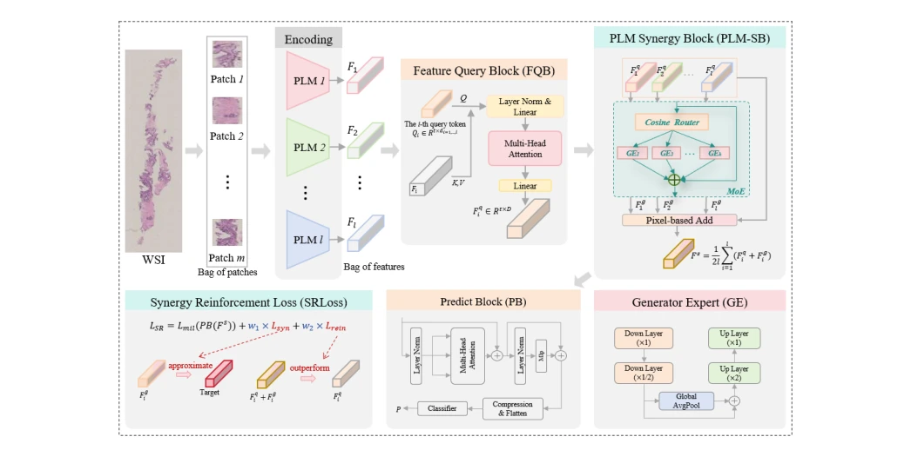

## PLM-SynNet: A Pathology Large Model Synergy Network Based on Multi-Instance Learning for Whole Slide Imaging Classification

> data: 内部 PCA-EPE、TCGA-CRC、BRIGHT
>
> IEEE Transactions on Medical Imaging 2026 · [论文](https://doi.org/10.1109/TMI.2026.3657524) · [作者代码](https://github.com/mathfyy/PLM-SynNet)

#### 引言

以专家混合模块协同多个病理基础模型，生成并融合互补特征，再通过协同强化损失提升任务相关的信息增益。

#### 方法

（1）多模型编码：从多个病理基础模型获得互补表征。

（2）PLM-SB：以 MoE 特征生成专家形成补充信息。

（3）SRLoss：共同约束查询与生成特征，增强协同带来的信息增益。

原文Fig. 2，PDF 第 5 页。

#### 实验

##### 实验设置

使用六种病理基础模型作为特征来源，并在统一条件下做五折及补充特征消融。

##### 主要结果

PCA-EPE 的 Precision/Recall/F1/ACC 为 69.21%/64.25%/66.23%/76.11%，对应内部任务而非所有公开数据。

##### 消融与讨论

比较直接多模型特征（NS）与生成补充特征的协同网络，以及协同强化损失；推理成本包含多个基础模型。

#### 参考文献

> PLM-SynNet: A Pathology Large Model Synergy Network Based on Multi-Instance Learning for Whole Slide Imaging Classification
>
> IEEE Transactions on Medical Imaging 2026 · [论文](https://doi.org/10.1109/TMI.2026.3657524) · [作者代码](https://github.com/mathfyy/PLM-SynNet)
