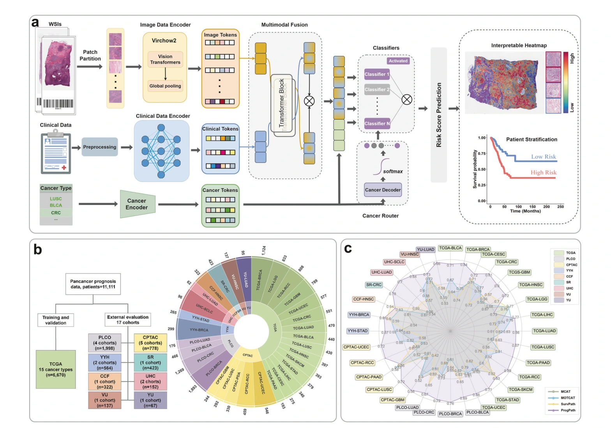
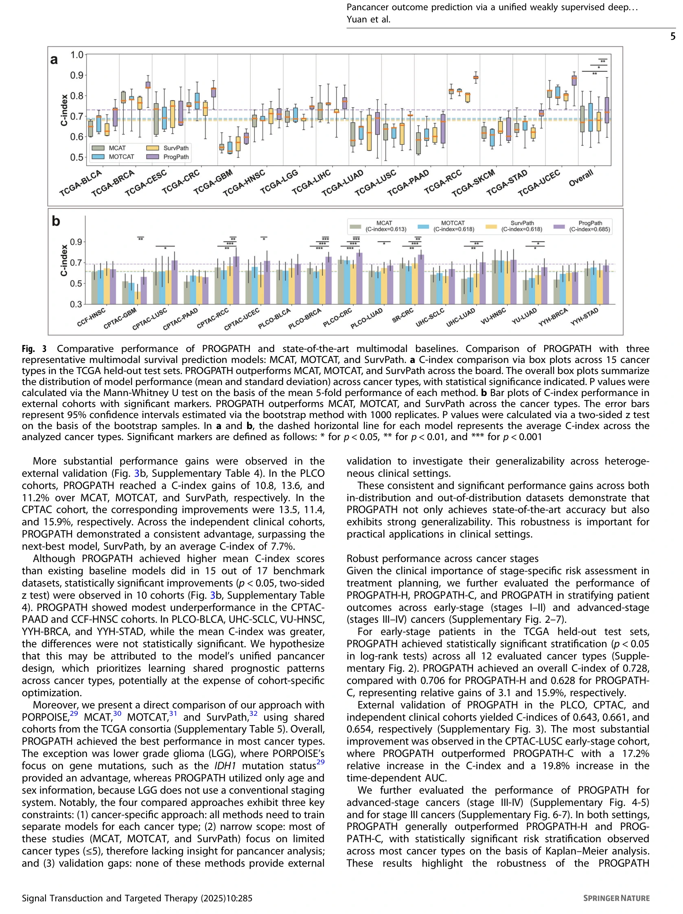
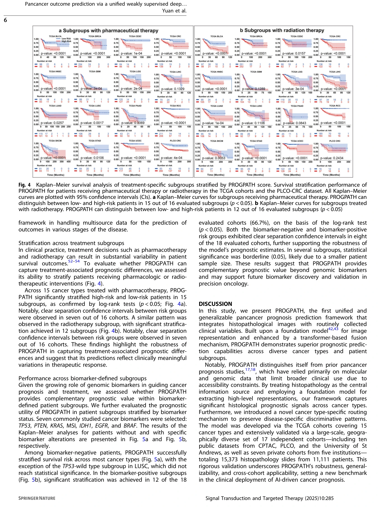
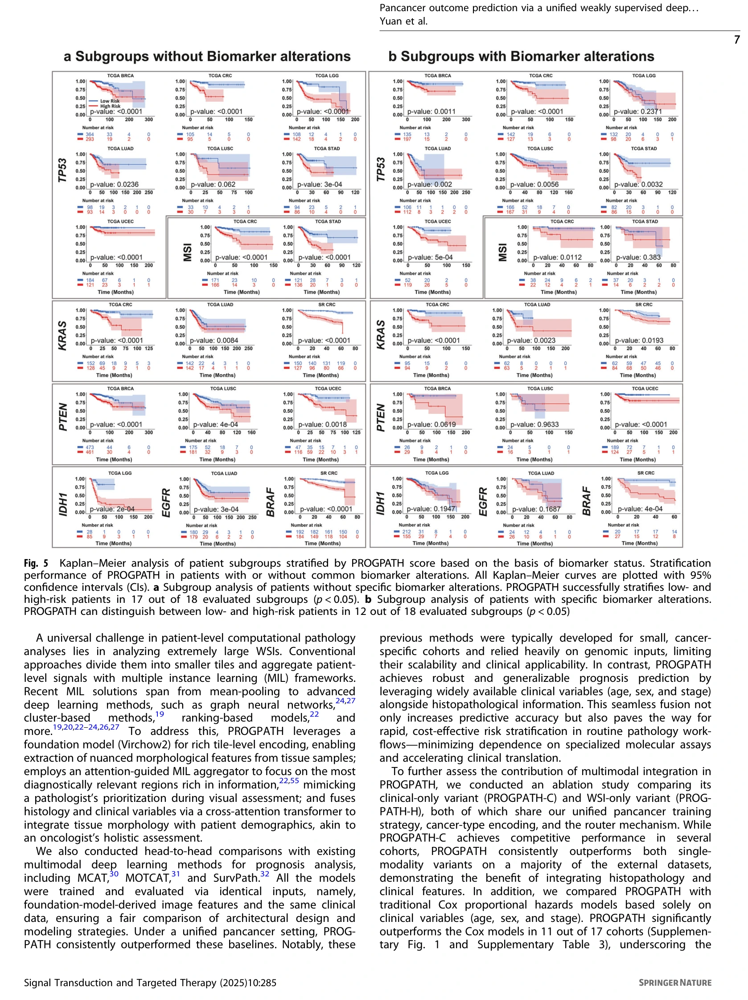
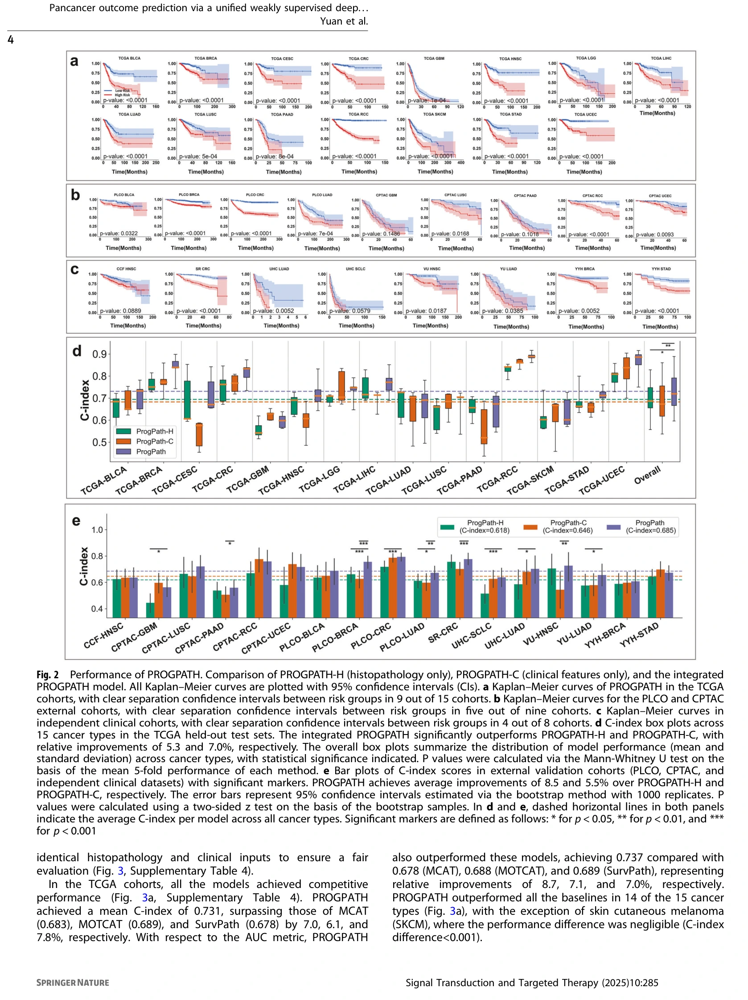

## Pancancer outcome prediction via a unified weakly supervised deep learning model

> data: 15 癌种 TCGA 训练数据，17 个独立外部队列
>
> Signal Transduction and Targeted Therapy 2025 · [论文](https://doi.org/10.1038/s41392-025-02374-w) · [作者代码](https://github.com/Valeyards/ProgPath)

#### 引言

将基础模型提取的病理特征与常规临床变量经注意力及交叉注意力融合，构建统一的泛癌预后预测框架，并开展外部队列验证。

#### 方法

（1）病理编码：用基础模型提取实例，经注意力 MIL 汇总。

（2）临床融合：以交叉注意力结合年龄、性别、分期等常规变量。

（3）路由预测：适配多癌种差异，形成统一的预后风险输出。

<!-- wsi-complete-model -->
##### 模型结构图

**图 1 · 模型结构**（PDF 第 3 页）

> 原文图注：Fig. 1 Overview of the prognostic prediction model (PROGPATH). a Workflows of PROGPATH. The input consists of digitized hematoxylin and eosin (H&E) slides, corresponding clinical variables, and cancer type information. Patch-level features are extracted from WSIs using Virchow2—a Vision Transformer-based foundation model pretrained for computational pathology. Clinical and cancer-type features are embedded via two independent fully connected networks. The image and clinical data representations are fused using a cross-attention transformer to model intermodal interactions. The fused representations are further concatenated with cancer-specific tokens, which are decoded into adaptive activation weights for a cancer-aware router. This router dynamically selects among domain-specific classifiers, enabling the generation of accurate and cancer-tailored survival predictions. b Data distribution. PROGPATH was developed using the TCGA cohorts (n = 6670) and has been extensively evaluated on 17 independent datasets (n = 42441), covering total of 15 cancer types. n represents the number of patients. c Overall performance in terms of the concordance index (C-index). PROGPATH significantly outperforms other methods across 32 datasets comprising 15,373 slides

[查看原尺寸](assest/PROGPATH/figure-1-complete.webp)

<!-- /wsi-complete-model -->

#### 实验

##### 实验设置

TCGA 按癌种分层五折、训练/验证 4:1；训练 20 epochs，评价 C-index、时间依赖 AUC、KM/log-rank。

##### 主要结果

TCGA 平均 C-index 为 0.731，病理单模态为 0.694、临床单模态为 0.683；相对提升与绝对差值需区分。

<!-- wsi-complete-results -->
##### 完整实验指标与对照

下列实验原页保留表头、全部行列、子图、误差说明和脚注，点击可查看原尺寸。比较时请对应相同的数据集、特征编码器和训练设置；`±`、置信区间、百分比和小数均保留原文的单位与统计口径。

| 原表/图中指标 | 读取方式 |
| --- | --- |
| ROC-AUC / AUROC | 越高越好；若原表明确为 PR-AUC，则按 PR 曲线面积读取 |
| C-index | 越高越好；用于生存预测，需保留终点及删失设置 |

| 原文页 | 阅读内容 | 图表及正文引用 |
| --- | --- | --- |
| PDF 第 4 页 | 数据与实验设置 | Figure 2 |
| PDF 第 5 页 | 实验结果 | Figure 3 |
| PDF 第 6 页 | 实验结果 | Figure 4 |
| PDF 第 7 页 | 实验结果 | Figure 5 |

**实验原页 · PDF 第 5 页**（图表及正文引用：Figure 3）

[查看原尺寸](assest/PROGPATH/experiment-page-05.webp)

**实验原页 · PDF 第 6 页**（图表及正文引用：Figure 4）

[查看原尺寸](assest/PROGPATH/experiment-page-06.webp)

**实验原页 · PDF 第 7 页**（图表及正文引用：Figure 5）

[查看原尺寸](assest/PROGPATH/experiment-page-07.webp)

展开消融、参数、数据设置及效率原页

**实验原页 · PDF 第 4 页**（图表及正文引用：Figure 2）

[查看原尺寸](assest/PROGPATH/experiment-page-04.webp)

<!-- /wsi-complete-results -->

##### 消融与讨论

分别比较病理、临床和联合模型，外部数据仅用于独立验证，不能并入内部交叉验证样本。

#### 参考文献

> Pancancer outcome prediction via a unified weakly supervised deep learning model
>
> Signal Transduction and Targeted Therapy 2025 · [论文](https://doi.org/10.1038/s41392-025-02374-w) · [作者代码](https://github.com/Valeyards/ProgPath)
