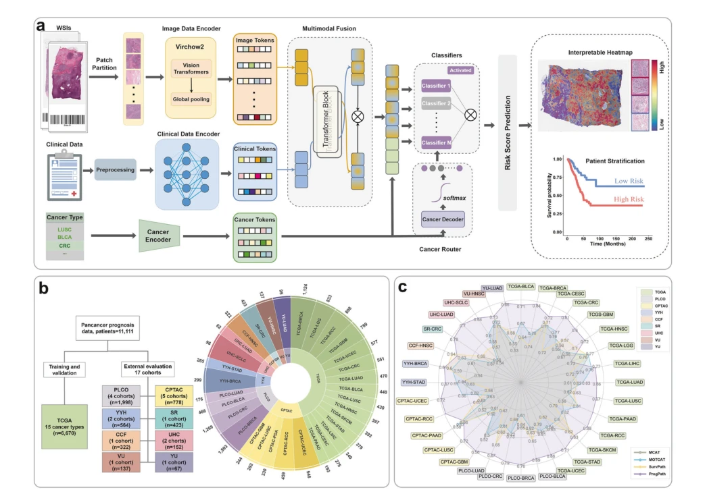

## Pancancer outcome prediction via a unified weakly supervised deep learning model

> data: 15 癌种 TCGA 训练数据，17 个独立外部队列
>
> Signal Transduction and Targeted Therapy 2025 · [论文](https://doi.org/10.1038/s41392-025-02374-w) · [作者代码](https://github.com/Valeyards/ProgPath)

#### 引言

将基础模型提取的病理特征与常规临床变量经注意力及交叉注意力融合，构建统一的泛癌预后预测框架，并开展外部队列验证。

#### 方法

（1）病理编码：用基础模型提取实例，经注意力 MIL 汇总。

（2）临床融合：以交叉注意力结合年龄、性别、分期等常规变量。

（3）路由预测：适配多癌种差异，形成统一的预后风险输出。

原文Fig. 1，PDF 第 3 页。

#### 实验

##### 实验设置

TCGA 按癌种分层五折、训练/验证 4:1；训练 20 epochs，评价 C-index、时间依赖 AUC、KM/log-rank。

##### 主要结果

TCGA 平均 C-index 为 0.731，病理单模态为 0.694、临床单模态为 0.683；相对提升与绝对差值需区分。

##### 消融与讨论

分别比较病理、临床和联合模型，外部数据仅用于独立验证，不能并入内部交叉验证样本。

#### 参考文献

> Pancancer outcome prediction via a unified weakly supervised deep learning model
>
> Signal Transduction and Targeted Therapy 2025 · [论文](https://doi.org/10.1038/s41392-025-02374-w) · [作者代码](https://github.com/Valeyards/ProgPath)
