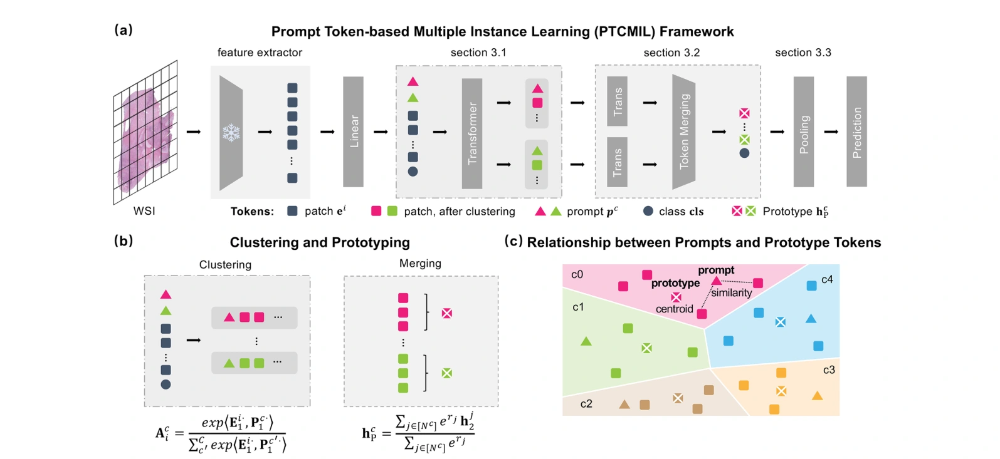
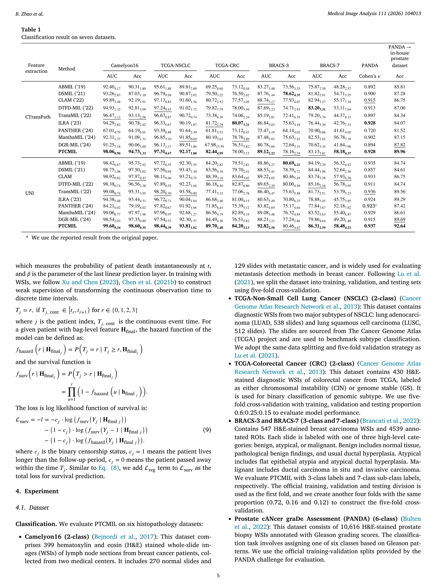
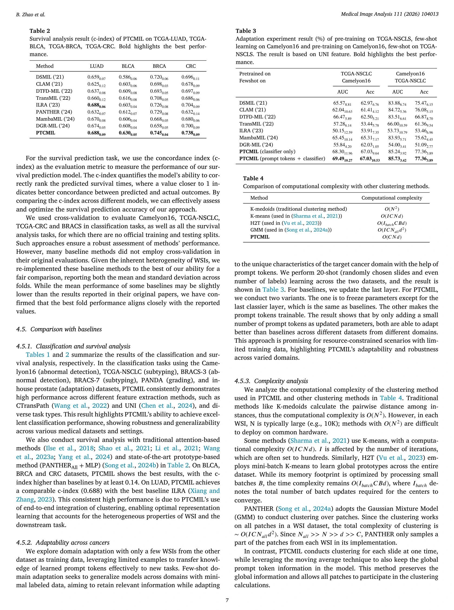
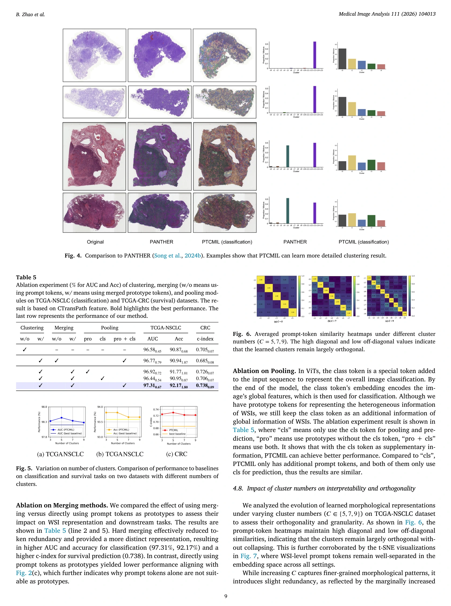
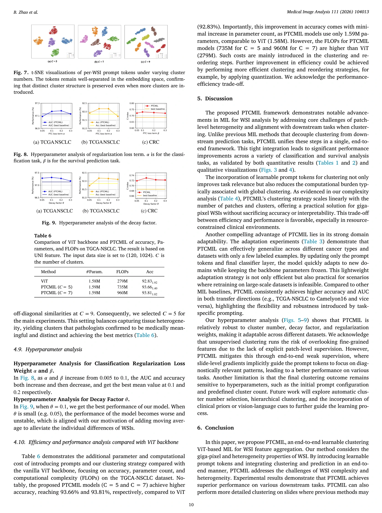

## PTCMIL: multiple instance learning via prompt token clustering for whole slide image analysis

> data: CAMELYON16、TCGA-NSCLC、TCGA-CRC、BRACS-3/7、PANDA、内部前列腺及生存队列
>
> Medical Image Analysis 2026 · [论文](https://doi.org/10.1016/j.media.2026.104013) · [作者代码](https://github.com/ubc-tea/PTCMIL)

#### 引言

在 ViT 中引入可学习提示 token，将切片特异聚类与预测端到端联合优化，再通过 token 合并和原型池化获得紧凑表示。

#### 方法

（1）提示聚类：把可学习 prompt token 插入 ViT，使聚类面向当前任务。

（2）Token 合并：把实例信息转为紧凑原型，降低交互开销。

（3）原型池化：联合聚类与预测目标，支持分类和生存分析。

<!-- wsi-complete-model -->
##### 模型结构图

**图 2 · 模型结构**（PDF 第 4 页）

> 原文图注：Fig. 2. The prompt token clustering-based multiple instance learning (PTCMIL) framework integrates efficient clustering with simple similarity matching into the MIL framework, which facilitate mutual promotion between the representation learning (via clustering) and the downstream task performance. (a) Overall framework of PTCMIL, with patch feature tokens, prompt tokens and class token as input, and the objective prediction goal as output; (b) Interpretation of clustering and prototyping based on the clusters; (c) Interpretation of the relationship between prototypes and prompt tokens.

[查看原尺寸](assest/PTCMIL/figure-2-complete.webp)

<!-- /wsi-complete-model -->

#### 实验

##### 实验设置

比较 CTransPath 与 UNI 特征，20×、256×256 patch；期刊版扩展到 11 个基准。

##### 主要结果

主表在不同编码器下检验提示聚类聚合，不能把编码器预训练中见过的数据直接当作下游全部测试队列。

<!-- wsi-complete-results -->
##### 完整实验指标与对照

下列实验原页保留表头、全部行列、子图、误差说明和脚注，点击可查看原尺寸。比较时请对应相同的数据集、特征编码器和训练设置；`±`、置信区间、百分比和小数均保留原文的单位与统计口径。

| 原表/图中指标 | 读取方式 |
| --- | --- |
| ROC-AUC / AUROC | 越高越好；若原表明确为 PR-AUC，则按 PR 曲线面积读取 |
| ACC / Accuracy | 越高越好；平衡准确率、平均准确率以原表标注为准 |
| C-index | 越高越好；用于生存预测，需保留终点及删失设置 |
| 时间 / FLOPs / 参数量 | 结合硬件、包长度和计时范围比较；小模型不一定推理更快 |

| 原文页 | 阅读内容 | 图表及正文引用 |
| --- | --- | --- |
| PDF 第 5 页 | 实验结果 | Table 1 |
| PDF 第 7 页 | 实验结果 | Table 2、Table 3、Table 4 |
| PDF 第 9 页 | 实验结果 | Table 5、Figure 5 |
| PDF 第 10 页 | 实验结果 | Figure 8、Table 6 |

**实验原页 · PDF 第 5 页**（图表及正文引用：Table 1）

[查看原尺寸](assest/PTCMIL/experiment-page-05.webp)

**实验原页 · PDF 第 7 页**（图表及正文引用：Table 2、Table 3、Table 4）

[查看原尺寸](assest/PTCMIL/experiment-page-07.webp)

**实验原页 · PDF 第 9 页**（图表及正文引用：Table 5、Figure 5）

[查看原尺寸](assest/PTCMIL/experiment-page-09.webp)

**实验原页 · PDF 第 10 页**（图表及正文引用：Figure 8、Table 6）

[查看原尺寸](assest/PTCMIL/experiment-page-10.webp)

<!-- /wsi-complete-results -->

##### 消融与讨论

消融提示 token、投影聚类、token 合并和原型池化；早期版本的实验规模与期刊版不同。

#### 参考文献

> PTCMIL: multiple instance learning via prompt token clustering for whole slide image analysis
>
> Medical Image Analysis 2026 · [论文](https://doi.org/10.1016/j.media.2026.104013) · [作者代码](https://github.com/ubc-tea/PTCMIL)
