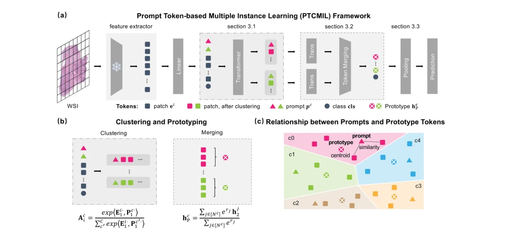

## PTCMIL: multiple instance learning via prompt token clustering for whole slide image analysis

> data: CAMELYON16、TCGA-NSCLC、TCGA-CRC、BRACS-3/7、PANDA、内部前列腺及生存队列
>
> Medical Image Analysis 2026 · [论文](https://doi.org/10.1016/j.media.2026.104013) · [作者代码](https://github.com/ubc-tea/PTCMIL)

#### 引言

在 ViT 中引入可学习提示 token，将切片特异聚类与预测端到端联合优化，再通过 token 合并和原型池化获得紧凑表示。

#### 方法

（1）提示聚类：把可学习 prompt token 插入 ViT，使聚类面向当前任务。

（2）Token 合并：把实例信息转为紧凑原型，降低交互开销。

（3）原型池化：联合聚类与预测目标，支持分类和生存分析。

原文Fig. 2，PDF 第 4 页。

#### 实验

##### 实验设置

比较 CTransPath 与 UNI 特征，20×、256×256 patch；期刊版扩展到 11 个基准。

##### 主要结果

主表在不同编码器下检验提示聚类聚合，不能把编码器预训练中见过的数据直接当作下游全部测试队列。

##### 消融与讨论

消融提示 token、投影聚类、token 合并和原型池化；早期版本的实验规模与期刊版不同。

#### 参考文献

> PTCMIL: multiple instance learning via prompt token clustering for whole slide image analysis
>
> Medical Image Analysis 2026 · [论文](https://doi.org/10.1016/j.media.2026.104013) · [作者代码](https://github.com/ubc-tea/PTCMIL)
