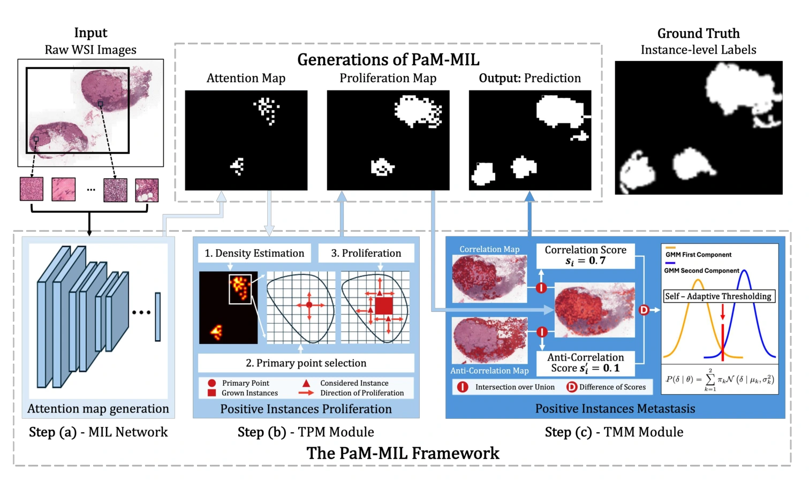
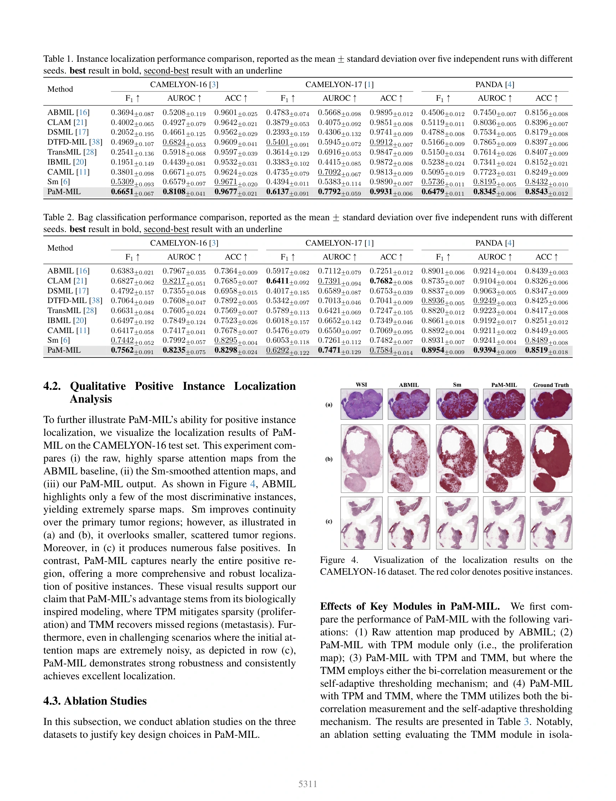
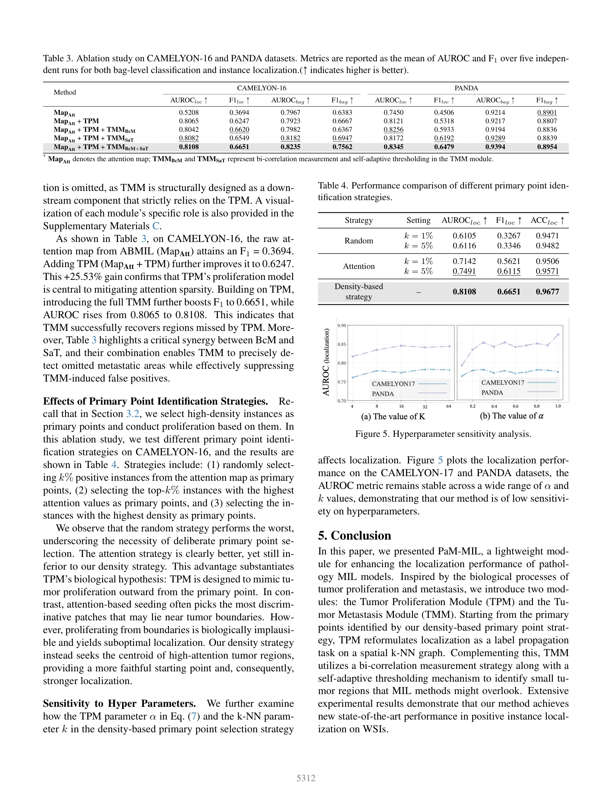

## PaM-MIL: Proliferation and Metastasis Enhanced Localization for Multiple Instance Learning on Pathology Images

> data: CAMELYON16、CAMELYON17、PANDA
>
> 收藏标记 CVPR 2026；本次核对 PDF，会议归属待核实 · [作者代码](https://github.com/hkustgary/PaM-MIL)

#### 引言

借鉴肿瘤增殖与转移过程，分别扩大局部阳性覆盖和恢复分散小病灶，显式优化 MIL 的实例定位完整性。

#### 方法

（1）TPM：从高置信病灶向邻近组织扩展阳性覆盖。

（2）TMM：恢复空间分散、被忽略的小病灶。

（3）传播整合：利用图关系更新实例定位，同时保留切片分类任务。

<!-- wsi-complete-model -->
##### 模型结构图

**图 2 · 模型结构**（PDF 第 4 页）

> 原文图注：Figure 2. Illustration of our PaM-MIL framework for the positive instance localization. In step (a), a MIL model is used to generate attention maps for WSIs. Then, in step (b), TPM module is used to identify primary points and proliferate positive instances, resulting in a fine-grained positive instance localization map. Finally, in step (c), TMM module is employed to identify small and scattered tumor regions that may be overlooked during the proliferation process.

[查看原尺寸](assest/PaM-MIL/figure-2-complete.webp)

<!-- /wsi-complete-model -->

#### 实验

##### 实验设置

同时使用实例定位与包分类指标，五个随机种子；默认 ResNet50，k-NN 的 k=8，传播最多 20 次。

##### 主要结果

C16 定位 F1 从 ABMIL 的 0.3694、TransMIL 的 0.2541 到 0.6651；这是定位 F1，不是切片分类 F1。

<!-- wsi-complete-results -->
##### 完整实验指标与对照

下列实验原页保留表头、全部行列、子图、误差说明和脚注，点击可查看原尺寸。比较时请对应相同的数据集、特征编码器和训练设置；`±`、置信区间、百分比和小数均保留原文的单位与统计口径。

| 原表/图中指标 | 读取方式 |
| --- | --- |
| ROC-AUC / AUROC | 越高越好；若原表明确为 PR-AUC，则按 PR 曲线面积读取 |
| F1 | 越高越好；保留 macro / weighted / micro 等平均方式 |

| 原文页 | 阅读内容 | 图表及正文引用 |
| --- | --- | --- |
| PDF 第 7 页 | 实验结果 | Table 1、Table 2 |
| PDF 第 8 页 | 实验结果 | Table 3、Table 4 |

**实验原页 · PDF 第 7 页**（图表及正文引用：Table 1、Table 2）

[查看原尺寸](assest/PaM-MIL/experiment-page-07.webp)

**实验原页 · PDF 第 8 页**（图表及正文引用：Table 3、Table 4）

[查看原尺寸](assest/PaM-MIL/experiment-page-08.webp)

<!-- /wsi-complete-results -->

##### 消融与讨论

消融局部增殖与远程转移模块，检查稠密区域覆盖和分散小病灶恢复是否互补。

#### 参考文献

> PaM-MIL: Proliferation and Metastasis Enhanced Localization for Multiple Instance Learning on Pathology Images
>
> 收藏标记 CVPR 2026；本次核对 PDF，会议归属待核实 · [作者代码](https://github.com/hkustgary/PaM-MIL)
