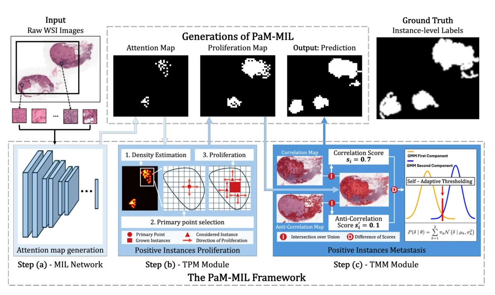
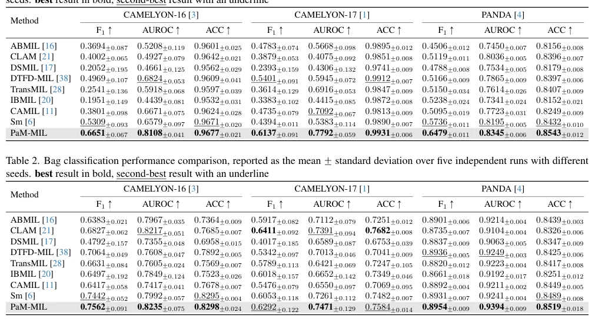

## PaM-MIL: Proliferation and Metastasis Enhanced Localization for Multiple Instance Learning on Pathology Images

> data: CAMELYON16、CAMELYON17、PANDA
>
> 收藏标记 CVPR 2026；本次核对 PDF，会议归属待核实 · [作者代码](https://github.com/hkustgary/PaM-MIL)

#### 引言

借鉴肿瘤增殖与转移过程，分别扩大局部阳性覆盖和恢复分散小病灶，显式优化 MIL 的实例定位完整性。

#### 方法

（1）TPM：从高置信病灶向邻近组织扩展阳性覆盖。

（2）TMM：恢复空间分散、被忽略的小病灶。

（3）传播整合：利用图关系更新实例定位，同时保留切片分类任务。

原文Figure 2，PDF 第 4 页。

#### 实验

##### 实验设置

同时使用实例定位与包分类指标，五个随机种子；默认 ResNet50，k-NN 的 k=8，传播最多 20 次。

##### 主要结果

C16 定位 F1 从 ABMIL 的 0.3694、TransMIL 的 0.2541 到 0.6651；这是定位 F1，不是切片分类 F1。

原文Table 1，PDF 第 7 页。

##### 消融与讨论

消融局部增殖与远程转移模块，检查稠密区域覆盖和分散小病灶恢复是否互补。

#### 参考文献

> PaM-MIL: Proliferation and Metastasis Enhanced Localization for Multiple Instance Learning on Pathology Images
>
> 收藏标记 CVPR 2026；本次核对 PDF，会议归属待核实 · [作者代码](https://github.com/hkustgary/PaM-MIL)
