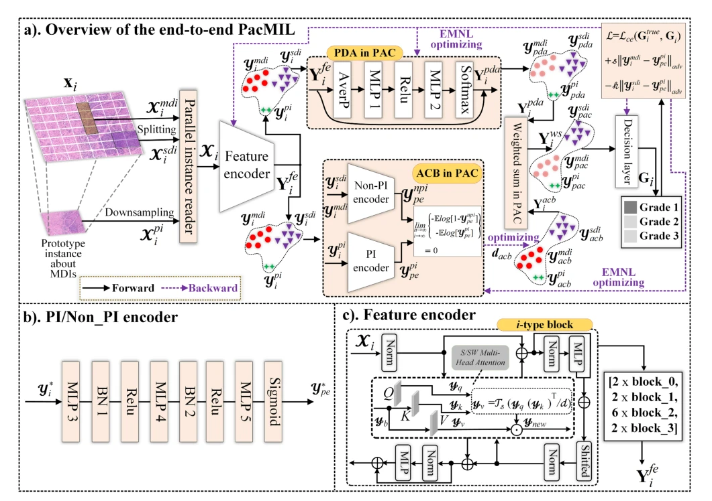
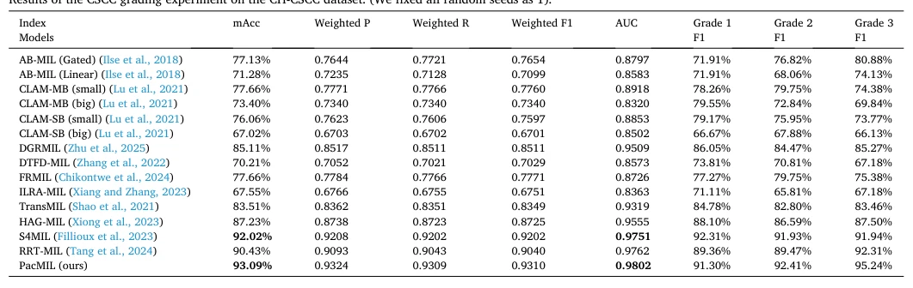

## A Multi-instance Learning Network with Prototype-instance Adversarial Contrastive for Cervix Pathology Grading

> data: CH-CSCC：941 张宫颈癌病理图和对应原型图像；另有公开/内部扩展数据
>
> Medical Image Analysis 2026 · [论文](https://doi.org/10.1016/j.media.2025.103880) · [作者代码](https://github.com/Baron-Huang/PacMIL)

#### 引言

通过原型实例、概率分布注意力和对抗对比学习，处理宫颈鳞癌中混合分化区域与单一分化区域的表征差异，用于病理分级。

#### 方法

（1）原型实例：用单一分化区域的病理先验引导学习。

（2）概率注意力：增强对混合分化实例的表征。

（3）对抗对比：学习可变的实例/原型度量，并对正确距离施加约束。

原文Fig. 2，PDF 第 4 页。

#### 实验

##### 实验设置

按 6:2:2 划分，分别含 564/189/188 个包，三个分化级别的样本数不均衡。

##### 主要结果

摘要 mAcc/AUC 为 93.09%/0.9802；原型图像及 PAC 模块各自贡献应看分解实验。

原文Table 2，PDF 第 9 页。

##### 消融与讨论

分别消融原型实例、概率注意力和对抗度量，注意原型标注是额外知识来源。

#### 参考文献

> A Multi-instance Learning Network with Prototype-instance Adversarial Contrastive for Cervix Pathology Grading
>
> Medical Image Analysis 2026 · [论文](https://doi.org/10.1016/j.media.2025.103880) · [作者代码](https://github.com/Baron-Huang/PacMIL)
