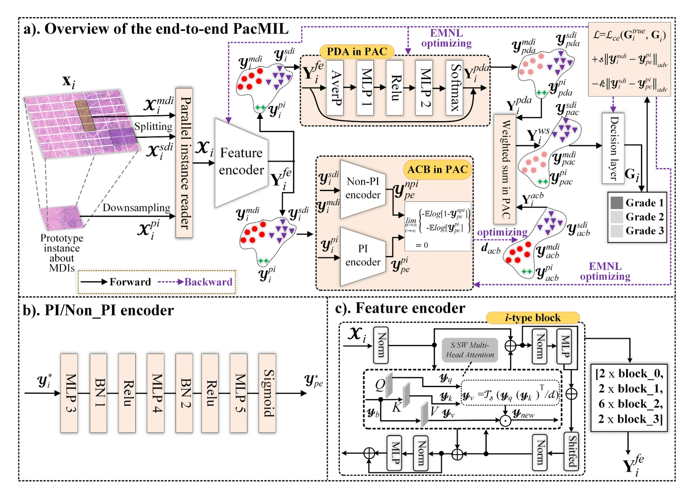
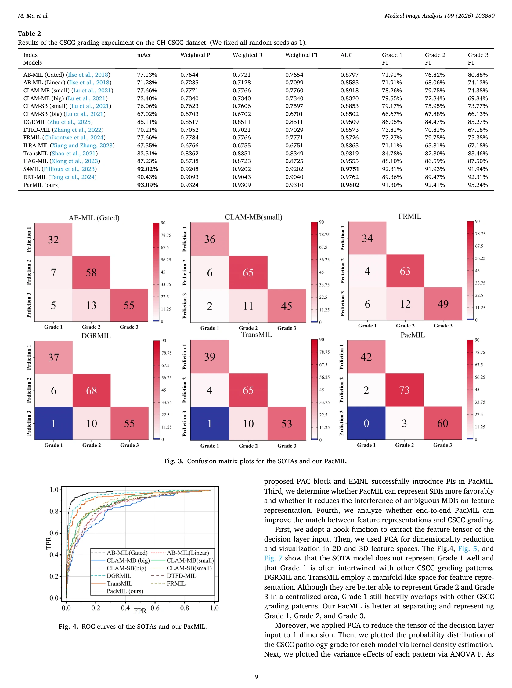
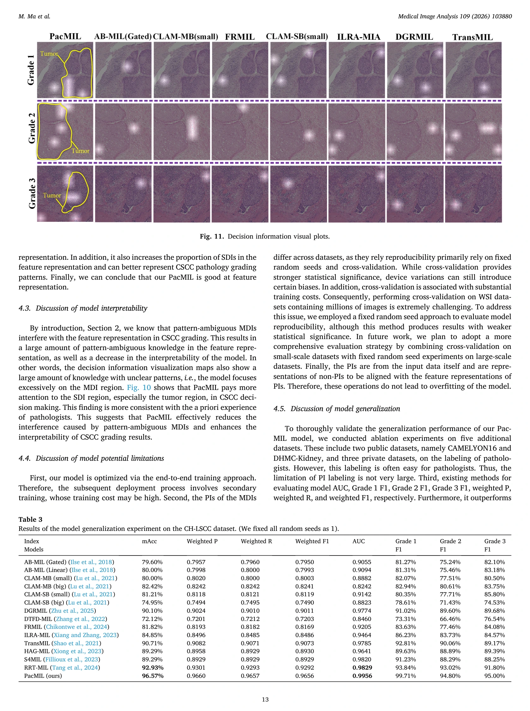
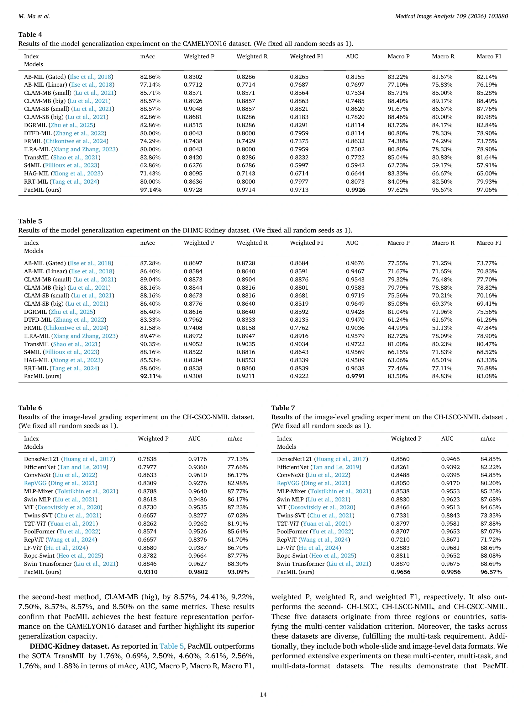
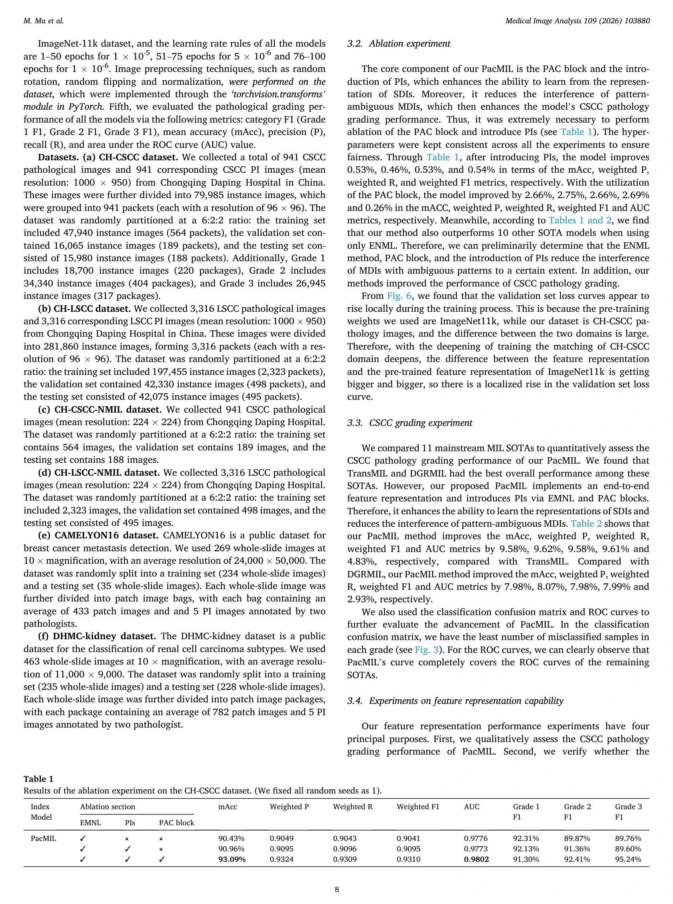

## A Multi-instance Learning Network with Prototype-instance Adversarial Contrastive for Cervix Pathology Grading

> data: CH-CSCC：941 张宫颈癌病理图和对应原型图像；另有公开/内部扩展数据
>
> Medical Image Analysis 2026 · [论文](https://doi.org/10.1016/j.media.2025.103880) · [作者代码](https://github.com/Baron-Huang/PacMIL)

#### 引言

通过原型实例、概率分布注意力和对抗对比学习，处理宫颈鳞癌中混合分化区域与单一分化区域的表征差异，用于病理分级。

#### 方法

（1）原型实例：用单一分化区域的病理先验引导学习。

（2）概率注意力：增强对混合分化实例的表征。

（3）对抗对比：学习可变的实例/原型度量，并对正确距离施加约束。

<!-- wsi-complete-model -->
##### 模型结构图

**图 2 · 模型结构**（PDF 第 4 页）

> 原文图注：Fig. 2. Overview of the end-to-end PacMIL. First, we divide the i-th batch CSCC image Xi into Nins (The values is 85 for CH-CSCC/LSCC) instance tensors, i.e.,

[查看原尺寸](assest/PacMIL/figure-2-complete.webp)

<!-- /wsi-complete-model -->

#### 实验

##### 实验设置

按 6:2:2 划分，分别含 564/189/188 个包，三个分化级别的样本数不均衡。

##### 主要结果

摘要 mAcc/AUC 为 93.09%/0.9802；原型图像及 PAC 模块各自贡献应看分解实验。

<!-- wsi-complete-results -->
##### 完整实验指标与对照

下列实验原页保留表头、全部行列、子图、误差说明和脚注，点击可查看原尺寸。比较时请对应相同的数据集、特征编码器和训练设置；`±`、置信区间、百分比和小数均保留原文的单位与统计口径。

| 原表/图中指标 | 读取方式 |
| --- | --- |
| ROC-AUC / AUROC | 越高越好；若原表明确为 PR-AUC，则按 PR 曲线面积读取 |

| 原文页 | 阅读内容 | 图表及正文引用 |
| --- | --- | --- |
| PDF 第 8 页 | 消融与参数分析 | Table 1 |
| PDF 第 9 页 | 实验结果 | Table 2、Figure 4 |
| PDF 第 13 页 | 实验结果 | Table 3 |
| PDF 第 14 页 | 实验结果 | Table 4、Table 5、Table 6、Table 7 |

**实验原页 · PDF 第 9 页**（图表及正文引用：Table 2、Figure 4）

[查看原尺寸](assest/PacMIL/experiment-page-09.webp)

**实验原页 · PDF 第 13 页**（图表及正文引用：Table 3）

[查看原尺寸](assest/PacMIL/experiment-page-13.webp)

**实验原页 · PDF 第 14 页**（图表及正文引用：Table 4、Table 5、Table 6、Table 7）

[查看原尺寸](assest/PacMIL/experiment-page-14.webp)

展开消融、参数、数据设置及效率原页

**实验原页 · PDF 第 8 页**（图表及正文引用：Table 1）

[查看原尺寸](assest/PacMIL/experiment-page-08.webp)

<!-- /wsi-complete-results -->

##### 消融与讨论

分别消融原型实例、概率注意力和对抗度量，注意原型标注是额外知识来源。

#### 参考文献

> A Multi-instance Learning Network with Prototype-instance Adversarial Contrastive for Cervix Pathology Grading
>
> Medical Image Analysis 2026 · [论文](https://doi.org/10.1016/j.media.2025.103880) · [作者代码](https://github.com/Baron-Huang/PacMIL)
