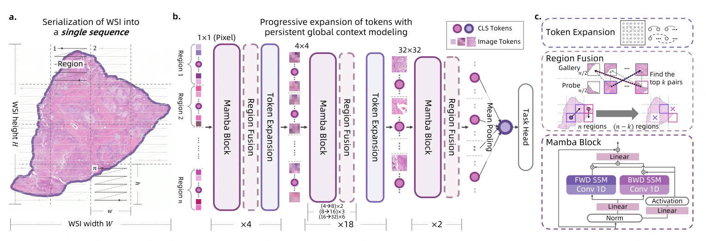

## Bridging Local Inductive Bias and Long-Range Dependencies with Pixel-Mamba for End-to-end Whole Slide Image Analysis

> data: ImageNet-1K；TCGA-BLCA、TCGA-BRCA、TCGA-LUAD
>
> ICCV 2025 · [论文](https://openaccess.thecvf.com/content/ICCV2025/html/Qiu_Bridging_Local_Inductive_Bias_and_Long-Range_Dependencies_with_Pixel-Mamba_for_ICCV_2025_paper.html)

#### 引言

以线性内存复杂度的 Mamba 和逐步扩展 token 的局部归纳偏置，分层融合局部与全局信息，开展端到端分期和生存分析。

#### 方法

（1）局部扩展：逐步扩大 token 的感受范围，保留类似卷积的局部偏置。

（2）状态空间：以 Mamba 学习长程信息，控制显存增长。

（3）层级分析：从像素/局部表示到切片任务端到端训练。

##### 模型结构图

图 2（PDF 第 4 页）

#### 实验

##### 实验设置

所有 WSI 实验从 ImageNet 预训练初始化，未进行病理专门预训练；分期用宏 F1、生存用 C-index，均五折。

##### 关键指标 { #key-results }

| 队列 | 分期宏 F1 | 生存 C-index |
| --- | --- | --- |
| TCGA-BLCA | 0.5334 ± 0.0608 | 0.6507 ± 0.0485 |
| TCGA-BRCA | 0.3744 ± 0.0163 | 0.6707 ± 0.0728 |
| TCGA-LUAD | 0.3917 ± 0.0125 | 0.6468 ± 0.0331 |

数据来源为原文表 2，PDF 第 6 页，2.5× 输入。

##### 结果解读

三个病理队列的生存 C-index 为 0.6507、0.6707、0.6468；分期宏 F1 为 0.5334、0.3744、0.3917，顺序均为 BLCA/BRCA/LUAD。

##### 消融与讨论

比较局部 token 扩展与 Mamba 长程建模，关注端到端整体开销及病理预训练是否相同。

#### 参考文献

> Bridging Local Inductive Bias and Long-Range Dependencies with Pixel-Mamba for End-to-end Whole Slide Image Analysis
>
> ICCV 2025 · [论文](https://openaccess.thecvf.com/content/ICCV2025/html/Qiu_Bridging_Local_Inductive_Bias_and_Long-Range_Dependencies_with_Pixel-Mamba_for_ICCV_2025_paper.html)
