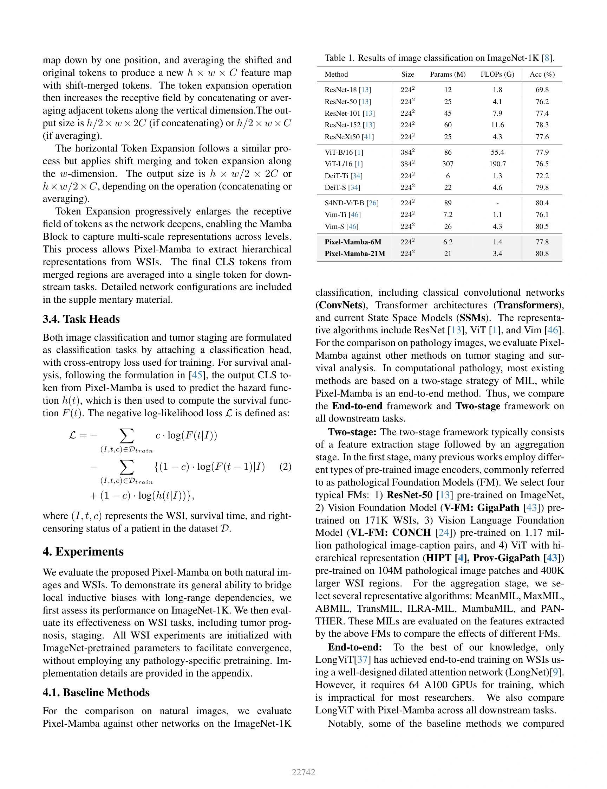
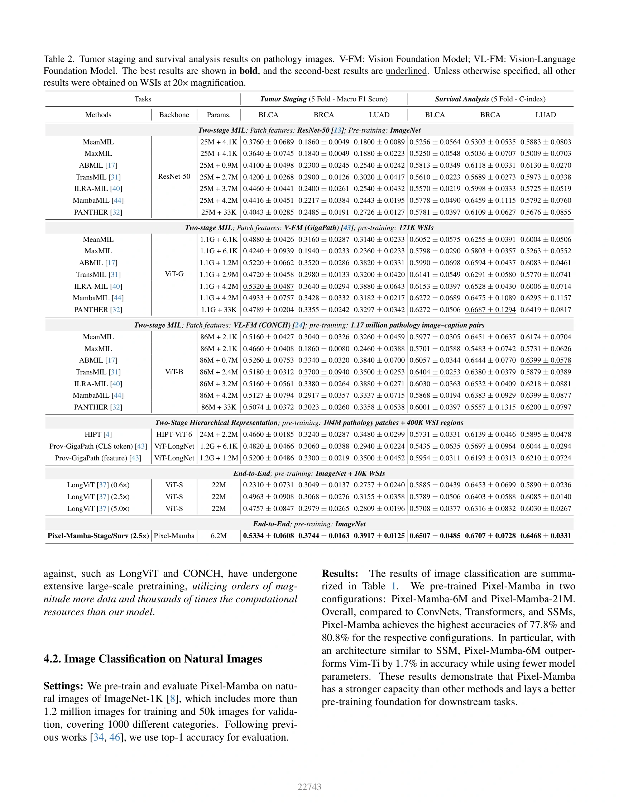
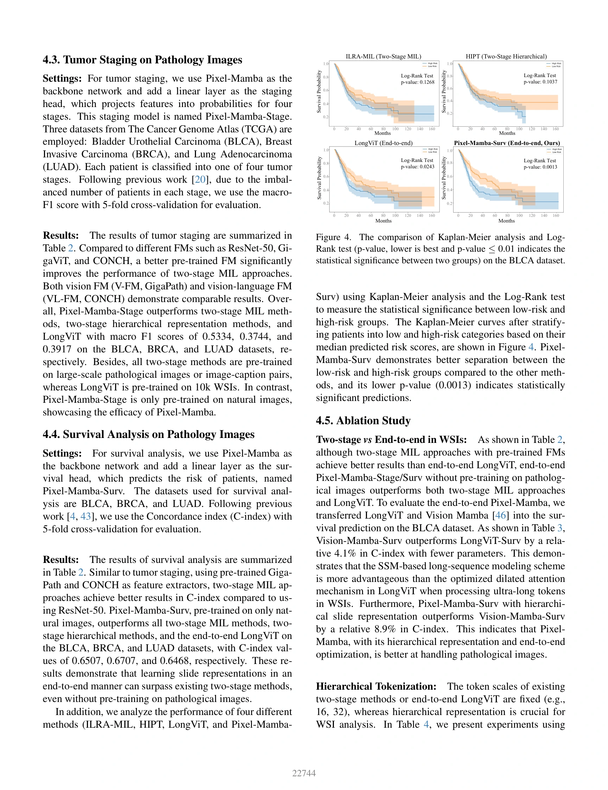
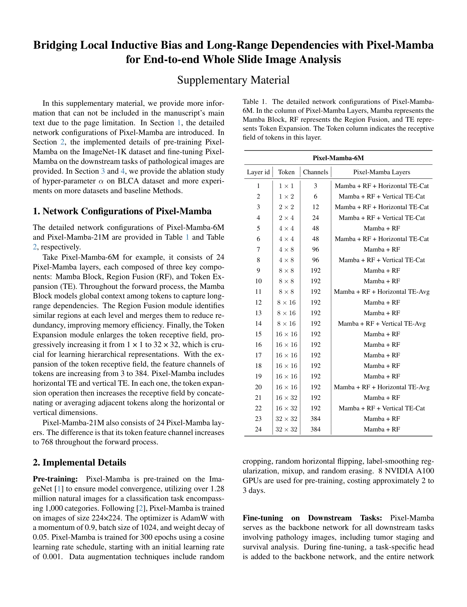
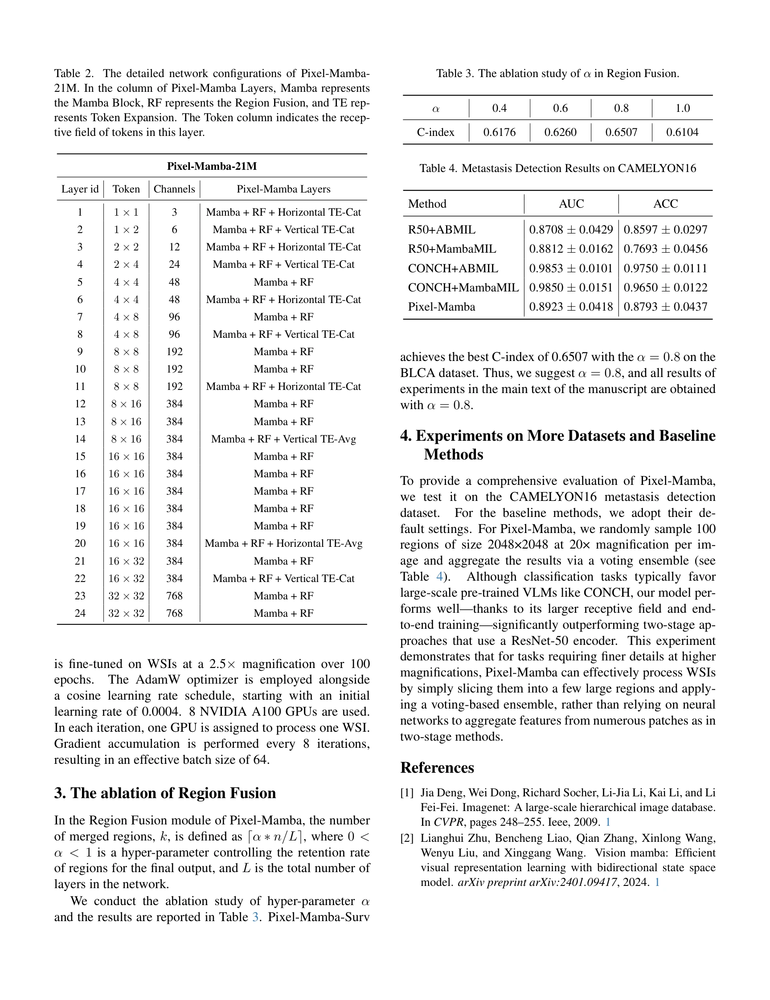
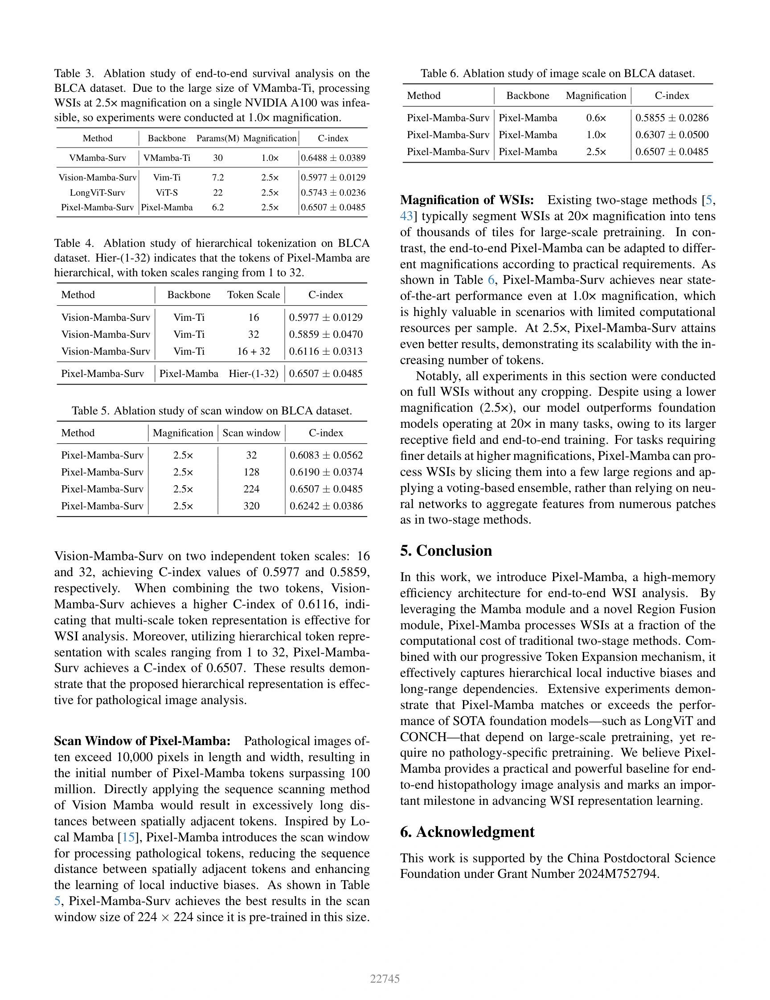

## Bridging Local Inductive Bias and Long-Range Dependencies with Pixel-Mamba for End-to-end Whole Slide Image Analysis

> data: ImageNet-1K；TCGA-BLCA、TCGA-BRCA、TCGA-LUAD
>
> ICCV 2025 · [论文](https://openaccess.thecvf.com/content/ICCV2025/html/Qiu_Bridging_Local_Inductive_Bias_and_Long-Range_Dependencies_with_Pixel-Mamba_for_ICCV_2025_paper.html)

#### 引言

以线性内存复杂度的 Mamba 和逐步扩展 token 的局部归纳偏置，分层融合局部与全局信息，开展端到端分期和生存分析。

#### 方法

（1）局部扩展：逐步扩大 token 的感受范围，保留类似卷积的局部偏置。

（2）状态空间：以 Mamba 学习长程信息，控制显存增长。

（3）层级分析：从像素/局部表示到切片任务端到端训练。

<!-- wsi-complete-model -->
##### 模型结构图

**图 2 · 模型结构**（PDF 第 4 页）

> 原文图注：Figure 2. The Pixel-Mamba Framework. (a) The WSI is serialized, with CLS tokens added to create the token series T. (b) Pixel-Mamba progressively expands the receptive field of tokens while maintaining global context modeling. (c) Detailed illustrations of the Mamba Block, Region Fusion, and Token Expansion modules.

[查看原尺寸](assest/Pixel-Mamba/figure-2-complete.webp)

<!-- /wsi-complete-model -->

#### 实验

##### 实验设置

所有 WSI 实验从 ImageNet 预训练初始化，未进行病理专门预训练；分期用宏 F1、生存用 C-index，均五折。

##### 主要结果

三个病理队列的生存 C-index 为 0.6507、0.6707、0.6468；分期宏 F1 为 0.5334、0.3744、0.3917，顺序均为 BLCA/BRCA/LUAD。

<!-- wsi-complete-results -->
##### 完整实验指标与对照

下列实验原页保留表头、全部行列、子图、误差说明和脚注，点击可查看原尺寸。比较时请对应相同的数据集、特征编码器和训练设置；`±`、置信区间、百分比和小数均保留原文的单位与统计口径。

| 原表/图中指标 | 读取方式 |
| --- | --- |
| F1 | 越高越好；保留 macro / weighted / micro 等平均方式 |
| C-index | 越高越好；用于生存预测，需保留终点及删失设置 |

| 原文页 | 阅读内容 | 图表及正文引用 |
| --- | --- | --- |
| PDF 第 5 页 | 实验结果 | Table 1 |
| PDF 第 6 页 | 实验结果 | Table 2 |
| PDF 第 7 页 | 实验结果 | Table 2 |
| PDF 第 8 页 | 消融与参数分析 | Table 3、Table 4、Table 5、Table 6 |
| PDF 第 11 页 | 实验结果 | Table 1 |
| PDF 第 12 页 | 实验结果 | Table 2、Table 3、Table 4 |

**实验原页 · PDF 第 5 页**（图表及正文引用：Table 1）

[查看原尺寸](assest/Pixel-Mamba/experiment-page-05.webp)

**实验原页 · PDF 第 6 页**（图表及正文引用：Table 2）

[查看原尺寸](assest/Pixel-Mamba/experiment-page-06.webp)

**实验原页 · PDF 第 7 页**（图表及正文引用：Table 2）

[查看原尺寸](assest/Pixel-Mamba/experiment-page-07.webp)

**实验原页 · PDF 第 11 页**（图表及正文引用：Table 1）

[查看原尺寸](assest/Pixel-Mamba/experiment-page-11.webp)

**实验原页 · PDF 第 12 页**（图表及正文引用：Table 2、Table 3、Table 4）

[查看原尺寸](assest/Pixel-Mamba/experiment-page-12.webp)

展开消融、参数、数据设置及效率原页

**实验原页 · PDF 第 8 页**（图表及正文引用：Table 3、Table 4、Table 5、Table 6）

[查看原尺寸](assest/Pixel-Mamba/experiment-page-08.webp)

<!-- /wsi-complete-results -->

##### 消融与讨论

比较局部 token 扩展与 Mamba 长程建模，关注端到端整体开销及病理预训练是否相同。

#### 参考文献

> Bridging Local Inductive Bias and Long-Range Dependencies with Pixel-Mamba for End-to-end Whole Slide Image Analysis
>
> ICCV 2025 · [论文](https://openaccess.thecvf.com/content/ICCV2025/html/Qiu_Bridging_Local_Inductive_Bias_and_Long-Range_Dependencies_with_Pixel-Mamba_for_ICCV_2025_paper.html)
