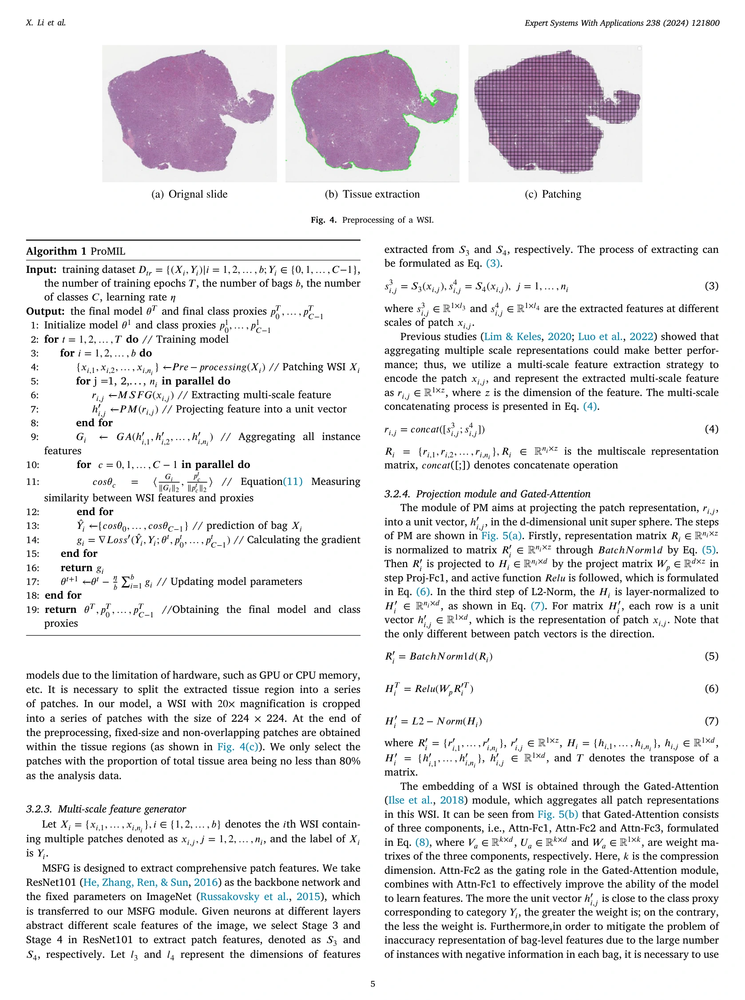
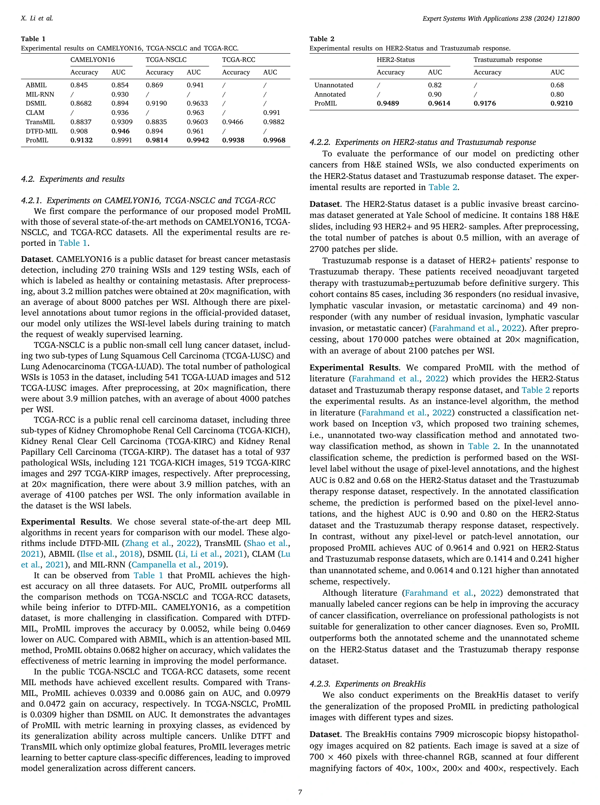
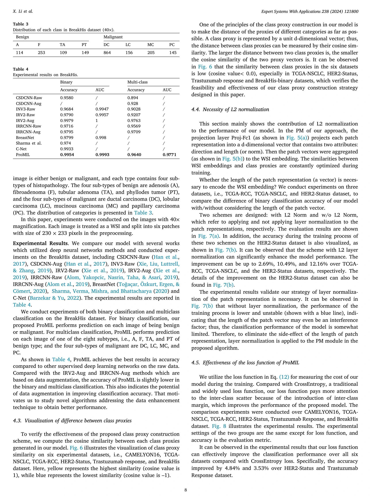
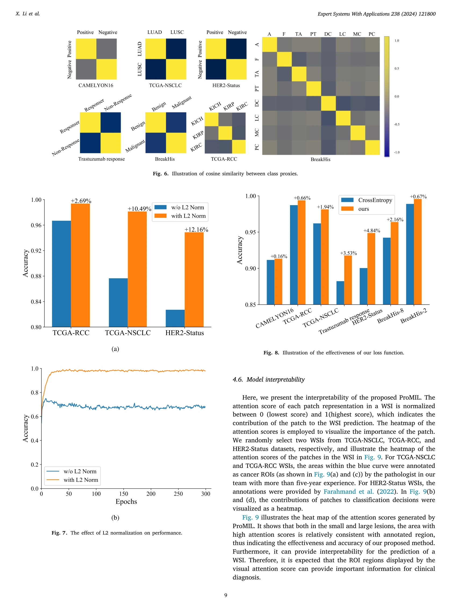

## ProMIL: A weakly supervised multiple instance learning for whole slide image classification based on class proxy

> data: CAMELYON16、TCGA-NSCLC、TCGA-RCC、HER2-Status、Trastuzumab response、BreakHis
>
> Expert Systems with Applications 2024（PDF 出版信息；2023 年在线发表） · [论文](https://doi.org/10.1016/j.eswa.2023.121800)

#### 引言

引入类别代理作为可学习的类别表征，将多尺度特征聚合与度量学习结合，按切片嵌入和类别代理的相似度分类，缓解弱监督下的特征混淆。

#### 方法

（1）多尺度表示：融合不同层级 patch 特征，再用门控注意力形成 WSI 嵌入。

（2）类别代理：为每个类别学习代表性向量，作为特征空间中的类别参照。

（3）度量分类：根据切片与代理的相似度训练分类器，使类别监督参与表征几何结构。

<!-- wsi-complete-model -->
##### 模型结构图

**图 2 · 模型结构**（PDF 第 4 页）

> 原文图注：Fig. 2. Illustration of ProMIL workflow.

[查看原尺寸](assest/ProMIL/figure-2-complete.webp)

<!-- /wsi-complete-model -->

#### 实验

##### 实验设置

CAMELYON16 使用挑战赛划分；其余数据按 4:1 划分并做五折交叉验证，重复五个随机种子。报告 ACC、AUC。

##### 主要结果

三个主要分类数据集上取得最高 ACC；CAMELYON16 的 AUC 低于 DTFD-MIL，不能概括成所有指标均最优。

<!-- wsi-complete-results -->
##### 完整实验指标与对照

下列实验原页保留表头、全部行列、子图、误差说明和脚注，点击可查看原尺寸。比较时请对应相同的数据集、特征编码器和训练设置；`±`、置信区间、百分比和小数均保留原文的单位与统计口径。

| 原表/图中指标 | 读取方式 |
| --- | --- |
| ROC-AUC / AUROC | 越高越好；若原表明确为 PR-AUC，则按 PR 曲线面积读取 |
| ACC / Accuracy | 越高越好；平衡准确率、平均准确率以原表标注为准 |

| 原文页 | 阅读内容 | 图表及正文引用 |
| --- | --- | --- |
| PDF 第 5 页 | 实验结果 | Figure 4 |
| PDF 第 7 页 | 实验结果 | Table 1、Table 2 |
| PDF 第 8 页 | 实验结果 | Table 3、Table 4 |
| PDF 第 9 页 | 消融与参数分析 | Figure 7 |

**实验原页 · PDF 第 5 页**（图表及正文引用：Figure 4）

[查看原尺寸](assest/ProMIL/experiment-page-05.webp)

**实验原页 · PDF 第 7 页**（图表及正文引用：Table 1、Table 2）

[查看原尺寸](assest/ProMIL/experiment-page-07.webp)

**实验原页 · PDF 第 8 页**（图表及正文引用：Table 3、Table 4）

[查看原尺寸](assest/ProMIL/experiment-page-08.webp)

展开消融、参数、数据设置及效率原页

**实验原页 · PDF 第 9 页**（图表及正文引用：Figure 7）

[查看原尺寸](assest/ProMIL/experiment-page-09.webp)

<!-- /wsi-complete-results -->

##### 消融与讨论

比较类别代理、度量学习与多尺度表示；注意不同任务的类别数和不平衡程度。

#### 参考文献

> ProMIL: A weakly supervised multiple instance learning for whole slide image classification based on class proxy
>
> Expert Systems with Applications 2024（PDF 出版信息；2023 年在线发表） · [论文](https://doi.org/10.1016/j.eswa.2023.121800)
