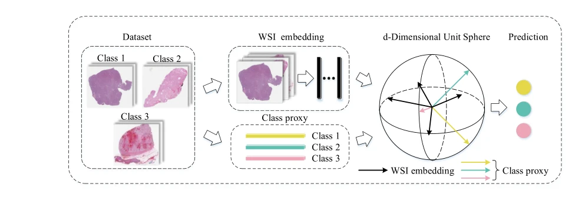
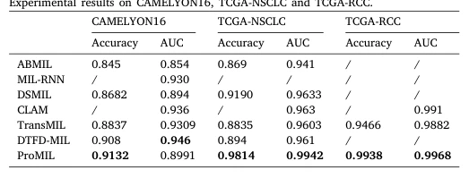

## ProMIL: A weakly supervised multiple instance learning for whole slide image classification based on class proxy

> data: CAMELYON16、TCGA-NSCLC、TCGA-RCC、HER2-Status、Trastuzumab response、BreakHis
>
> Expert Systems with Applications 2024（PDF 出版信息；2023 年在线发表） · [论文](https://doi.org/10.1016/j.eswa.2023.121800)

#### 引言

引入类别代理作为可学习的类别表征，将多尺度特征聚合与度量学习结合，按切片嵌入和类别代理的相似度分类，缓解弱监督下的特征混淆。

#### 方法

（1）多尺度表示：融合不同层级 patch 特征，再用门控注意力形成 WSI 嵌入。

（2）类别代理：为每个类别学习代表性向量，作为特征空间中的类别参照。

（3）度量分类：根据切片与代理的相似度训练分类器，使类别监督参与表征几何结构。

原文Fig. 2，PDF 第 4 页。

#### 实验

##### 实验设置

CAMELYON16 使用挑战赛划分；其余数据按 4:1 划分并做五折交叉验证，重复五个随机种子。报告 ACC、AUC。

##### 主要结果

三个主要分类数据集上取得最高 ACC；CAMELYON16 的 AUC 低于 DTFD-MIL，不能概括成所有指标均最优。

原文Table 1，PDF 第 7 页。

##### 消融与讨论

比较类别代理、度量学习与多尺度表示；注意不同任务的类别数和不平衡程度。

#### 参考文献

> ProMIL: A weakly supervised multiple instance learning for whole slide image classification based on class proxy
>
> Expert Systems with Applications 2024（PDF 出版信息；2023 年在线发表） · [论文](https://doi.org/10.1016/j.eswa.2023.121800)
