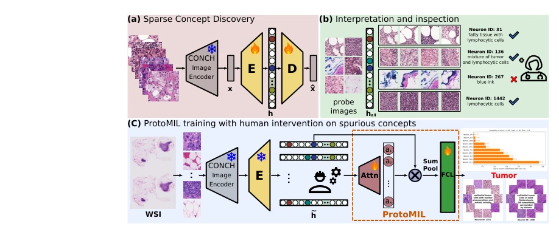
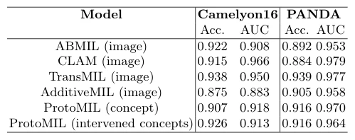

## Prototype-Based Multiple Instance Learning for Gigapixel Whole Slide Image Classification

> data: CAMELYON16、PANDA
>
> MICCAI 2025（PDF 与作者代码） · [论文](https://papers.miccai.org/miccai-2025/paper/0542_paper.pdf) · [作者代码](https://github.com/ss-sun/ProtoMIL)

#### 引言

用稀疏自编码器发现可解释概念，再将切片预测表示为概念的线性组合，支持人为修改概念以检查和干预模型决策。

#### 方法

（1）概念发现：以稀疏自编码器学习可解释的病理特征。

（2）概念预测：把切片决策写成概念的线性组合。

（3）人为干预：删除或修改输入概念，检查是否依赖无关信息。

原文Fig. 1，PDF 第 2 页。

#### 实验

##### 实验设置

C16 保留官方测试集，训练/验证为 80/20；PANDA 公开训练部分按 80/10/10 划分。

##### 主要结果

概念输入下分类表现与传统图像特征 MIL 相近，同时允许人工删除不相关概念；核心不是单纯追求最高 AUC。

原文Table 1，PDF 第 8 页。

##### 消融与讨论

比较干预前后性能及概念原型，检查预测是否依赖与诊断无关的概念。

#### 参考文献

> Prototype-Based Multiple Instance Learning for Gigapixel Whole Slide Image Classification
>
> MICCAI 2025（PDF 与作者代码） · [论文](https://papers.miccai.org/miccai-2025/paper/0542_paper.pdf) · [作者代码](https://github.com/ss-sun/ProtoMIL)
